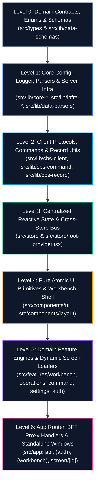

# 🏛️ Architecture Harmonization & Implementation Master Plan (v2.0)

> **Janata CBS Core Banking Workbench**  
> **Status:** Rigid Engineering Blueprint & Execution Guide  
> **Goal:** Zero circular dependencies, zero scattered magic constants, strict server/client boundary enforcement, bulletproof multi-window/multi-tab sync, and lag-free dynamic form state.

---

## 🎯 Uncompromising Engineering Principles (The 7 Pillars)

To guarantee that no architectural decisions need to be backtracked during the lifecycle of this application, all implementations must conform strictly to these 7 pillars:

### 1. Unidirectional Dependency Rule (No Layer Inversion)
$$\text{Level 6 (App)} \longrightarrow \text{Level 5 (Features)} \longrightarrow \text{Level 4 (Components)} \longrightarrow \text{Level 3 (Store)} \longrightarrow \text{Level 2 (Client Lib)} \longrightarrow \text{Level 1 (Core/Infra)} \longrightarrow \text{Level 0 (Contracts)}$$
* **Strict Constraint**: A lower level must **NEVER** import from a higher level.
* **Specifically**: `src/lib` must **NEVER** import from `@/store`, `@/components`, `@/features`, or `@/app`. All communications from `src/lib` upward must use the **Adapter Bus Pattern** (`registerCommandAdapter`).

### 2. Zero Magic Strings & Centralized Registry
* **Zero Inline Paths**: No component or service may write string URLs like `"/api/login"`, `"/dashboard"`, or `"/screen"`. All routes must come strictly from `clientConfig.routes`.
* **Zero Raw Action Codes**: Never compare against string literals like `"S"`, `"I"`, `"AU"`, or `"NEW"`. Always use canonical enums from `@/types/cbs.ts` (`CBS_FUNCTION_CODES`, `CbsRecordFunction`, `CbsRecordLifecycleStatus`).
* **Zero Hardcoded Context**: Active branch codes, user credentials, and session tokens must resolve dynamically from `useSessionStore` (or `clientConfig.centralBranch` via `.env`), never as hardcoded literals in UI components.
* **Storage Invariants**: All keys for `localStorage`, `sessionStorage`, or cookies must be declared in `clientConfig.storageKeys`.

### 3. Server/Client Isolation Boundary
* Infrastructure drivers (`@grpc/grpc-js`, `ioredis`, backend services) must remain sealed behind `import "server-only"`.
* The browser client **NEVER** speaks gRPC. It communicates exclusively via Next.js Route Handlers (`/api/...`) or Server Actions with strict Zod validation at the boundary.

### 4. Dual Workspace Contract (Internal Tabs vs. Detached Popups)
* **Internal Tabs (`panel` mode)**: Managed by `WorkbenchStore` in-memory. Switching tabs is instantaneous and maintains dirty form draft state.
* **Detached Windows (`window` mode)**: When popped out via `window.open()`, the popup runs as an autonomous Next.js screen instance under `src/app/(workbench)/screen/[id]/page.tsx`.
* **Cross-Window Synchronization**: If an action in a popup (e.g. Authorize or Delete) alters a record, cross-window notification is broadcasted via the standard `BroadcastChannel("cbs_workbench_bus")` to automatically refresh open parent tabs without stale data conflicts.

### 5. High-Performance Form State (No Keystroke Thrashing)
* Banking screens can contain 60+ dynamic fields. Keystrokes must **never** trigger global Zustand re-renders on every character.
* **Two-Tier Form State**:
  1. **Tier 1 (Local Component State)**: Fast, local uninhibited field editing via `react-hook-form` / local refs.
  2. **Tier 2 (Global Tab Store Sync)**: The tab store only receives **debounced snapshots (400ms)** or **blur events**, plus a lightweight boolean `isDirty: true`.

### 6. Zero Dead Code, Zero Legacy Shims & Rigid Naming Standards
* **No Backward Compatibility Burden**: The app is not in production. Do **NOT** keep deprecated shims, legacy aliasing, fallback adapter wrappers, or obsolete types. If a contract changes, update all call sites cleanly across the codebase.
* **Zero Dead Code**: Delete unused imports, orphaned types, unreachable branches, and abandoned utility files immediately.
* **Strict Naming Conventions**:
  * **Files & Folders**: Strictly `kebab-case` (e.g. `cbs-screen-mode.ts`, `workbench-shell.tsx`).
    *(Preserve Next.js special files: `page.tsx`, `layout.tsx`, `route.ts`, and route groups `(auth)`, `[id]`)*.
  * **React Components**: Strictly `PascalCase` for component declarations inside files (e.g. `export function WorkbenchShell()`).
  * **Types & Interfaces**: Strictly `PascalCase` with self-documenting semantic names (e.g. `WorkspaceDisplayMode`, `CbsRecordStatusDefinition`). Sealed with `readonly`.
  * **Constants & Enums**: Strictly `UPPER_SNAKE_CASE` for primitives and tuples (e.g. `CBS_FUNCTION_CODES`, `STORAGE_KEYS`). Structured config singletons use `camelCase` (e.g. `clientConfig`).
  * **Functions & Hooks**: Strictly `camelCase` (e.g. `parseAccessibilityRights`, `useCbsAccess`). Custom hooks must always prefix with `use`.

### 7. Immediate Extraction & Relocation Invariant (The Boy Scout Relocation Rule)
Whenever any file is touched or refactored:
* **Misplaced Types / Interfaces**:
  * If an interface or type represents a domain entity, shared contract, or boundary model (and is not purely internal to that single component's private JSX props), **immediately extract it to `src/types/`** (or `src/lib/data-schemas/`).
  * Export it from `src/types/index.ts` and update all import sites cleanly.
* **Scattered Constants & Configurations**:
  * If a literal string or number represents a route, endpoint, storage key, fallback value, or business parameter, **immediately migrate it to `src/lib/core-config/`** (`clientConfig` or `serverConfig`).
  * Import the constant from the centralized config instead of leaving inline definitions or duplicate local objects.
* **Prohibited Cross-Boundary References**:
  * If a lower layer file (e.g., in `src/lib/infra-services/` or `src/lib/cbs-*`) references data from a higher layer (e.g., `src/store/`, `src/features/`, `src/components/`, or `src/app/`), **halt the direct import immediately**.
  * Decouple it on the spot: pass the data as a parameter, use the `CommandAdapter`, or relocate the hook/helper to its appropriate layer.
* **No Half-Way Shims**:
  * Do **NOT** leave duplicate copies or deprecation aliases (`export const OLD = NEW`) in the original file. Update all consumers directly.

---

## 🗺️ Architectural Layer Map



---

## 📋 Comprehensive 8-Phase Execution Roadmap

---

### 🟢 Phase 1: Canonical Domain Contracts, Enums & Schemas (`src/types` & `src/lib/data-schemas`)
> **Objective**: Lock down the single source of truth for all domain entities, banking codes, and API envelopes. No feature or engine may invent its own types.

- [x] **1.1. Standardize Canonical Banking Enums (`src/types/cbs.ts`)**:
  - `CBS_FUNCTION_CODES`: `["S", "I", "D", "A", "R", "H"] as const`.
  - `CbsRecordFunction`: `{ SEE: "S", INPUT: "I", DELETE: "D", AUTHORIZE: "A", REVERSE: "R", HISTORY: "H" } as const`.
  - `CbsScreenMode`: `(typeof CBS_SCREEN_MODES)[number]`.
  - `WORKSPACE_DISPLAY_MODES`: `["panel", "window"] as const` (`WorkspaceDisplayMode`) — eliminated clash with ScreenMode.
  - `CBS_RECORD_STATUSES`: `["NEW", "INA", "AU", "HLD", "REV", "DEL"] as const` (`CbsRecordLifecycleStatus`).
  - Added `CBS_RECORD_STATUS_DEFINITIONS` metadata dictionary with badge variants.
- [x] **1.2. Universal API Envelope Standard (`src/types/api.ts`)**:
  - Define canonical shape returned by all BFF endpoints and consumed by the client:
    ```ts
    export interface ApiResponse<T = unknown> {
      status: "SUCCESS" | "FAIL" | "ERROR" | "RECORD_NOT_FOUND";
      statusCode: number;
      data?: T;
      message?: string;
      errors?: string[];
      fieldErrors?: Record<string, string[]>;
      timestamp: string;
      idempotencyKey?: string;
    }
    ```
- [x] **1.3. Audit & Consolidate Zod Schemas (`src/lib/data-schemas/`)**:
  - Verify strict type inference for:
    - `auth-schema.ts`: `CurrentUser`, `LoginInput`, `ChangePasswordInput`.
    - `form-schema.ts`: `RawPropertyRecord`, `RawPropertyConfigRecord`, `FormField`, `FormSchema`.
    - `inquiry-schema.ts`: `RawEnquiryWire`, `SelectionField`, `EnquirySchema`, `EnquiryRow`.
    - `menu-schema.ts`: `MenuItem`, `RawMenuRecord`.
    - `branch-schema.ts`: `BranchRecord`, `BranchContact`.
    - Eliminated duplicate `RawEnquiryColumn` aliases and screen mode shims.

---

### 🟢 Phase 2: Core Configuration, Loggers & Server Boundaries (`src/lib/core-*` & `src/lib/infra-*`)
> **Objective**: Centralize application constants and ensure 100% server-only isolation for infrastructure.

- [x] **2.1. Central Client & Server Configuration (`src/lib/core-config/`)**:
  - Enforce `clientConfig`:
    - `routes`: All client navigation paths (`home`, `dashboard`, `screen`, `login`, `changePassword`).
    - `routes.api`: All BFF endpoints (`login`, `logout`, `session`, `proxy`, `form`, `inquiry`, `menu`, `branches`, `controls`).
    - `storageKeys`: Centralized keys (`workbenchTabs`, `lastActivity`, `sidebarState`, `themeAccent`).
    - `centralBranch`: Dynamic fallback (`NEXT_PUBLIC_CENTRAL_BRANCH ?? "JB9999"`).
  - Enforce `serverConfig`:
    - Protected with `import "server-only"`.
    - Holds Redis credentials, gRPC host/port, session secrets, and circuit breaker thresholds.
- [x] **2.2. Audit Server-Only Infrastructure Boundary**:
  - Verify `import "server-only"` in:
    - `src/lib/infra-grpc/` (`client.ts`, `dispatch.ts`, `index.ts`).
    - `src/lib/infra-redis/` (`client.ts`, `cache.ts`, `session.ts`, `rate-limit.ts`).
    - `src/lib/infra-services/` (all domain services: `auth-service.ts`, `form-service.ts`, etc.).
  - Verify that no file in `src/app/(workbench)`, `src/components`, or `src/features` imports from `infra-*`.
- [x] **2.3. Universal Logger & Redaction (`src/lib/core-logger/`)**:
  - Ensure sensitive banking fields (passwords, PINs, card numbers, tokens) are automatically redacted in both client console and server logs.

---

### 🟢 Phase 3: Client Transport Facades & Decoupled Command Bus (`src/lib/cbs-*`)
> **Objective**: Eliminate upward dependencies so `src/lib` is 100% pure and independent of `@/store`.

- [x] **3.1. Decouple `useCbsPersistence` and `useCbsAccess`**:
  - **Resolution**:
    - `src/lib` has **0 imports** from `@/store`.
    - `useCbsAccess` dynamically queries session data via decoupled `getCommandAdapter().getCurrentUser?.()`.
- [x] **3.2. Solidify Command Adapter Protocol (`src/lib/cbs-command/executor/adapter.ts`)**:
  - Maintained decoupled event bus:
    ```ts
    export interface CommandAdapter {
      getCurrentUser?: () => UserSecurityProfile | null | undefined;
      openTab?: (tab: CommandTabPayload) => void;
      logout?: () => void;
      notify?: (message: string, variant?: "success" | "error" | "info") => void;
    }
    ```
  - `cbsCommand` delegates tab opening and session queries through the registered adapter without knowing Zustand exists.
- [x] **3.3. Standardize Micro-Client Facade (`src/lib/cbs-client/index.ts`)**:
  - Single unified front door `cbs.send()`, `cbs.form`, `cbs.inquiry`, `cbs.menu`.
  - Automatically targets `clientConfig.routes.api.proxy` using typed payloads.

---

### 🟢 Phase 4: Centralized Reactive State & Unified Root Provider (`src/store`)
> **Objective**: Consolidate all Zustand stores, implement cross-store coordination, and create a single root provider wrapper.

- [x] **4.1. Harmonize Store Contracts**:
  - **`WorkbenchStore` (`src/store/workbench/workbench-store.ts`)**:
    - State: `tabs: WorkbenchTab[]`, `activeTabId: string | null`.
    - Actions: `addTab`, `removeTab`, `setActiveTab`, `closeAllTabs`, `closeOthers`, `closeToRight`, `duplicateTab`, `updateFormData` (debounced), `setTabDirty`, `reorderTabs`.
    - Persistence: Persisted using `createJSONStorage` via `appConfig.storageKeys.workbenchTabs`.
  - **`SessionStore` (`src/store/session/session-store.ts`)**:
    - State: `user: CurrentUser | null`, `currentBranch: string | null`, `isAuthenticated: boolean`.
    - Actions: `setSession`, `clearSession`, `setBranch`, `logout`.
  - **`AlertStore` (`src/store/alert/alert-store.ts`)**:
    - State: `isConfirmOpen`, `confirmOptions`.
    - Actions: `confirm(options)`, `closeConfirm()`.
- [x] **4.2. Implement Cross-Store Coordination**:
  - When `sessionStore.logout()` executes:
    - Automatically clears `sessionStorage` workbench tabs.
    - Broadcasts logout signal via `BroadcastChannel("cbs_workbench_bus")`.
  - When `sessionStore.setBranch(branch)` executes:
    - Broadcasts branch change event across windows/tabs.
- [x] **4.3. Unified Root Provider (`src/store/root-provider.tsx`)**:
  - Created `<CbsAppStoreProvider>` composing ThemeProvider, SessionStoreProvider, WorkbenchStoreProvider, and AlertStoreProvider.
  - Automatically registers `CommandAdapter` hooks.
  - Exported cleanly via `src/store/index.ts`.

---

### 🟢 Phase 5: Domain-Agnostic UI Primitives & App Shell Layout (`src/components`)
> **Objective**: Pure presentational components and the responsive workbench shell frame.

- [x] **5.1. Audit UI Atomic Primitives (`src/components/ui/`)**:
  - Primitives (buttons, inputs, dialogs, dropdowns, tables, tabs) remain 100% pure presentational components with **zero** store dependencies.
  - Utilize modern semantic design tokens (`--surface`, `--fg-muted`, `--primary`).
- [x] **5.2. App Shell Scaffolding (`src/components/layout/workbench-shell.tsx`)**:
  - Replaced individual nested providers with `<CbsAppStoreProvider>`.
  - Wired components cleanly:
    - `AppTabBar` (`src/components/layout/app-tabbar.tsx`): Multi-tab strip with drag-to-reorder, dirty indicators, close menu.
    - `AppSidebar` (`src/components/layout/app-sidebar.tsx`): Hierarchical navigation, branch switcher, collapse state.
    - `AppAlert` (`src/components/layout/app-alert.tsx`): Centralized modal confirm dialog.
    - Global command listener: `Ctrl+K` (omnibar) and standard CBS keyboard shortcuts.

---

### 🟢 Phase 6: Domain Features & Dynamic Screen Subsystem (`src/features`)
> **Goal**: High-level banking operations, dynamic screen resolution, and form/inquiry engines.

#### 📐 Standard Feature Architecture Blueprint (Mandatory Template)
Every domain feature in `src/features/<feature-name>/` must strictly comply with this modular anatomy to prevent code duplication, retain layer hygiene, and maintain 100% testability:

```text
src/features/<feature-name>/
├── components/          # Presentational UI (no intermediate barrel; direct file imports)
│   └── *.tsx
├── hooks/               # Feature state machines & API mutations (direct file imports)
│   └── use-*.ts
├── utils/               # Pure helpers & transforms
│   └── *.ts
├── types.ts             # Local UI/view-model types; imports domain entities from @/types
└── index.ts             # THE ONLY BARREL: Public API re-exporting components, hooks & types
```

##### 5 Invariant Rules for Features:
1. **Zero Raw Fetch URLs**: All endpoint URLs must come exclusively from `clientConfig.routes` (e.g. `clientConfig.routes.api.login`).
2. **Strict Zod Input Validation**: Form submissions must validate against canonical Zod schemas from `@/lib/data-schemas/` before sending.
3. **Canonical Typed Responses**: Handle API payloads using the canonical `ApiResponse<T>` contract from `@/types/api.ts`.
4. **Decoupled Store Interactions**: Features mutate or read state only via centralized Zustand stores (`useSessionStore`, `useWorkbenchStore`, `useAlertStore`).
5. **Clean Barrel Export**: External consumers (`src/app/`, `src/features/workbench/`) must only import from `@/features/<feature-name>`, never reaching into internal component files directly.

---

Proceed in this strict feature order:

- [x] **6.1. `src/features/auth` (Master Template Feature)**:
  - Establish the standard directory structure: `components/`, `hooks/`, `types.ts`, `index.ts`.
  - Migrate `login-form.tsx` and `change-password.tsx` to use:
    - Input schemas: `loginSchema` / `changePasswordSchema` from `@/lib/data-schemas/auth-schema.ts`.
    - Endpoints: `clientConfig.routes.api.login` and `clientConfig.routes.api.changePassword`.
    - Store: Synchronize authenticated user profile directly into `useSessionStore.getState().setSession(...)`.
    - Feedback: Standard toast / alert notification.
  - Verify zero code repetition and export cleanly via `src/features/auth/index.ts`.
- [x] **6.2. `src/features/workbench` (Workspace Orchestration & Screen Loader)**:
  - Centralize dynamic screen component resolution in `screen-loader.tsx`.
  - Bespoke Screen Registry (`src/features/workbench/registry.tsx`):
    - Declarative mapping of custom screens (`SC.MENU`, `SC.MENU.DESIGN`, `SC.USER.GROUP`, `SC.MODEL.CONFIG`, `SC.REPORT.BUILDER`).
    - Fallback cleanly to `InquiryScreen` or `FormScreen` when no bespoke component is registered.
  - Suspense loading skeletons for forms vs inquiries + ErrorBoundary.
  - Eliminated dead types and sealed public API via `src/features/workbench/index.ts`.
- [x] **6.3. `src/features/command` (Omnibar & Terminal)**:
  - Connect command search/input to `cbsCommand.execute()`.
  - Proactive RIDASH & Space Guidance powered by centralized `cbsCommand.parse()`.
  - Pre-execution RBAC security checks using active session profile.
  - Eliminated intermediate barrels and sealed public API via `src/features/command/index.ts`.
- [x] **6.4. `src/features/operations` (Dynamic Form & Inquiry Engines)**:
  - Domain namespace architecture aligned with `src/features/system/*` (no parent super-barrel):
    - **Forms Engine (`src/features/operations/forms`)**:
      - Declarative Field Registry (`FieldFactory`) supporting all core CBS data types (`text`, `number`, `date`, `select`).
      - Two-tier state: Local typing + debounced tab store persistence sync (`useFormPersistence`).
      - Unified with canonical `getDefaultMoreActions` from `@/lib/cbs-screen`.
      - Sealed public contract (`@/features/operations/forms`).
    - **Inquiries Engine (`src/features/operations/inquiries`)**:
      - Step 1: Selection criteria generator (`InquiryFilters`).
      - Step 2: High-density results data table with pagination, column sorting, and CSV/HTML/XML export (`InquiryTable`).
      - Integrated inline drill-down (`InquiryDrillDown`) connecting directly into `FormScreen`.
      - Sealed public contract (`@/features/operations/inquiries`).
- [x] **6.5. `src/features/settings`**:
  - Workstation configuration, branch selection, user preferences, and theme switching.
  - Eliminated redundant `/api/session` HTTP fetch; consumes `useSessionStore` directly.
  - Consolidated UI contracts into `src/features/settings/types.ts`.
  - Sealed public API via `src/features/settings/index.ts`.

---

### 🟢 Phase 7: App Router, Standalone Popups & BFF API Routes (`src/app`)
> **Goal**: Mount Next.js routes, SSR boundaries, and BFF proxy endpoints.

- [ ] **7.1. BFF Route Handlers (`src/app/api/`)**:
  - All incoming HTTP requests validate body against Zod schemas in `src/lib/data-schemas`.
  - Forward validated payloads to Java backend via `infra-services` or `infra-grpc`.
  - Centralized error response transformation (mapping gRPC error codes to `ApiResponse`).
- [ ] **7.2. Standalone Screen Popup (`src/app/(workbench)/screen/[id]/page.tsx`)**:
  - Mount `<CbsAppStoreProvider>`.
  - Hydrate query parameters into a standalone tab instance.
  - Mount `ScreenLoader` to render identical form/inquiry UI as the tabbed workbench.
  - Connect to `BroadcastChannel("cbs_workbench_bus")` to notify the parent workbench when records change.
- [ ] **7.3. Main Workbench Dashboard (`src/app/(workbench)/dashboard/page.tsx`)**:
  - Render widgets, quick action buttons, and active tabs inside `WorkbenchShell`.
- [ ] **7.4. Authentication Flow (`src/app/(auth)/login/page.tsx`)**:
  - Unauthenticated layout, credentials authentication, session cookie initialization.

---

### 🟢 Phase 8: Verification, Test Matrix & Hardening
> **Goal**: Absolute verification that all architectural invariants are met with zero regressions.

- [ ] **8.1. Type & Lint Integrity**:
  - Run `pnpm typecheck` $\rightarrow$ Must exit with **0 errors** in TypeScript strict mode.
  - Run `pnpm lint` $\rightarrow$ Must pass Biome checks.
- [ ] **8.2. Dependency Flow Audit**:
  - Verify that `grep "from \"@/store\"" src/lib` returns **0 matches**.
  - Verify that client bundles do not include any file marked with `server-only`.
- [ ] **8.3. Constants & Magic Strings Scan**:
  - Verify zero raw `"/api/..."` paths or hardcoded branch strings in UI components.
- [ ] **8.4. Offline / Static Mock Verification**:
  - Run `pnpm verify:matrix` and `pnpm verify:client` to confirm static mock fallbacks operate seamlessly.

---

## 🚦 Verification Gate Protocol

Before moving from one Phase to the next during execution:
1. All tasks in the phase checklist must be marked `[x]`.
2. `pnpm typecheck` must complete with **0 errors**.
3. No circular imports or layer inversions introduced.

---
*Architectural Master Plan v2.0 | Janata CBS Core Banking Workbench*
