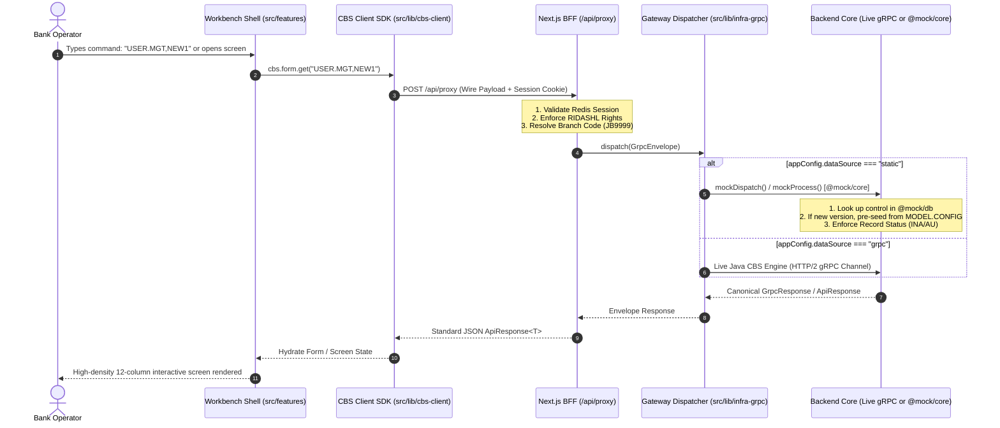

# 🏛️ CBS Workbench: Centralized Architecture & Micro-Segment Refactoring Playbook

> **Target Audience:** Core Banking Frontend & Systems Engineers  
> **Architecture Paradigm:** Dynamic Metamodel-Driven Core Banking Workbench (Next.js App Router + TypeScript + HTTP/2 gRPC / Static Mock Engine)  
> **Guiding Principles:** Strict SRP (Single Responsibility Principle), Zero-Duplication (DRY), 100% Protocol Parity between Static Mock & Live Java gRPC.

---

## 📑 Table of Contents

1. [Architectural Philosophy: The Circular Metamodel](#1-architectural-philosophy-the-circular-metamodel)
2. [Universal Request Lifecycle: Client ↔ Proxy ↔ Core](#2-universal-request-lifecycle-client--proxy--core)
3. [The Golden Rules of the Refactoring](#3-the-golden-rules-of-the-refactoring)
4. [Master Micro-Segment Roadmap](#4-master-micro-segment-roadmap)
   - [Phase 1: In-Memory Core & Mock Database (`mock/`)](#phase-1-in-memory-core--mock-database-mock)
   - [Phase 2: Canonical Type Contracts & Zod Schemas (`src/types/` & `src/lib/data-schemas/`)](#phase-2-canonical-type-contracts--zod-schemas)
   - [Phase 3: Headless CBS Foundation Libraries (`src/lib/`)](#phase-3-headless-cbs-foundation-libraries-srclib)
   - [Phase 4: Presentation Primitives & Screen Scaffolds (`src/components/`)](#phase-4-presentation-primitives--screen-scaffolds-srccomponents)
   - [Phase 5: Domain Applications & Dynamic Engines (`src/features/`)](#phase-5-domain-applications--dynamic-engines-srcfeatures)
   - [Phase 6: BFF API Gateway, Auth Proxy & Middleware (`src/app/` & `src/proxy.ts`)](#phase-6-bff-api-gateway-auth-proxy--middleware)
   - [Phase 7: End-to-End Automated Verification (`scripts/`)](#phase-7-end-to-end-automated-verification-scripts)
5. [Folder-by-Folder & File-by-File Audit Checklist](#5-folder-by-folder--file-by-file-audit-checklist)
6. [Step-by-Step Execution Protocol](#6-step-by-step-execution-protocol)

---

## 1. Architectural Philosophy: The Circular Metamodel

In a world-class Core Banking System (CBS), the user interface is **never hardcoded**. Instead, the entire system is **data-driven and self-describing**:

```
                       ┌─────────────────────────┐
                       │   SC_MODEL_CONFIG       │
                       │   (Universal Metamodel) │
                       └────────────┬────────────┘
                                    │ Describes every entity:
         ┌──────────────────────────┼──────────────────────────┐
         ▼                          ▼                          ▼
┌──────────────────┐       ┌──────────────────┐       ┌──────────────────┐
│    AC_ACCOUNT    │       │  CUST_CUSTOMER   │       │   MODEL.CONFIG   │
│  (Business Entity│       │ (Business Entity)│       │ (Self-Describing │
│   & Properties)  │       │  & Properties)   │       │   Metamodel!)    │
└────────┬─────────┘       └────────┬─────────┘       └────────┬─────────┘
         │                          │                          │
         ▼                          ▼                          ▼
┌──────────────────┐       ┌──────────────────┐       ┌──────────────────┐
│   FORM.CONFIG    │       │  INQUIRY.CONFIG  │       │   MENU_CATALOG   │
│ (Visual Layouts  │       │ (Query Tables    │       │ (Screen Catalog  │
│  & 12-Col Zones) │       │  & Drilldowns)   │       │  & Permissions)  │
└──────────────────┘       └──────────────────┘       └──────────────────┘
```

### Key Principles of this Design:

1. **Every Entity is a Control**:
   - Every `recordId` in `SC_MODEL_CONFIG` represents a canonical `controlName` (e.g., `ACCOUNT`, `CUSTOMER`, `USER.GROUP`, `MODEL.CONFIG`, `FORM.CONFIG`).
   - In gRPC, every request passes this `controlName` in the wire header.
2. **Circular Self-Description**:
   - `MODEL.CONFIG` contains a record for itself (`recordId: "MODEL.CONFIG"`). The screen that edits data models is rendered by the exact same engine that renders an Account Opening form!
3. **The Dumb Frontend Shell**:
   - `src/` does not guess business rules, invent record layouts, or hardcode dropdown options.
   - The frontend accepts operator commands (e.g. `ACCOUNT,SEE` or `USER.MGT,NEW1`), dispatches the exact command over the wire via `cbs.send()`, and renders whatever layout and field schemas the Core returns.
4. **100% Static / Live Parity**:
   - When offline (`DATA_SOURCE="static"`), `@mock/core` acts as a high-fidelity simulator of the Java Core Banking host.
   - When online (`DATA_SOURCE="grpc"`), HTTP/2 gRPC channels communicate with the live backend.
   - **Crucial Rule**: The frontend code inside `src/` does not know or care which mode is running!

---

## 2. Universal Request Lifecycle: Client ↔ Proxy ↔ Core

Every user interaction follows this strictly governed 6-stage lifecycle:



---

## 3. The Golden Rules of the Refactoring

Before modifying any file, verify these non-negotiable architectural invariants:

1. **Zero Mock Imports in `src/`**:
   - No file under `src/` may import `@mock/*` or `mock/*`. The sole exception is `src/lib/infra-grpc/client.ts` and `src/lib/infra-grpc/dispatch.ts`, which are server-only transport bridges.
2. **File Budget Constraints**:
   - Presentation components: **$\le$ 300 lines**.
   - Custom hooks, persistence, and utilities: **$\le$ 200 lines**.
   - Split complex components into cohesive child modules (`components/`, `hooks/`, `fields.ts`).
3. **Canonical CBS Request Verbs**:
   - `GMC`: Get Model Configuration (Data schema & properties).
   - `GET`: Get Single Record or Dynamic Layout Template (`MODEL,VERSION`).
   - `GRL`: Generic Record List for a control table.
   - `GUM`: Get User Navigation Menu tree.
   - `INQ`: Execute tabular Inquiry query.
   - `GNI`: Get Next Sequence ID (`AC1001`, `CU1002`).
   - `PUT`: Insert or Update record (`RECORD_STATUS: "INA"`).
   - `AUT`: Authorize record under Four-Eyes (`RECORD_STATUS: "AU"`).
   - `HLD`: Place record on hold (`RECORD_STATUS: "HLD"`).
   - `REV`: Reverse authorized record (`RECORD_STATUS: "REV"`).
   - `DEL`: Mark record deleted (`RECORD_STATUS: "DEL"`).
4. **Universal Four-Eyes (RIDASHL) Rule**:
   - Every system screen must provide `auditContext={formData.auditData}` to `<CbsScreenScaffold>`.
   - Never implement ad-hoc status checking inline. Use `useCbsAccess()` from `@/lib/cbs-access`.
5. **No Client-Side ID Fabrication**:
   - Do NOT invent fake IDs like `INQ.NEW_${Date.now()}` on the frontend.
   - Creation in system screens is strictly input-driven: the user enters the ID/version, and Core validates and returns the template.
6. **Strict Menu Action Types (`SCREEN` | `POPUP`)**:
   - Navigation and catalog actions are strictly single-purpose: `"SCREEN"` (opens in workspace tab/screen) or `"POPUP"` (opens detached popup dialog).
   - System functions (`THEME`, `LOGOUT`, `SETTINGS`) remain fixed client shell utilities and are not catalog action types.
7. **Canonical Record Status Lifecycle (`CbsRecordStatus`)**:
   - All database tables, schemas, and mutation flows must conform to `CbsRecordStatus`: `"NEW"` | `"INA"` | `"AU"` | `"HLD"` | `"REV"` | `"DEL"`.
   - Authorized records are strictly `"AU"`. Uncommitted drafts are `"INA"`.
8. **High-Density Zero-Fluff UI (Layout Over Explanation)**:
   - Eliminate marketing taglines, decorative subtitles, and verbose helper paragraphs.
   - If a screen requires helper text to make sense, fix the layout, label, input mask, or grouping instead. Move critical context to `<Tooltip>` or the validation checklist drawer.
9. **Tri-Experience Optimization & Zero-Breakage Invariant (UX / DX / AX)**:
   - Every architectural change must simultaneously elevate User Experience (fast, keyboard-first, zero layout shifts), Developer Experience (strict unidirectional layers, zero `any`, modular components), and Agent Experience (deterministic schemas, explicit contracts, no magic side effects).
   - Zero-breakage guarantee: All verifications (`pnpm verify:all`) must pass 100% clean at each milestone.

---

## 4. Master Micro-Segment Roadmap

Work through the codebase folder by folder in this exact sequence to ensure zero compilation or architectural breaks.

```
Phase 1: mock/ (Data & Engine)
   ↓
Phase 2: src/types/ & src/lib/data-schemas/ (Contracts)
   ↓
Phase 3: src/lib/ (Headless Infrastructure)
   ↓
Phase 4: src/components/ (Presentation Primitives)
   ↓
Phase 5: src/features/ (Domain Apps & Engines)
   ↓
Phase 6: src/app/ & src/proxy.ts (Gateway & BFF)
   ↓
Phase 7: scripts/ (Validation Suites)
```

---

### Phase 1: In-Memory Core & Mock Database (`mock/`)

The foundation of offline simulation and test automation.

#### 1.1 `mock/db/` — Database Tables & Schemas
- [ ] **`types.ts`**: Define `CbsTableVersion` (`"LIVE"` | `"HIST"` | `"UNAUTH"`), `CbsVersionedTable<T>`, and `queryVersionedRecord()`.
- [ ] **Physical Tables**:
  - `SC_MODEL_CONFIG.ts`: The universal metamodel table. Verify it includes `MODEL.CONFIG`, `FORM.CONFIG`, `INQUIRY.CONFIG`, `ACCOUNT`, `CUSTOMER`, `USER`, `BRANCH`, `USER.GROUP`.
  - `SC_FORM_CONFIG.ts`: Visual layout configurations and 12-column zone definitions.
  - `SC_INQUIRY_CONFIG.ts`: Tabular query definitions, filters, column widths, and drilldown targets.
  - `AC_ACCOUNT.ts`, `CUST_CUSTOMER.ts`, `SC_BRANCH.ts`, `SC_CONTROL.ts`, `SC_MENU.ts` (SCREEN & POPUP types), `SC_MENU_TREE.ts`, `SC_USER.ts`, `SC_USER_GROUP.ts`.
- [ ] **`index.ts`**:
  - Export all table constants (`*_LIVE`, `*_LIST`, `*_TABLE`).
  - Export universal dictionary `CBS_DATABASE` keyed by canonical model and table names.
  - Export `queryCbsDatabase(tableOrModel, recordId, version)`.

#### 1.2 `mock/core/` — Protocol Simulator Engine
- [ ] **`database-router.ts`**:
  - `resolveTable(controlName)`: Automatically resolves logical control (`ACCOUNT`) to physical database table (`AC_ACCOUNT`) via `SC_MODEL_CONFIG`.
  - Format helpers for customer, control, and system user records.
- [ ] **`operation-handlers.ts`**:
  - `handleGetMenu()`: Serves `SC_MENU_TREE`.
  - `handleGetModelConfig()`: Serves dynamic properties from `SC_MODEL_CONFIG`.
  - `handleInquiry()`: Queries matching records from target tables based on filter criteria.
  - `handleRecordList()`: Returns complete record list for `controlName`.
  - `handleGetRecord()`:
    - Resolves existing records by ID.
    - Resolves `FORM.CONFIG` `<MODEL>,<VERSION>`: validates target model exists and returns initial layout.
    - Resolves `MODEL.CONFIG` `<MODEL>`: returns initial model schema.
    - Resolves `INQUIRY.CONFIG` `<INQUIRY_ID>`: builds dynamic columns and actions from target model.
  - `handleNextId()`: Formats next sequential ID using `idDef.idPrefix`.
  - `handleMutation()`: Processes `PUT` (`INA`), `AUT` (`AU`), `HLD` (`HLD`), `REV` (`REV`), `DEL` (`DEL`).
- [ ] **`auth-simulator.ts`**:
  - `mockLogin()`: Validates credentials against `SC_USER_LIVE`, returns user session and JWT token.
- [ ] **`response-factory.ts`**:
  - Standardized response factories: `successResult()`, `notFoundResult()`, `toGrpcResponse()`.
- [ ] **`index.ts`**:
  - Barrel export: `mockLogin`, `mockProcess`, `mockDispatch`, `getMockProxyResponse`.

---

### Phase 2: Canonical Type Contracts & Zod Schemas

Establish strong typing and runtime validation boundaries before touching client libraries.

#### 2.1 `src/types/` — Universal TypeScript Contracts
- [ ] **`api.ts`**: Define `ApiResponse<T>`, `ApiErrorResponse`, `ApiEnvelope<T>`.
- [ ] **`cbs.ts`**:
  - `CbsRecordFunction` (`"S" | "L" | "I" | "A" | "D" | "H" | "R" | "V"`).
  - `CbsRequestType` (`"GET" | "GRL" | "GMC" | "GUM" | "INQ" | "GNI" | "PUT" | "AUT" | "HLD" | "DEL" | "REV"`).
  - `CbsRecordStatus` (`"NEW" | "INA" | "AU" | "HLD" | "REV" | "DEL"`).
  - `CbsScreenMode` (`"IDLE" | "I" | "S" | "A" | "D" | "H" | "R"`).
  - `CbsWirePayload` and `GrpcEnvelope`.
- [ ] **`index.ts`**: Re-export all canonical contracts.

#### 2.2 `src/lib/data-schemas/` — Runtime Zod Validation
- [ ] **`common-schema.ts`**: `auditDataSchema` (recStatus, recInputter, recAuthorizer, recBranchCode, recInputTime).
- [ ] **`model-config-schema.ts`**: Zod schema for `ModelConfigRecord`, properties, widgets, and validations.
- [ ] **`form-config-schema.ts`**: Zod schema for `FormConfigRecord`, sections, zones, and field placements.
- [ ] **`inquiry-config-schema.ts`**: Zod schema for `InquiryConfigRecord`, columns, filters, and row actions.
- [ ] **`menu-catalog-schema.ts`** & **`menu-designer-schema.ts`**: Action types strictly restricted to `"SCREEN" | "POPUP"`.
- [ ] **`user-group-schema.ts`**, **`branch-schema.ts`**, **`control-schema.ts`**, **`env-schema.ts`**.

---

### Phase 3: Headless CBS Foundation Libraries (`src/lib/`)

The core engine powering all UI operations. Keep these modules headless and decoupled from React components.

#### 3.1 `src/lib/cbs-client/` — Front-End Micro-Client
- [ ] **`transport/proxy-client.ts`**: `sendCbsRequest<T>(payload, options)` — the **only** channel through which front-end code reaches `/api/proxy`.
- [ ] **`payloads/base-model.ts`**: `createModelPayloads(controlName)` factory generating `get()`, `list()`, `save()`, `authorize()`, `hold()`, `delete()`, `reverse()`.
- [ ] **`payloads/form.ts`**, **`payloads/inquiry.ts`**, **`payloads/menu.ts`**, **`payloads/user-security.ts`**.
- [ ] **`index.ts`**: Export unified singleton `cbs`:
  ```typescript
  export const cbs = {
    send: sendCbsRequest,
    model: createModelPayloads,
    formConfig: createModelPayloads("FORM.CONFIG"),
    inquiryConfig: createModelPayloads("INQUIRY.CONFIG"),
    modelConfig: createModelPayloads("MODEL.CONFIG"),
    userGroup: createModelPayloads("USER.GROUP"),
    form: formPayloads,
    inquiry: inquiryPayloads,
    menu: menuPayloads,
    userSecurity: userSecurityPayloads,
  };
  ```

#### 3.2 `src/lib/cbs-command/` — Command Parser & Catalog
- [ ] **`engine/`**: Grammar parser & syntax validator (`"ACCOUNT,SEE"`, `"USER.MGT,NEW1"`, `"CONFIG.INQUIRY"`).
- [ ] **`registry/catalog.ts`**: Command catalog mapping commands to screen components and default modes.
- [ ] **`registry/alias-map.ts`**: Fast O(1) canonical alias resolution.

#### 3.3 `src/lib/cbs-form-spec/` — Dynamic Form Presentation Spec Compiler
- [ ] **`compile.ts`**: Dynamic Form Spec Compiler merging `MODEL.CONFIG` properties with `FORM.CONFIG` layout into a typed, validated form schema.
- [ ] **`field-rules.ts`**: Metamodel field rules, 12-column spans, and validation constraints.
- [ ] **`index.ts`**: Re-export `compileFormSpec`, `compileModelSpec`, and rule evaluators.

#### 3.4 `src/lib/cbs-record/` — Mutation Delta Engine
- [ ] **`delta-engine.ts`**: `computeTouchDelta(baseline, current)` — evaluates deep diffs so commits only touch modified keys.
- [ ] **`lifecycle.ts`**: Evaluates status transitions (`NEW` $\rightarrow$ `INA` $\rightarrow$ `AU`).

#### 3.5 `src/lib/cbs-access/` — RIDASHL Capability Evaluator
- [ ] **`parser.ts`**: `parseAccessibilityRights(raw)` normalizes RIDASHL string/array.
- [ ] **`evaluator.ts`**: `evaluateCbsAccess()` — Four-Eyes evaluator (Authorize requires `INA` & `inputter !== currentUser`).
- [ ] **`hooks/use-cbs-access.ts`**: React hook consuming `useSessionStore` for easy UI integration.

#### 3.6 `src/lib/cbs-screen/` — Screen Scaffolding Hooks & Inter-Tab Bus
- [ ] **`hooks/use-cbs-persistence.ts`**: Unified screen state management (baseline snapshots, dirty tracking, debounced tab writes).
- [ ] **`hooks/use-cbs-action-bar.ts`**: Wires F-keys and action bar buttons to screen operations.
- [ ] **`bus/broadcast.ts`**: `broadcastRecordMutation(control, id)` using native `BroadcastChannel`.

#### 3.7 `src/lib/infra-grpc/` & `src/lib/infra-redis/` — Transport & Infrastructure
- [ ] **`infra-grpc/dispatch.ts`**:
  - Classifies transactions (financial vs nonfinancial).
  - Routes to `@mock/core` when `DATA_SOURCE="static"`.
  - Routes to live gRPC channel pool when `DATA_SOURCE="grpc"`.
- [ ] **`infra-grpc/client.ts`**: Pooled `GrpcServiceClient` on `globalThis.__grpcClientPool`.
- [ ] **`infra-redis/pool.ts`**: Redis connection pool with circuit breaker (fails open silently when Redis is unavailable).

#### 3.8 `core-config`, `core-logger`, `core-utils`
- [ ] **`core-config/`**: Type-safe isomorphic client/server env validation.
- [ ] **`core-logger/`**: Structured logger with automatic PII redaction (account numbers, NIDs, JWT tokens).
- [ ] **`core-utils/`**: BDT currency formatters, account number masks, date formatters.

---

### Phase 4: Presentation Primitives & Screen Scaffolds (`src/components/`)

Ensure reusable presentation components adhere to Base UI/Tailwind v4 tokens and don't embed business logic.

#### 4.1 `src/components/ui/` — Atomic UI Primitives
- [ ] Button, Input, Select, Dialog, Dropdown, Table, Badge, Checkbox, Tabs, Tooltip.
- [ ] Ensure all components are $\le 200$ lines and support dark/light modes.

#### 4.2 `src/components/cbs-screen/` — Universal CBS Screen Shell
- [ ] **`cbs-screen-scaffold.tsx`**:
  - The universal layout for all screens (Header, Record Search bar, Mode Badges, Tab strip, Action Footer).
  - Accepts `auditContext`, `isDirty`, `onValidate`, `onSubmit`, `onHold`, `onDelete`, `onAuthorizeReverse`.
  - Enforces closed creation (`onCreateNew={undefined}`) for system configuration screens.
- [ ] **`cbs-record-header.tsx`**: Displays Record ID, Mode indicator (`INPUT`, `SEE`, `AUTHORIZE`), and Status badge (`AU`, `INA`, `HLD`).
- [ ] **`cbs-action-bar.tsx`**: Standard bottom action bar with hotkey hints (F2: Save, F5: Auth, F8: Reset, Esc: Return).

---

### Phase 5: Domain Applications & Dynamic Engines (`src/features/`)

Refactor each screen to be a pure consumer of `@/lib/cbs-client`, `@/components/cbs-screen`, and `useCbsPersistence`.

#### 5.1 `src/features/workbench/` — Multi-Tab Desktop Shell
- [ ] **`registry.tsx`**: `resolveScreen(command)`:
  1. Checks bespoke screen map (`MODEL.CONFIG`, `FORM.CONFIG`, `CONFIG.INQUIRY`, `MENU.CATALOG`).
  2. If starts with `INQ`/`INQUIRY`: renders `InquiryScreen`.
  3. Otherwise: falls through to dynamic `FormScreen` (GMC engine).
- [ ] **`tabbar/`**: Draggable multi-tab bar with dirty indicators and close confirmation dialog.

#### 5.2 Dynamic Form & Inquiry Engines
- [ ] **`features/form-engine/`**: Headless dynamic form kernel for GMC layouts (150–1,000 fields):
  - **Two-Tier Form State Architecture (Pillar 5)**:
    - *Tier 1 (Local Kernel State)*: `FormKernelStore` handles instant, isolated keystroke mutations and local formula calculations without triggering global Zustand tree re-renders.
    - *Tier 2 (Global Tab Store Sync)*: Syncs to `WorkbenchStore` via debounced snapshots (400ms) or field blur events with lightweight `isDirty: true`.
  - Self-subscribing field atoms (`FieldAtom`) to guarantee zero typing latency on dense screens.
- [ ] **`features/inquiry-engine/`**: Tabular inquiry renderer with server-side pagination, sorting, and drilldown triggers.
  - Zero-clutter, compact table rows (`text-xs`, `h-8`).
  - Auto-synthesized column views for raw models when custom `INQUIRY.CONFIG` is absent.

#### 5.3 System Administration Screens (`src/features/system/`)
Audit each system screen to verify strict CBS protocol conformance:
- [ ] **`model-config/`** (`SC.MODEL.CONFIG`):
  - Uses `useCbsPersistence<ModelConfigRecord>`.
  - Input-driven creation (closed `onCreateNew`).
  - Full RIDASHL lifecycle: Save, Authorize, Hold, Delete, Reverse.
  - Broadcasts mutations via `broadcastRecordMutation("MODEL.CONFIG", id)`.
- [ ] **`form-config/`** (`SC.FORM.CONFIG`):
  - Uses `useCbsPersistence<FormConfigRecord>`.
  - Input-driven versioning (`<MODEL>,<VERSION>`).
  - Full RIDASHL lifecycle.
  - Broadcasts mutations via `broadcastRecordMutation("FORM.CONFIG", id)`.
- [ ] **`inquiry-config/`** (`CONFIG.INQUIRY`):
  - Uses `useCbsPersistence<InquiryConfigRecord>`.
  - Input-driven creation (`<INQUIRY_ID>`).
  - Full RIDASHL lifecycle with `auditContext={formData.auditData}`.
  - Broadcasts mutations via `broadcastRecordMutation("INQUIRY.CONFIG", id)`.
- [ ] **`user-group/`** & **`menu-designer/`**: Verify same protocol conformance.

---

### Phase 6: BFF API Gateway, Auth Proxy & Middleware

The secure gateway guarding downstream Core Banking services.

#### 6.1 `src/proxy.ts` — Edge Request Middleware
- [ ] Cookie presence check (`session_id`).
- [ ] Redirects unauthenticated requests to `/login`.
- [ ] Enforces forced password change workflow (`initLoginCookie`).
- [ ] Excludes `/api/*` (API routes perform real session authentication in route handlers).

#### 6.2 `src/app/api/proxy/route.ts` — The Single BFF Proxy
- [ ] Validates session via `getSession()` from `infra-redis`.
- [ ] Extracts user ID, branch code, and role profile.
- [ ] Enforces RIDASHL permissions via `parseAccessibilityRights()` for modifying actions (I, A, D, R).
- [ ] Formats outgoing `GrpcEnvelope` and invokes `dispatch()`.
- [ ] Redacts sensitive PII from logs via `core-logger`.

---

### Phase 7: End-to-End Automated Verification (`scripts/`)

Maintain 100% CI pass rate at every commit.

```bash
# Run all 9 verification suites
pnpm verify:all
```

- [ ] `scripts/verify/verify-cbs-access.ts` (Access control & RIDASHL rules)
- [ ] `scripts/verify/verify-cbs-record.ts` (Delta mutation engine & touch payload diffs)
- [ ] `scripts/verify/verify-cbs-form-spec.ts` (Form spec compiler & 12-column zone builder)
- [ ] `scripts/verify/verify-cbs-command.ts` (Command gateway & catalog alias parser)
- [ ] `scripts/verify/verify-cbs-client.ts` (Wire protocol payload factories & transport)
- [ ] `scripts/verify/verify-env-matrix.ts` (Config matrix, Zod schemas & PII redaction)
- [ ] `scripts/verify/verify-core-utils.ts` (Banking utilities & currency formatters)
- [ ] `scripts/verify/verify-infra-services.ts` (Gateway services & transparent caching)
- [ ] `scripts/verify/verify-mock-services.ts` (In-memory mock Core engine & database fixtures)

---

## 5. Folder-by-Folder & File-by-File Audit Checklist

When auditing any folder, apply this 5-point quality test to each file:

```text
[ ] 1. Single Responsibility: Does this file perform exactly ONE cohesive task?
[ ] 2. Zero Direct Mocking: Does it import from @mock/*? (Forbidden in src/!)
[ ] 3. Size Compliance: Is it ≤ 300 lines (component) or ≤ 200 lines (logic/hook)?
[ ] 4. Protocol Purity: Does it use cbs.send() and standard CBS request verbs?
[ ] 5. State Baseline: Does it use useCbsPersistence rather than bespoke state?
```

---

## 6. Step-by-Step Execution Protocol

When refactoring a specific module, follow these disciplined steps:

1. **Read Existing Code**: Inspect existing components, hooks, and types before editing.
2. **Review Target Contract**: Check corresponding Zod schema in `src/lib/data-schemas/`.
3. **Refactor Hook First**: Implement persistence using `useCbsPersistence` and wire operations (`cbs.*`).
4. **Refactor UI Second**: Update presentation components to consume the standardized hook.
5. **Verify Locally & Incremental Gate**:
   - Run typecheck and lint:
     ```bash
     pnpm typecheck
     pnpm lint
     ```
   - Run the phase-specific verification test:
     - **Phase 1 (Mock Database & Core)**: `pnpm verify:mock`
     - **Phase 2 (Contracts & Matrix)**: `pnpm verify:matrix`
     - **Phase 3 (Libraries & Foundations)**: `pnpm verify:client && pnpm verify:access && pnpm verify:record && pnpm verify:form-spec`
     - **Phase 4 & 5 (Components & Screens)**: `pnpm verify:command && pnpm verify:form-spec`
     - **Phase 6 & 7 (Gateway & Master)**: `pnpm verify:all`
6. **Commit Milestone**: Create a clean Git commit marking the milestone complete.
