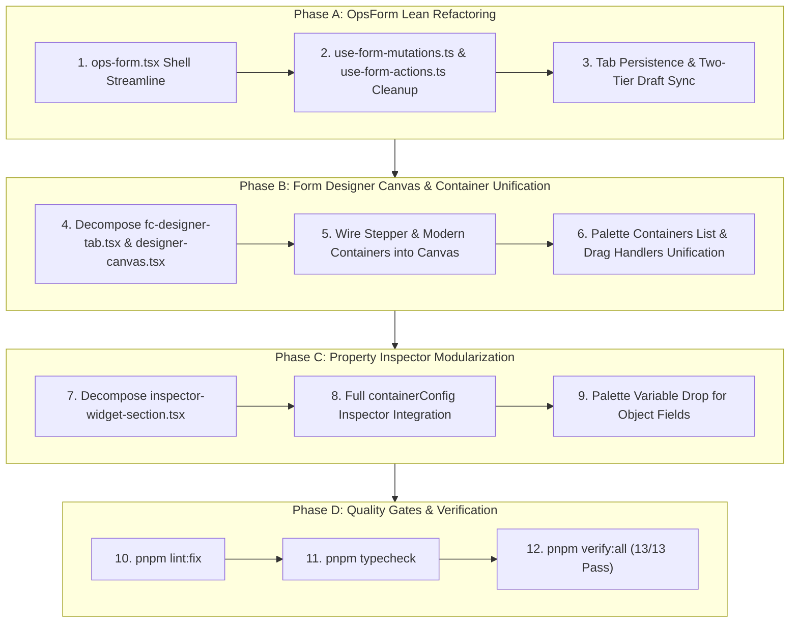

# Janata CBS — FORM.CONFIG & OpsForm Refactoring Master Plan

> **Scope**: Lean, DRY, centralized refactoring for `src/features/system/form-config/` (Visual Form Designer Workbench) and `src/features/operations/forms/` (CBS Operational Form Shell), leveraging the modernized `@/features/form-engine` and `@/lib/cbs-form-spec`.

---

## 1. Architectural Philosophy & DRY Core Invariants

Following Janata CBS core invariants and unidirectional dependency layers:

$$\text{app} \longrightarrow \text{features} \longrightarrow \text{components} \longrightarrow \text{store} \longrightarrow \text{lib/cbs-_} \longrightarrow \text{lib/infra-_} \longrightarrow \text{types \& data-schemas}$$

1. **Zero Double-Coding / Zero Duplication**:
   - Layout calculation, 12-column spans, and width conversions delegate strictly to `@/lib/cbs-form-spec` (`layout-grid.ts`, `compile.ts`).
   - Container rendering delegates to `@/features/form-engine/components/containers/` (`card-container.tsx`, `tab-group-container.tsx`, `stepper-container.tsx`, `audit-container.tsx`).
   - Field editing and scalar/object values delegate to `UnifiedFieldFactory` and `ObjectField`.

2. **Strict Size Budget**:
   - Every UI component $\le 300$ lines.
   - Every hook and helper $\le 200$ lines.
   - Exceeding files will be cleanly partitioned by responsibility.

3. **Zero Magic Strings & Zero Legacy**:
   - Container types: `"card" | "plain" | "tab" | "step" | "accordion"` from `formContainerTypeSchema`.
   - Screen modes: `CbsScreenMode` (`"I" | "A" | "V" | "D" | "R" | "S"`).
   - No legacy shims (`type`, `zone`, `tabGroupId`, `tabTitle`, `bindKey`, `layoutStyle`).

---

## 2. Target Component Breakdown & Line Budget

### Area A: Operational Form Shell (`src/features/operations/forms/`)

| File                                                                                                                      | Current Lines | Target Lines | Optimization & Refactoring Focus                                                                            |
| :------------------------------------------------------------------------------------------------------------------------ | :-----------: | :----------: | :---------------------------------------------------------------------------------------------------------- |
| [`ops-form.tsx`](file:///d:/Work/React/cbs/janata-cbs/src/features/operations/forms/ops-form.tsx)                         |      177      |  $\le 120$   | Pure shell orchestrator connecting `CbsScreenScaffold` with `FormKernelProvider` and `FormRenderer`.        |
| [`use-form-mutations.ts`](file:///d:/Work/React/cbs/janata-cbs/src/features/operations/forms/hooks/use-form-mutations.ts) |      213      |  $\le 160$   | Centralized transaction commit (Save/Hold/Delete/Reverse) utilizing `computeDelta` from `@/lib/cbs-record`. |
| [`use-form-actions.ts`](file:///d:/Work/React/cbs/janata-cbs/src/features/operations/forms/hooks/use-form-actions.ts)     |      191      |  $\le 150$   | Navigation, search, amend, and inquiry drill-down actions.                                                  |
| [`use-form-state.ts`](file:///d:/Work/React/cbs/janata-cbs/src/features/operations/forms/hooks/use-form-state.ts)         |      168      |  $\le 130$   | Draft isolation, tab persistence debouncing, and dirty state synchronization.                               |
| [`use-form-schema.ts`](file:///d:/Work/React/cbs/janata-cbs/src/features/operations/forms/hooks/use-form-schema.ts)       |      107      |   $\le 80$   | Cache-first schema resolution with fallback to `/api/proxy` via `cbs.model()`.                              |

---

### Area B: Form Designer Workbench (`src/features/system/form-config/`)

#### 1. Designer Core & Over-Budget Reductions:

| File                                                                                                                                                              | Current Lines | Target Lines | Refactoring Action                                                                                                                                                       |
| :---------------------------------------------------------------------------------------------------------------------------------------------------------------- | :-----------: | :----------: | :----------------------------------------------------------------------------------------------------------------------------------------------------------------------- |
| [`fc-designer-tab.tsx`](file:///d:/Work/React/cbs/janata-cbs/src/features/system/form-config/components/fc-designer-tab.tsx)                                      |  **387** ⚠️   |  $\le 220$   | **Decompose**: Split top action bar (`DesignerHeaderActions`) and keyboard shortcuts hook (`useDesignerHotkeys`) into dedicated sub-components.                          |
| [`designer-canvas.tsx`](file:///d:/Work/React/cbs/janata-cbs/src/features/system/form-config/components/designer/designer-canvas.tsx)                             |  **322** ⚠️   |  $\le 200$   | **Extract**: Extract block rendering dispatcher (`CanvasBlockDispatcher`) into sub-component. Delegate block clustering to `buildRenderBlocks` in `@/lib/cbs-form-spec`. |
| [`inspector-widget-section.tsx`](file:///d:/Work/React/cbs/janata-cbs/src/features/system/form-config/components/designer/inspector/inspector-widget-section.tsx) |  **301** ⚠️   |  $\le 200$   | **Decompose**: Extract widget-specific sub-inspectors (NumberConfig, DateConfig, BooleanConfig) into modular child rows.                                                 |
| [`tab-group-header.tsx`](file:///d:/Work/React/cbs/janata-cbs/src/features/system/form-config/components/designer/tab-group/tab-group-header.tsx)                 |      258      |  $\le 180$   | Streamline tab CRUD and drop operations.                                                                                                                                 |
| [`tab-strip-item.tsx`](file:///d:/Work/React/cbs/janata-cbs/src/features/system/form-config/components/designer/tab-group/tab-strip-item.tsx)                     |      253      |  $\le 160$   | Simplify tab drag-drop and rename popover.                                                                                                                               |
| [`sortable-section-card.tsx`](file:///d:/Work/React/cbs/janata-cbs/src/features/system/form-config/components/designer/sortable-section-card.tsx)                 |      222      |  $\le 160$   | Align with modern `CardContainer` presentation and `containerConfig`.                                                                                                    |

---

## 3. Phased Implementation Roadmap



---

## 4. Detailed Task Specifications

### Phase A: `OpsForm` Modernization

1. **`ops-form.tsx`**:
   - Ensure clean composition: `CbsScreenScaffold` wraps `FormKernelProvider` which wraps `FormRenderer`.
   - Remove any direct DOM references or bespoke container logic (audit section uses `AuditContainer` directly via `FormRenderer`).
2. **`use-form-mutations.ts`**:
   - Refactor transaction payload builder:
     - Pure diff via `computeDelta(initialValues, values).modifiedFields`.
     - Maker-checker verification handling.
3. **`use-form-state.ts`**:
   - Debounce workbench tab draft persistence to avoid microtask starvation.

---

### Phase B: Form Designer Canvas Modernization

1. **Budget Compliance for `fc-designer-tab.tsx` (Current 387 lines $\to \le 220$)**:
   - Extract `designer-toolbar.tsx` (Save, Preview, Reset, Zoom controls).
   - Extract `use-designer-shortcuts.ts` for keyboard bindings (`Ctrl+S`, `Delete`, `Escape`).
2. **Budget Compliance for `designer-canvas.tsx` (Current 322 lines $\to \le 200$)**:
   - Use `buildRenderBlocks(sections)` from `@/lib/cbs-form-spec` instead of ad-hoc tab clustering loops.
   - Extract `canvas-block-dispatcher.tsx` for single card, tab-group, and stepper containers.
3. **Stepper Container Support in Designer**:
   - Allow adding and editing sequential step containers (`containerType: "step"`) in the designer canvas, identical to tab groups.

---

### Phase C: Property Inspector Modularization

1. **Budget Compliance for `inspector-widget-section.tsx` (Current 301 lines $\to \le 200$)**:
   - Partition into sub-inspectors:
     - `inspector-text-config.tsx`
     - `inspector-number-config.tsx`
     - `inspector-date-config.tsx`
     - `inspector-boolean-config.tsx`
2. **Container Inspector Polish**:
   - Integrate `variant`, `density`, `badge`, and `collapsible` controls smoothly into `inspector-container-section.tsx`.

---

### Phase D: Quality Gates & Verification Runbook

At every checkpoint, execute:

```bash
pnpm lint:fix        # Biome formatting and lint check
pnpm typecheck       # Strict TypeScript compiler verification
pnpm verify:all      # 13/13 standalone CBS domain verification suites
```

---

## 5. Review & Approval

This plan completely honors the **size budget ($\le 300$ lines)**, **unidirectional dependency layers**, **zero double-coding**, and **high-density CBS banking UI**. Ready to execute upon your approval!
