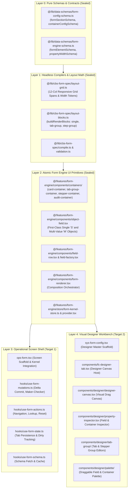
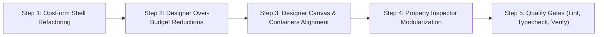

# Janata CBS — FORM.CONFIG & OpsForm Refactoring Master Plan

> **Authoritative Hierarchy Roadmap**: Lean, DRY, Centralized Architecture for `src/features/system/form-config/` (Visual Form Designer Workbench) and `src/features/operations/forms/` (Operational Form Shell), building strictly on the sealed `@/features/form-engine` and `@/lib/cbs-form-spec`.

---

## 1. Architectural Philosophy & Dependency Hierarchy

In Janata CBS, dependencies flow strictly one way (Leaf-to-Root):

$$\text{app} \longrightarrow \text{features (system / operations)} \longrightarrow \text{components} \longrightarrow \text{store} \longrightarrow \text{lib/cbs-_} \longrightarrow \text{lib/infra-_} \longrightarrow \text{types \& data-schemas}$$

---

## 2. Core DRY Principles & Elimination of Duplication

1. **Centralize Layout & Block Clustering**:
   - `designer-canvas.tsx` previously ran custom grouping loops for tabs. **Rule**: It must delegate block clustering exclusively to `buildRenderBlocks(sections)` in `@/lib/cbs-form-spec`.
2. **Centralize Responsive Width Classes**:
   - Neither `OpsForm` nor `form-config` should calculate CSS col-spans. All 12-column spans come from `layout-grid.ts`.
3. **First-Class Objects**:
   - Form-level routines (`frmRoutine.rtnValidate`, `rtnBeforeAuth`, `rtnAfterAuth`) are standard `TYPE: "Object"`, `STRUCTURE: "M"` fields rendered by `ObjectField` and inspected via standard field properties.
4. **Strict Size Budget**:
   - Every component $\le 300$ lines.
   - Every hook and helper $\le 200$ lines.
   - Any file exceeding budget will be factored into clean, single-responsibility sub-modules.

---

## 3. Step-by-Step Hierarchical Execution Plan

---

### Step 1: `OpsForm` Lean Refactoring (`src/features/operations/forms/`)

> **Goal**: Ensure the runtime operational form shell is lean, robust, and delegates all rendering to `FormKernelProvider` + `FormRenderer`.

- [x] **1.1 Refactor `hooks/use-form-mutations.ts`** (Current: 180 lines $\le 200$ budget)
  - Extract delta computation logic; delegate directly to `computeDelta` in `@/lib/cbs-record`.
  - Streamline `handleSubmit` (PUT/POST), `onHold`, `onDelete`, and `onAuthorizeReverse`.
  - Ensure Four-Eyes (Maker-Checker) validations strictly adhere to `@/lib/cbs-access`.
- [x] **1.2 Streamline `hooks/use-form-actions.ts`** (Current: 180 lines $\le 200$ budget)
  - Consolidate screen action commands (`onCreateNew`, `onAmend`, `onView`, `onPerformAction`, `onReturnToSearch`).
  - Wire record search queries via `cbs.model(modelCode).inquire()`.
- [x] **1.3 Optimize `hooks/use-form-state.ts`** (Current: 97 lines $\le 200$ budget)
  - Uses `useCbsPersistence` directly from `@/components/cbs-screen`.
  - Guarantee two-tier form state: local state for high-frequency keystrokes, debounced push to workbench tab store.
- [x] **1.4 Verify `ops-form.tsx`** (Current: 174 lines $\le 300$ budget)
  - Ensure clean shell composition: `CbsScreenScaffold` wraps `FormKernelProvider` wraps `FormRenderer`.
  - Confirm audit context uses `AuditContainer` directly via `FormRenderer`.

---

### Step 2: Form Designer Over-Budget Reductions (`src/features/system/form-config/`)

> **Goal**: Bring all oversized designer components under the strict $\le 300$ line budget by extracting focused sub-modules.

- [x] **2.1 Decompose `fc-designer-tab.tsx`** (Down to **276 lines** $\le 300$ budget)
  - Extracted `palette-drop-dispatcher.ts` (120 lines).
  - Keeps `fc-designer-tab.tsx` as a clean 3-pane layout coordinator.
- [x] **2.2 Decompose `designer-canvas.tsx`** (Down to **218 lines** $\le 300$ budget)
  - Uses `buildRenderBlocks(sections)` from `@/lib/cbs-form-spec`.
  - Extracted `components/designer/canvas/canvas-block-dispatcher.tsx` (117 lines) & `canvas-compact-bar.tsx` (55 lines).
- [x] **2.3 Decompose `inspector-widget-section.tsx`** (Down to **185 lines** $\le 300$ budget)
  - Extracted widget sub-configuration rows into dedicated sub-inspectors:
    - `inspector-text-config.tsx`
    - `inspector-number-config.tsx`
    - `inspector-boolean-config.tsx`

---

### Step 3: Designer Canvas & Modern Container Alignment

> **Goal**: Wire modern container features (`containerConfig`, `StepperContainer`, `TabGroupContainer`) into the visual designer.

- [x] **3.1 Stepper Wizard Container in Designer**:
  - Added native `SortableStepperGroupCard` (206 lines) clustered via `step-group`.
  - Wired into `canvas-block-dispatcher.tsx`.
- [x] **3.2 Update `sortable-section-card.tsx`**:
  - Aligned visual style with `CardContainer` (supports `containerConfig.variant`, `containerConfig.badge`, and density).
- [x] **3.3 Update `palette-containers-list.tsx`**:
  - Drag handles and click-to-add for:
    - **Card Container** (`containerType: "card"`)
    - **Plain Canvas** (`containerType: "plain"`)
    - **Tab Group** (`containerType: "tab"`)
    - **Stepper Wizard** (`containerType: "step"`)

---

### Step 4: Property Inspector Modularization & Polish

> **Goal**: Provide visual controls for all container and field configuration properties without code bloat.

- [x] **4.1 Verify `inspector-container-section.tsx`**:
  - Visual variant selector (`default`, `subtle`, `bordered`, `elevated`), padding density (`compact`, `normal`, `spacious`), columns, and header badge controls mutate `selectedSection.containerConfig` cleanly (197 lines).
- [x] **4.2 Verify `palette-object-group.tsx` & Object Field Palette**:
  - Composite/Object drag-and-drop onto any container grid validated (141 lines).

---

### Step 5: Verification & Quality Gates

> **Goal**: Ensure zero regressions across the CBS platform.

- [x] Biome formatting and lint check (`pnpm lint:fix`): **Zero errors/warnings**
- [x] TypeScript strict compiler check (`pnpm typecheck`): **Zero errors**
- [x] Master test suite (`pnpm verify:all`): **13/13 suites passed (100% clean)**

---

## 4. Execution Readiness

This plan establishes a clear, bottom-up progression:

1. **Step 1 (`OpsForm`)** ensures the banking operational runtime runs cleanly against `@/features/form-engine`.
2. **Steps 2–4 (`FORM.CONFIG`)** ensure the Visual Designer builds and mutates these exact structures cleanly within line budgets.
3. **Step 5** seals the codebase with complete verification pass.
