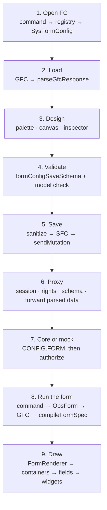
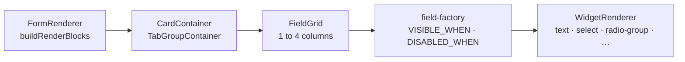

# Form Config: Learn and Verify Guide

How a form is built in **FORM.CONFIG** (aliases `FC`, `SC.FORM.BUILDER`), saved to the core, and drawn as a working screen. Work through the steps in order. Each step says **what happens**, **where the code is**, and **how to check it yourself**, so you end up knowing the whole path and can prove that each rule holds.

> [!NOTE]
> Run every command from the repo root with `DATA_SOURCE=static` (the in-memory core in `mock/`) unless a step says otherwise. Find code by searching for the names given here; line numbers are left out on purpose because they drift.

---

## 0. The whole path at a glance



Two records meet in this path:

| Record                      | What it holds                                                                        | Owner screen | Schema                                                                    |
| --------------------------- | ------------------------------------------------------------------------------------ | ------------ | ------------------------------------------------------------------------- |
| Model (`MODEL.CONFIG`)      | The database columns: `NAME`, `TYPE`, `LENGTH`, `STRUCTURE`, `REQUIRED`, `MODELNAME` | MODEL.CONFIG | `modelConfigRecordSchema` (`src/lib/data-schemas/model-config-schema.ts`) |
| Form layout (`CONFIG.FORM`) | How those columns look: sections, cards, tabs, widgets, widths, rules                | FORM.CONFIG  | `formConfigRecordSchema` (`src/lib/data-schemas/form-config-schema.ts`)   |

The model says **what** a field is. The form says **how** it is shown. The compiler joins the two at runtime.

---

## Step 1. Opening FC: command to screen

**What happens.** The operator types `FC`. The command gateway turns the alias into the canonical command `FORM.CONFIG`, and `resolveScreen()` finds it in `BESPOKE_SCREENS`, which maps it to `SysFormConfig`.

**Read:**

- `src/lib/cbs-command/registry/catalog.ts`: the `FORM.CONFIG` entry and its aliases
- `src/features/workbench/registry.tsx`: `BESPOKE_SCREENS` and `resolveScreen()` (bespoke screen → inquiry → otherwise `OpsForm`)
- `src/features/system/form-config/sys-form-config.tsx`: the screen and its tabs (General, Designer, Routines, JSON, Preview, from `components/fc-*-tab.tsx`)

**Verify:**

- [ ] `pnpm verify:command` passes (grammar, aliases, RBAC).
- [ ] In the app, `FC` and `FORM.CONFIG` open the same screen.
- [ ] Search for `"/screen/` in `src/features/system/form-config`: there should be no matches. Screens open only through `cbsCommand.execute` (AGENTS §3.4).

---

## Step 2. Loading a form: GFC and the parser

**What happens.** You enter a form ID such as `USER.MGT,V1`. `useFormConfig().fetchRecord` sends `cbs.formConfig.get(id, { recordFunction })`, which is a `GFC` request with the screen mode's record function (`recordFunctionOfMode`), so Authorize reviews the pending layout, not the live one. The core answers with **one** record: the model's columns plus a `FORMCONTROL` key that holds the stored layout. `parseGfcResponse()` splits them:

1. `FORMCONTROL` is taken off the record.
2. The model half is checked with `modelConfigRecordSchema`. If a required header such as `SERVICEPATH` is missing, the parser tries `modelConfigRecordSchema.partial()`, so the field palette still loads with checked columns. If that also fails, the result is `{ success: false }`.
3. The layout half is read **leniently**: it is checked with `formConfigRecordSchema`, and each part that fails is dropped and listed in `repairs` (a bad value drops that key; a missing required key drops its section or field). Then it is cleaned by `sanitizeFormConfigRecord()`. The designer opens a repaired layout with a "Stored Layout Repaired" warning, and the save rules stay strict, so saving stores a clean copy. A running screen (`cbsQueries.formConfig.schema`) refuses a repaired layout instead, because a dropped field could take wrong input.
4. `isNew` is true only when `FORMCONTROL` is empty. Any stored layout, even one holding only a description, is **not** new, so a blank draft can never overwrite it.

In INPUT mode, a new form gets a fresh draft; in any other mode it shows "Form Not Found". A failed response stops after the error toast. Loading clears the previous form's validation errors.

**Read:**

- `src/features/system/form-config/hooks/use-form-config.ts`: `fetchRecord`, `initDraft`
- `src/lib/cbs-client/payloads/form-config.ts`: `get` (GFC) and `save` (SFC)
- `src/lib/data-parsers/form-config-parser.ts`: `parseGfcResponse`
- `mock/core/handlers/model-handlers.ts`: how the mock builds the combined GFC answer

**Verify:**

- [ ] `pnpm verify:parsers` passes.
- [ ] Open FC, load an existing form from `mock/db/SC_FORM_CONFIG.ts`: the canvas shows its layout. Load an unknown ID: you get one error toast and no "New Form Config Draft" toast.
- [ ] Load a new version of an existing form (`CUSTOMER,V9`): it starts as a blank draft, not a copy of `CUSTOMER`. Open a form with no layout in See mode: "Form Not Found".

---

## Step 3. Designing: palette, canvas, inspector

**What happens.** Everything you do on the Designer tab changes one draft `FormConfigRecord` held in the designer context. Three parts work on it:

| Part      | Job                                                                      | Files (`src/features/system/form-config/components/designer/`) |
| --------- | ------------------------------------------------------------------------ | -------------------------------------------------------------- |
| Palette   | Lists model columns and containers (card, tab group) to drag in          | `field-palette.tsx`, `palette/*`                               |
| Canvas    | Shows sections, cards, tab groups and fields; accepts drops and reorders | `designer-canvas.tsx`, `canvas/*`, `canvas/tab-group/*`        |
| Inspector | Edits the selected form, container or field                              | `property-inspector.tsx`, `inspector/*`                        |

How drag and drop works:

- **Native HTML5 drag** carries palette items and tabs between groups. The data is written by `writeDragPayload()` and read by `readDragPayload()` (`canvas/drag-payload.ts`) and checked with `designerDragPayloadSchema`. A drag from another window or tab that doesn't match the schema is ignored.
- **dnd-kit** handles sorting fields and sections inside the canvas.
- Every drop goes through `canvas/canvas-drop-dispatcher.ts` with an explicit `PaletteDropTarget`.
- `canvas/use-section-drop-slot.ts` works out where a dragged field would land in a section's grid.

Field inspector rules (in `inspector/field-inspector.tsx`):

- The widget shown is the one the engine will draw (`resolveWidgetType`). A lookup field (`MODELNAME` or `PARAMETER`) is a `select`.
- A single-value database column (`S`) can't become multi-value (`M`). A `NOT NULL` column can't become optional. A model lookup stays a `select`.
- **Width AUTO** leaves `WIDTH` unset, so the width follows the column length. Picking a size fixes it.
- Selecting a field doesn't change it: the inspector specs have no default values that would be written into unset keys.
- The widget picker and its "why disabled" tooltips are in `inspector/inspector-widget-picker.tsx`; the Rules tab is in `inspector/inspector-rules-pane.tsx`.

Tabs: tabs with the same `groupId` are drawn as one tab group and saved together (`buildRenderBlocks` in `src/lib/cbs-form-spec/layout-blocks.ts`).

**Verify:**

- [ ] Drop a model field, an object group, a card and a tab group. Reorder them, move a tab between groups, and drop a tab on a gap line: it becomes a card at that spot.
- [ ] Select a field and then something else without editing: the screen doesn't show unsaved changes.
- [ ] Check the tab clustering yourself:

  ```bash
  pnpm exec tsx -e 'import { buildRenderBlocks } from "@/lib/cbs-form-spec"; const s=(id:string,t:string,g?:string)=>({id,title:id,containerType:t,groupId:g,fields:[]} as any); console.log(buildRenderBlocks([s("t1","tab","g"),s("c","card"),s("t2","tab","g")]).map((b:any)=>b.type==="single"?b.section.id:"["+b.tabSections.map((x:any)=>x.id)+"]").join(" "));'
  ```

  Expected: `[t1,t2] c`. The two tabs with group `g` join, ahead of the card.

---

## Step 4. Validating before save

**What happens.** Save first runs `validateFormConfig` (`hooks/fc-validation.ts`):

1. `formConfigSaveSchema` checks the rules of a savable form: a title, routine names, at least one section, unique section IDs, a title on every tab, a label on every field, unique field names, condition and `ON_CHANGE` targets that exist, options for choice widgets (unless a lookup feeds them), `min` ≤ `max`, and valid regex patterns.
2. With the model loaded, every field, including inner fields of object groups, must exist in the model. Fields match by name, ignoring case and spaces (`modelPropertyMatcher` in `src/lib/cbs-form-spec/compile.ts`), the same rule the compiler uses. A field may narrow a multi-value (`M`) column to one value, but a field stored as `M` on a single-value (`S`) column is an error.

The server can't run the model checks (the proxy has no model on SFC), so the compiler enforces them when the form runs: the model decides `TYPE`, `LENGTH` and `REQUIRED`, `STRUCTURE` can only narrow, and a field the model lacks is left out (Step 8). Hold (`HLD`) skips validation and the save schema on purpose: it parks work in progress, as in model and inquiry config.

**Verify:**

- [ ] `pnpm verify:schemas`: every case passes except `10d` (see "Known red gate" below).
- [ ] In FC, clear a field's label and save: the error is shown and nothing is sent.

---

## Step 5. Saving: sanitize, SFC, idempotent mutation

**What happens.** `useFcActions().handleSubmit`:

1. `sanitizeFormConfigRecord(formData)` writes sparse JSON: unset defaults are left out, `WIDTH` is kept whenever it is set (`md` included), and `LABEL` is kept as typed.
2. `cbs.formConfig.save(cleanData, { recordId })` builds the `SFC` payload. `recordId` is required.
3. `sendMutation()` adds the UUIDv4 idempotency key (AGENTS §3.5). A failure shows exactly one toast, raised by `cbs.send()`.
4. On success, the React Query form-schema cache is invalidated, so open screens reload the new layout, and the screen returns to idle.

Hold (`HLD`) sends the cleaned draft without validating it and keeps the screen on the record, the sent draft becoming the new baseline (model config does the same, then reloads the held copy).

**Read:** `hooks/use-fc-actions.ts`, `src/lib/data-parsers/form-config-serializer.ts`, `src/lib/cbs-client/payloads/form-config.ts`.

**Verify:**

- [ ] `pnpm verify:client` passes (payload factories, including the SFC case).
- [ ] Set a short field (for example `LENGTH 10`) to width `md`, save, and reload: it is still `md`, not the `sm` the length would give.

---

## Step 6. The proxy: the server-side seal

**What happens.** `POST /api/proxy` (`src/app/api/proxy/route.ts`) is the only way to the core. For an SFC, it checks, in order:

1. **Session.** No session gives 401; a pending password change gives 403.
2. **Wire shape.** `cbsWirePayloadSchema.safeParse`.
3. **Rights.** `verifyUserRecordAccess` (RIDASHL). The proxy checks rights, and Four-Eyes before every authorize (AGENTS §3.3).
4. **Save rules.** `SAVE_DATA_SCHEMAS` runs the **same** `formConfigSaveSchema` as the screen on `body.data` (also PUT for MODEL.CONFIG and INQUIRY.CONFIG). A direct API call can't skip the screen's rules.
5. **Forward the checked record.** The proxy sends `dataCheck.data` (the parsed result), not the raw body. Form fields are a plain `z.object` built from the column shape, so a key the designer doesn't author is removed at any depth. Model properties stay loose.
6. `buildGrpcEnvelope` takes user and branch from the session, never from the browser. A mutation never forwards the browser's audit fields (maker, authorizer, their times, status, branch): `withoutClientAudit` keeps only `recCurrNumber`, the version the user edited, so a maker can't name someone else as inputter. A Hold of a config record is parsed with that control's read schema (no save rules, unknown keys stripped). Then come cache, `dispatch()` and `autoInvalidateOnMutation` (`src/lib/infra-redis/cache.ts`).

**Verify:**

- [ ] Unknown field keys are removed, model keys are kept:

  ```bash
  pnpm exec tsx -e 'import { formElementSchema, modelPropertySchema } from "@/lib/data-schemas"; const f:any = formElementSchema.parse({ NAME: "a", LABEL: "A", INJECT: "x", PROP: [{ NAME: "b", INJECT: 1 }] }); const m:any = modelPropertySchema.parse({ NAME: "a", EXTRA: 1 }); console.log(f.INJECT, f.PROP[0].INJECT, m.EXTRA);'
  ```

  Expected: `undefined undefined 1`.
- [ ] `pnpm verify:layers` passes (the proxy and `infra-*` stay `server-only`).
- [ ] Search `route.ts` for `dataCheck.data`: it is what reaches `buildGrpcEnvelope`.

> [!IMPORTANT]
> Because the parsed record is forwarded, Zod defaults reach the core: an empty `frmRoutine` on forms; `READONLY`, `USERDEFINEID`, `SEARCHABLE: false` and an empty `IDDEF` on models. Run `pnpm verify:api` (live core, `DATA_SOURCE=grpc`, dev server running) once before shipping this.

---

## Step 7. The core and the record lifecycle

**What happens.** The core (or `mock/core`) stores the layout in `CONFIG.FORM`. Like every record, a saved form waits for authorization: another user authorizes it with `cbs.formConfig.authorize(id)` (the inputter never authorizes their own record). Hold, Delete and Reverse use the same base payloads (`src/lib/cbs-client/payloads/base-model.ts`).

**Read:** `mock/core/index.ts` (SFC is routed to `handleMutation`), `mock/core/handlers/mutation-handlers.ts`.

**Verify:**

- [ ] `pnpm verify:mock` and `pnpm verify:access` (RIDASHL, Four-Eyes) pass.
- [ ] In the app, save as one user, then try to authorize as the same user: the button is disabled and its tooltip gives the reason.

---

## Step 8. Running the form: OpsForm and the compiler

**What happens.** An operator types the form's command, for example `USER.MGT,V1`. It isn't a bespoke screen or an inquiry, so `resolveScreen()` returns `OpsForm` (`src/features/operations/forms/ops-form.tsx`). `useFormSchema` runs `cbsQueries.formConfig.schema(command)` (`src/lib/cbs-client/queries/schemas.ts`):

1. Sends GFC for the form ID and parses it with the same `parseGfcResponse` as the designer.
2. Fails with a clear message if the form is missing or unreadable ("Create it in Form Design (FC)").
3. Calls `compileFormSpec(model, form)` (`src/lib/cbs-form-spec/compile.ts`), which for each layout field:
   - finds its model column (`modelPropertyMatcher`, by name). A field the model lacks, or an inner field its group's column lacks, is left out with one logged warning, so it never runs on the layout's own TYPE and REQUIRED or sends a value the core doesn't know;
   - merges them: the model gives `TYPE`, `LENGTH` and `STRUCTURE`, the form gives label, widget, width and rules (`mergeFieldWithModelProp`);
   - resolves the widget (`resolveWidgetType`) and width (`deriveSemanticWidth`: an explicit `WIDTH`, else from `LENGTH`).
4. The result is cached for 5 minutes and cleared when FC saves.

`PARAMETER` rules (options or lookup) are defined once, in `src/lib/data-schemas/form-engine-schema.ts`: `resolveFieldParameter`, `hasFieldOptions`, `isLookupParameter`, `isArrayLookup` (only `type: "A"` is an array lookup).

Model columns carry only database facts. The compiler never reads widgets, options or rules from a model column; those come from the form layout alone.

On screen, `OpsForm` keeps a **baseline**: the record as loaded, or empty for a new entry (`useFormState`). An amendment sends only the fields that differ from it; a new entry sends every field. So every step that changes which record is shown resets it: loading a record (`hydrate`), New, a successful save and Return (`clearForm`, back to idle with an empty baseline). Reset (`revertForm`) drops the edits and goes back to the baseline. Hold sends the whole draft and makes it the baseline. A load that fails says so ("Record Could Not Be Loaded"); only a missing record reads "Record Not Found", and neither changes the screen.

**Verify:**

- [ ] `pnpm verify:form-spec` passes (compiler, widths, widgets, rules, validation).
- [ ] Open a saved form by its command: the fields and widths match the Preview tab in FC.

---

## Step 9. Drawing: the form engine

**What happens.** `FormRenderer` (`src/components/cbs-form-engine/components/form-renderer.tsx`) draws the compiled spec:



- Containers are in `components/containers/`, fields in `components/fields/` (`object-field.tsx` handles object groups), widgets in `components/widgets/`.
- Options and lookups come from `hooks/use-field-options.ts` and `hooks/use-model-lookup.ts`; lookup rows become options in `resolveLookupOptions` (`src/lib/cbs-form-spec/lookup-options.ts`). A lookup `condition` the engine can't read shows no options (and the save rules refuse it).
- Field rules (`TRANSFORM`, `CASCADE`, `ON_CHANGE`, conditions) are evaluated in `src/lib/cbs-form-spec/field-rules.ts`, and values are validated in `validation.ts`.
- Radio Group and Segmented select an option only on an exact code or label match (`radio-widget.tsx`).
- The same engine also draws the inspectors of FORM.CONFIG, MODEL.CONFIG, INQUIRY.CONFIG and MENU.DESIGN, so an engine change must keep all four working.

**Verify:**

- [ ] `pnpm verify:screen` passes.
- [ ] Open MODEL.CONFIG, INQUIRY.CONFIG and MENU.DESIGN: their inspectors still render and save.

---

## 10. Sealed rules: one home for each

Each rule below has exactly one definition. To prove it, search for the name: you should find one definition and only callers elsewhere.

| Rule                                                   | Single home                                                                              |
| ------------------------------------------------------ | ---------------------------------------------------------------------------------------- |
| Lookup or options of a field                           | `resolveFieldParameter`, `hasFieldOptions`, `isArrayLookup` in `form-engine-schema.ts`   |
| A lookup's `condition` (save rule and runtime)         | `parseLookupCondition` in `form-engine-schema.ts`                                        |
| Lookup rows → options                                  | `resolveLookupOptions` in `cbs-form-spec/lookup-options.ts`                              |
| Field ↔ model column, by name (runtime and save check) | `modelPropertyMatcher` in `cbs-form-spec/compile.ts`                                     |
| Which layout fields run (the model decides)            | `mergeKnownFields` in `cbs-form-spec/compile.ts` (private)                               |
| Field ↔ model column, by `SN` at any depth (designer)  | `findModelPropDeep` in `form-config/hooks/fc-field-tree.ts`                              |
| A new designer field (click or drop)                   | `createDesignerField` in `form-config/hooks/fc-field-tree.ts`                            |
| A tab group left with one tab becomes a card           | `dissolveLoneTabGroup` in `form-config/hooks/fc-field-tree.ts`                           |
| Canvas gap drop targets                                | `canvasGapId`, `isCanvasGapId` in `designer/canvas/canvas-types.ts`                      |
| A field dropped past a section's last field            | `dropsAfterLastField` in `designer/canvas/use-canvas-drag.ts`                            |
| Widget for a field                                     | `resolveWidgetType` in `cbs-form-spec/field-normalizer.ts`                               |
| Why a widget can't be picked                           | `widgetIneligibleReason`, `TEXTAREA_MIN_LENGTH` in `form-widget-schema.ts`               |
| Widget sets (choice, inline width)                     | `CHOICE_WIDGETS`, `INLINE_WIDTH_WIDGETS` in `form-widget-schema.ts`                      |
| Density and layout values                              | `FORM_DENSITIES`, `FORM_LAYOUTS` in `form-engine-schema.ts`                              |
| Which tab's settings govern a tab group                | `resolveTabGroupConfig` in `cbs-form-spec/layout-blocks.ts`                              |
| Badge colour of a container                            | `containerBadgeTone` in `cbs-form-engine/components/form-layout-context.tsx`             |
| Loose value equality in rules                          | `looseEquals` in `cbs-form-spec/field-rules.ts` (private)                                |
| Designer drag data                                     | `designerDragPayloadSchema` + `readDragPayload`                                          |
| Save rules (screen and proxy)                          | `formConfigSaveSchema`                                                                   |
| The record function a screen mode reads with           | `recordFunctionOfMode` in `cbs-access/record-guard.ts`                                   |
| Four-Eyes (screen tooltip and proxy refusal)           | `isRecordMaker`, `FOUR_EYES_REASON` in `cbs-access/record-guard.ts`                      |
| Audit fields a save may carry (only `recCurrNumber`)   | `withoutClientAudit` in `app/api/_lib/record-guards.ts`                                  |
| A tab's errors as a `FormRenderer` map; the warning    | `fieldErrorMap`, `tabFieldErrors` in `cbs-screen/validation.ts`; `toastValidationIssues` |

---

## 11. Verify everything in one go

```bash
pnpm lint
pnpm typecheck
pnpm knip
pnpm deprecated
pnpm verify:all
```

All clean, except `verify:schemas` **`10d`**, which you have chosen to keep failing.

**Known red gate (`10d`).** The test expects an inquiry filter with an extra key (`selectFieldType`) to be rejected. `inquiryOperatorCriterionSchema` is a `z.looseObject` because the URM sends each filter's field name as an extra key, so the test fails. To make it pass, either allow exactly that key and reject the rest, or change the test (it is a `verify:*` suite, so it's your call).

**Manual smoke test** (there is no browser test suite):

1. In FC, drop a model field, an object group, a card and a tab group. Reorder them, move a tab between groups, drop a field on a gap, and close one of two tabs.
2. Set a short field to width `md`, save, reload, and check the width. Change something and Hold, then reopen: the change is still there.
3. Open the Preview tab, then open the form by its command and compare.
4. In the running form: amend record A and save, then New, enter B and save, and view B (every field is there). Edit an object group's inner field and save. Change a field and Reset.
5. Save as one user, then try to authorize as the same user: the button is disabled, and a forced request gets a 403.
6. Open MODEL.CONFIG, INQUIRY.CONFIG and MENU.DESIGN: their inspectors still render and save.

---

## 12. What the audit changed, and what is still open

**First audit**

| Phase                | Commit    | Result                                                                                                                                           |
| -------------------- | --------- | ------------------------------------------------------------------------------------------------------------------------------------------------ |
| 1. Bugs              | `75f120c` | `md` width kept on save; inspector shows the engine's widget; deep model match; no draft on a failed GFC; inner fields checked against the model |
| 2. Schema constants  | `c1f9af1` | Parameter types, densities, layouts and widget sets defined once; dead aliases and exports removed                                               |
| 3. Compiler rules    | `cb77910` | `PARAMETER` rules, name matching, tab group settings and rule equality defined once; only `type: "A"` is an array lookup                         |
| 4. Engine API        | `e0f3a34` | Dead renderer props and the 12-column path removed; one `errors` prop; AUTO width                                                                |
| 5. Drag and sections | `c16e703` | Checked drag data; explicit drop targets; 3 drop fixes; no inspector defaults                                                                    |
| 6. Parser and client | `3f2abc3` | GFC parsed per schema; checked model fallback; `recordId` required on save                                                                       |
| 7. Boundary          | `edb237b` | Unknown field keys removed; proxy forwards checked data; radio prefix alias and model widget reads removed                                       |
| 8. Size budget       | `82135dc` | Inspector, section grid, tab specs and field badges split; every file within budget                                                              |
| 9. Docs              | `6b476b6` | READMEs, runbook and AGENTS §2 (`pnpm deprecated`) match the code; dead `combobox` widget case removed                                           |

**Second audit (steps 1 to 9, line by line)**

| Steps                      | Commit     | Result                                                                                                                                                                                                                       |
| -------------------------- | ---------- | ---------------------------------------------------------------------------------------------------------------------------------------------------------------------------------------------------------------------------- |
| 1–2 Open and load          | `ec55307d` | GFC reads the copy the mode acts on (Authorize reviews the pending layout); stored layouts read leniently and repaired; "Form Not Found" outside Input; one model key for copy/paste; dead screen props removed              |
| 3 Designer                 | `2b7478e8` | One field builder for every add; pure state updaters; shared drop rules, gap ids and tab-group dissolve; widget reasons from the widget rules; semantic badge colours                                                        |
| 4 Validation               | `61e72052` | The compiler leaves out fields the model lacks; validation flags a multi-value field on a single-value column                                                                                                                |
| 5–7 Save, proxy, lifecycle | `5b1251b0` | The proxy strips the browser's audit fields from every save (keeps `recCurrNumber`); Hold sends the draft, checked with the read schema                                                                                      |
| 8–9 Run and draw           | `0fb6b991` | A new record sends every field (baseline reset); Reset reverts to the loaded record; load failures told apart; object-group edits saved as nested values; an unreadable lookup condition fails closed and is refused on save |

Regression cases added: `verify:form-spec` 3.3 (fields the model lacks are left out), 9.4 (object-group edits saved nested), 9.5 (lookup conditions); `verify:access` 12.2 (server Four-Eyes), 12.3 (audit fields stripped); `verify:schemas` 4d (saved-model rules), 5e (unreadable lookup condition refused), 7b (unknown request types); `verify:client` 3.4 (Hold carries the draft); `verify:record` 7.1 (a new record sends every field, `recordSaveData`).

**Still open:**

- [ ] **`verify:api` against a live core** (`DATA_SOURCE=grpc`, dev server running), before shipping. It confirms the wire changes of both audits.
- [ ] **`GET CONFIG.FORM` with function `A`** on the live core. The proxy's Four-Eyes check reads the pending form that way (the mock supports it). If the core serves forms only through GFC, every form authorize is refused, and the check must read `FORMCONTROL.auditData` instead (GFC's top-level audit block is the model's).
- [ ] **Core team: audit fields on save.** The proxy now forwards only `recCurrNumber` from a save's audit block. Confirm the core needs nothing else from it.
- [ ] **`authNumber`**: stored on CONFIG.FORM and edited on the General tab, but nothing in the frontend reads it (authorization comes from the model's `AUTHLEVEL`). Waiting on the core team to say whether the Java core uses it.
- [ ] **`10d`**: decide whether to keep it red (see section 11).
- [ ] **Shared designer kit**: the four designers (model, form, inquiry, menu) still each have their own actions hook and issue-to-tab mapper. One shared unit in `src/lib/cbs-screen` would remove that duplication.
