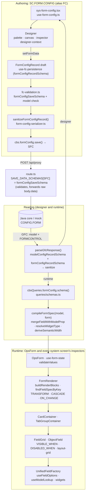

# Form Config Audit Plan (SC.FORM.CONFIG → CONFIG.FORM → runtime forms)

Audit of everything a form layout touches, from the three schema files out to the designer, the compiler, the form engine and the proxy. It follows the model-config audit and uses the same rules: one source per rule, no dead code, no legacy aliases, smallest safe change, and every compatibility boundary flagged before it moves.

- **Baseline:** `dev` at `bfcc02d` (2026-11-26). **Progress:** see **Status** below; per-phase detail is in §4 ("Phase N as applied").
- **Scope:** `src/lib/data-schemas/form-{config,engine,widget}-schema.ts` and every unit that reads or writes their types (about 95 files, about 13k lines).
- **Not in scope:** model-config (already audited); inquiry-config and menu-designer, except where they share the form engine.

---

## Status (resume here)

Last updated 2026-11-26. File and line references in §2 are from the baseline `bfcc02d`; code has moved since, so re-locate each finding with grep before changing it.

| Phase                     | State                                                                        | Commit    | Closed                                                  |
| ------------------------- | ---------------------------------------------------------------------------- | --------- | ------------------------------------------------------- |
| 0. Triage                 | Done: `verify:grpc` 5.1 updated to the page size. `10d` stays red, see below | with 5    | 5.1                                                     |
| 1. Confirmed bugs         | Done                                                                         | `75f120c` | B1 to B6, unique container ids                          |
| 2. `data-schemas` source  | Done                                                                         | `c1f9af1` | D4, D7, D9, D11, D14, X1, X2, X11, N1, N7 (X12 dropped) |
| 3. `cbs-form-spec` source | Done                                                                         | `cb77910` | D1, D2, D3, D5, D6, D10, X3, X14, X15, N3 (D12 dropped) |
| 4. Engine API, dead code  | Done                                                                         | `e0f3a34` | X4, X5, X6, X13, X16, D13, N6, AUTO width               |
| 5. Drag data, section API | Done                                                                         | `c16e703` | S6, D8, X7, N8, N2, 11 inspector defaults, 3 drop fixes |
| 6. Parser and client wire | Applied, **not committed**                                                   | —         | S3, S4, X8, X9                                          |
| 7. Boundary               | Applied, **not committed**. Needs one `verify:api` run before shipping       | —         | S1, S2, S5, X10. Deferred: `authNumber` (D2)            |
| 8. Size budget            | Not started. No decision needed                                              | —         | open: see sizes below                                   |
| 9. Docs                   | Not started. No decision needed                                              | —         | open: N4, N5, AGENTS §2 `pnpm deprecated`, §0 table     |

**Decided:** D4 keep both identity rules (designer by `SN`, runtime by `NAME`, two helpers); D6 option B (tabs group by `groupId`, saved together); D7 only `type: "A"` is an array lookup; D8 delete the 12-column path; D1 strict fields and the proxy forwards parsed data; D3 delete the model-property reads; D5 delete the radio alias.
**Still open:** D2 (`authNumber`, deferred until the core team confirms whether the Java core reads it), D9 (the §5 suite cases).

**Known red gate:** `verify:schemas` `10d` fails **by owner choice**. The URM needs each filter's field name as a duplicate key, so the browser filter schema (`inquiryOperatorCriterionSchema`) stays `looseObject`. Expect exactly this one failure in `verify:all`; anything else is a regression.

**Over budget now** (`features/system/form-config`, limit 300 / 350 cohesive for components, 250 / 280 for helpers): `field-inspector.tsx` 488, `fc-canvas-fields.ts` 361, `canvas-section-grid.tsx` 360, `canvas-field-card.tsx` 327, `canvas-card-container-block.tsx` 321.

**To resume:**

1. `git log --oneline -6` and `git status`: if Phase 5 is still uncommitted, review and commit it first.
2. Run the gates: `pnpm lint`, `pnpm typecheck`, `pnpm knip`, `pnpm deprecated`, `pnpm verify:all`. Only `10d` may fail.
3. Take the next phase from the table. For each of its findings, read the row in §2, then confirm it against the current code (grep, read the callers) before planning; earlier phases found several rows wrong or already fixed.
4. Plan, get approval for anything that touches a compatibility boundary or a `verify:*` suite, implement, run the gates, and add a "Phase N as applied" note to §4.
5. Update this table: state, commit hash, and the finding IDs closed.

---

## 0. Baseline gates

| Gate                           | Result      | Note                                                                                                                                                                   |
| ------------------------------ | ----------- | ---------------------------------------------------------------------------------------------------------------------------------------------------------------------- |
| `pnpm typecheck`               | ✅ clean    |                                                                                                                                                                        |
| `pnpm knip`                    | ✅ clean    | `knip.json` sets `ignoreExportsUsedInFile: true`, so an export that is only used in its own file is **not** reported. Every "unused export" below was found with grep. |
| `pnpm deprecated`              | ✅ 0 usages | `scripts/tools/check-deprecated.ts` (not listed in AGENTS.md §2 yet)                                                                                                   |
| `verify:form-spec`             | ✅ 52/52    |                                                                                                                                                                        |
| `verify:parsers`               | ✅ 12/12    |                                                                                                                                                                        |
| `verify:client`                | ✅ 25/25    |                                                                                                                                                                        |
| `verify:mock`, `verify:layers` | ✅          |                                                                                                                                                                        |
| `verify:schemas`               | ❌ 1 fail   | Test `10d` (INQ data is strict). **Resolved as intended behaviour:** the owner keeps the loose browser filter schema for the URM (see Status).                         |
| `verify:grpc`                  | ❌ 1 fail   | Test `5.1` expected the old 5000-row cap; the code sends the page size on purpose (server-side paging, `dc08606`). **Fixed in Phase 0** (test updated).                |

---

## 1. The flow

**Reach:** `FormRenderer` and `FormElement` / `FormSection` also drive the inspector field specs of FORM.CONFIG (`fields/fc-*.ts`), MODEL.CONFIG (`mc-*`), INQUIRY.CONFIG (`ic-*`) and MENU.DESIGN (`md-*`). Any schema or engine change has to keep those four screens working (`verify:form-spec`, plus a smoke test of each designer).

### Units and size budget

| Unit                             | Files | Over budget (≤300 component, ≤250 hook or helper)                                                                                                                                               |
| -------------------------------- | ----- | ----------------------------------------------------------------------------------------------------------------------------------------------------------------------------------------------- |
| `lib/data-schemas/form-*`        | 3     | —                                                                                                                                                                                               |
| `lib/data-parsers/form-config-*` | 2     | —                                                                                                                                                                                               |
| `lib/cbs-form-spec`              | 9     | —                                                                                                                                                                                               |
| `components/cbs-form-engine`     | 27    | —                                                                                                                                                                                               |
| `features/operations/forms`      | 8     | —                                                                                                                                                                                               |
| `features/system/form-config`    | 55    | `field-inspector.tsx` **461**, `fc-canvas-fields.ts` **367**, `canvas-section-grid.tsx` **357**, `canvas-card-container-block.tsx` 329, `canvas-field-card.tsx` 326, `designer-context.tsx` 302 |

---

## 2. Findings

Severity: **B** = confirmed bug, **S** = boundary or security, **D** = duplicated rule (single-source violation), **X** = dead code or legacy, **N** = stale doc or nit.
Every **B** finding was reproduced with a throwaway `tsx` probe against the real units (§6).

### 2.1 Confirmed bugs

| ID  | Where                                             | What happens                                                                                                                                                                                                                                                                                                                             | Fix (root, once)                                                                                                                                                                   |
| --- | ------------------------------------------------- | ---------------------------------------------------------------------------------------------------------------------------------------------------------------------------------------------------------------------------------------------------------------------------------------------------------------------------------------- | ---------------------------------------------------------------------------------------------------------------------------------------------------------------------------------- |
| B1  | `form-config-serializer.ts:42` + `compile.ts:119` | **An explicit `md` width is lost on save.** The serializer drops `WIDTH === "md"` as if it were the default, but the compiler re-derives a missing width from `LENGTH`. Probe: a `LENGTH 10` field set to `md` reloads as `sm`. The same happens for every field whose derived width isn't `md` (dates, short codes, long names).        | Serialize `WIDTH` whenever it is set. The default is "derived from LENGTH", not `md`. Stored layouts that omitted `md` keep rendering as they do today, so there's no migration.   |
| B2  | `field-inspector.tsx:67`                          | The inspector shows `field.WIDGET \|\| getDefaultWidgetForType(type)`. That ignores lookups, so a `MODELNAME` or `PARAMETER` field reads as `text` while the engine renders a `select`. The README promises "designer and engine match 1:1".                                                                                             | Use `resolveWidgetType()` (the engine's rule) for the current widget.                                                                                                              |
| B3  | `canvas-field-card.tsx:45`                        | Matches the model property with a flat `p.SN === field.SN \|\| p.NAME === field.NAME`. Inner fields never match (the list isn't searched in depth), and an `SN` that collides at the top level matches the wrong property. Width and widget badges then compare against the wrong defaults.                                              | Use `findModelPropDeep()` (`hooks/fc-field-tree.ts`), the same lookup the property inspector uses.                                                                                 |
| B4  | `use-form-config.ts:109`                          | A GFC that returns a **failure response** (not a throw) in INPUT mode falls through to `initDraft()`. The operator gets the error toast and then a "New Form Config Draft" toast over a blank canvas for a record that may exist. The `catch` comment says the opposite ("keep the current draft").                                      | Only start a draft when `parsed.data.isNew`. On a failure response, return after the toast that `cbs.send` already raised.                                                         |
| B5  | `fc-validation.ts:93`                             | The "field is not in the model" check only looks at top-level fields. An inner field of an object group that the model dropped is never flagged, and at runtime it renders with its stored `TYPE`.                                                                                                                                       | Walk `PROP` against `modelProp.PROP` with the same lookup as B3.                                                                                                                   |
| B6  | `layout-blocks.ts:62` (`buildRenderBlocks`)       | Its JSDoc and the README say only **contiguous** tabs cluster, but the code merges every tab with the same `groupId`. Probe: `tab(g), card, tab(g)` renders as `[t1,t2], card`, so the second tab jumps ahead of the card. Designer and runtime agree (both call it), so the bug is that the visual order differs from the stored order. | **Decision D6:** either cluster contiguous tabs only (matches the doc), or keep the merge and make the designer move the tab next to its group on drop. Then fix the doc to match. |

### 2.2 Boundary and security (stop and ask: §1 compatibility or a security check)

| ID  | Where                                                      | Issue                                                                                                                                                                                                                                                                               | Proposal                                                                                                                                                                                                                    |
| --- | ---------------------------------------------------------- | ----------------------------------------------------------------------------------------------------------------------------------------------------------------------------------------------------------------------------------------------------------------------------------- | --------------------------------------------------------------------------------------------------------------------------------------------------------------------------------------------------------------------------- |
| S1  | `model-config-schema.ts:104` → `form-engine-schema.ts:113` | `baseFormElementSchema` extends `baseFieldSchema`, which is a `z.looseObject`. So **any unknown key on a field passes `formConfigSaveSchema`** (probe: `INJECT: "<x>"` survives). Sections strip unknown keys, fields don't.                                                        | Give form elements a strict object (`z.strictObject` or `.strip()`) built from the shared column shape, so model reads can stay loose. Wire impact: the core never receives keys the designer didn't author.                |
| S2  | `route.ts:123` → `:133`                                    | The proxy validates `body.data` with the save schema, then forwards the **raw** `body.data`, not the parsed result. Whatever S1 lets through, and anything sanitisation would have removed, reaches CONFIG.FORM when the API is called directly.                                    | Forward `dataCheck.data` for schema-checked saves (SMC, SFC, PUT INQUIRY.CONFIG). Defaults that Zod fills in (`frmRoutine: {…}`, `description: ""`) then reach the wire, so **run `verify:api` against a live core first**. |
| S3  | `form-config-schema.ts:55`                                 | `FORMCONTROL: z.union([formConfigRecordSchema, z.record(any)])`. The second branch accepts anything, so the union only adds parse cost, and `parseGfcResponse` parses the form again anyway.                                                                                        | Drop `gfcResponseSchema`. Split `FORMCONTROL` off the extracted record and parse each half with its own schema (see X9).                                                                                                    |
| S4  | `form-config-parser.ts:41-63`                              | When the parse fails, the "resilient fallback" passes unvalidated data as `modelRaw as ModelConfigRecord` into `sanitizeModelConfigRecord`.                                                                                                                                         | Parse the model with `modelConfigRecordSchema.safeParse` and keep the palette-preserving fallback explicit, with a typed default, not a cast.                                                                               |
| S5  | `radio-widget.tsx:51,93`                                   | A hard-coded domain alias in the **shared engine**: a stored `P` or `L` value matches any option whose code starts with that letter. It hides wrong data and applies to every radio field on every screen.                                                                          | **Decision D5:** find which stored values need it (probably an old `ACCESS` or status code), migrate them, and delete the alias. Keep only exact code or label matching.                                                    |
| S6  | Designer drag and drop (6 readers, see D8)                 | Drag data from `dataTransfer` is parsed with `JSON.parse` and then cast (`as DragPayload`, `Record<string, unknown>`). It is cross-window input (another tab can drag JSON in) and is never validated. Invariant 2 says outside input goes through `data-schemas` + `.safeParse()`. | One `designerDragPayloadSchema` (a discriminated union on `type`) plus one `readDragPayload(e)` helper.                                                                                                                     |

### 2.3 Duplicated rules (single source)

| ID  | Rule                                                          | Copies                                                                                                                                                                                                                                                                                      | Single home                                                                                                                                          |
| --- | ------------------------------------------------------------- | ------------------------------------------------------------------------------------------------------------------------------------------------------------------------------------------------------------------------------------------------------------------------------------------- | ---------------------------------------------------------------------------------------------------------------------------------------------------- |
| D1  | "No `PARAMETER` but a `MODELNAME`" becomes `{type:"M"}`       | `compile.ts:106`, `field-normalizer.ts` (`if (!param && modelName)`), `use-field-options.ts:26`                                                                                                                                                                                             | `resolveFieldParameter(field)` in `cbs-form-spec/field-normalizer.ts`                                                                                |
| D2  | "Does this field have a lookup or options"                    | `resolveWidgetType` `hasLookup` (`field-normalizer.ts:70`), `useFieldOptions` `isDynamic`, `formConfigSaveSchema` options check, `inspector-lookup-config.tsx:43`                                                                                                                           | `hasFieldOptions(param, modelName)` / `isDynamicLookup(param)` next to D1                                                                            |
| D3  | Array-lookup mode = `type === "A" \|\| recordId`              | `use-model-lookup.ts:67`, `inspector-lookup-config.tsx:47`                                                                                                                                                                                                                                  | `isArrayLookup(param)`. Ideally only `type === "A"` decides it (**D7**).                                                                             |
| D4  | Default array-lookup model `"LOOKUP"`                         | `form-config-serializer.ts:75`, `use-model-lookup.ts:28`                                                                                                                                                                                                                                    | `DEFAULT_ARRAY_LOOKUP_MODEL` in `form-engine-schema.ts`                                                                                              |
| D5  | Matching a field to its model property                        | `compile.ts` (lowercase `NAME`), `fc-validation.ts:93` (lowercase `NAME`), `fc-field-tree.ts:90` (`SN` at any depth, then `NAME`), `canvas-field-card.tsx:45` (flat `SN \|\| NAME`)                                                                                                         | One rule, decided in **D4**: the designer keys on `SN`, runtime on `NAME`. Document why both exist and route every caller to one of the two helpers. |
| D6  | Which tab's `containerConfig` governs the group               | `form-renderer.tsx:97` (`hasFillBlock`), `tab-group-container.tsx:50`                                                                                                                                                                                                                       | `resolveTabGroupConfig(tabSections, activeId?)` in `layout-blocks.ts`                                                                                |
| D7  | Widget categories                                             | `CHOICE_WIDGETS` (`form-config-schema.ts:72`), toggles in `getCompatibleWidgets`, inline widgets in `layout-grid.ts:76-84` (which also lists `"radio"`, a widget that doesn't exist)                                                                                                        | `CHOICE_WIDGETS`, `TOGGLE_WIDGETS`, `INLINE_WIDTH_WIDGETS` exported from `form-widget-schema.ts`                                                     |
| D8  | Reading drag data                                             | `canvas-gap-indicator.tsx:65`, `canvas-section-grid.tsx:245`, `designer-canvas.tsx:195`, `tab-strip-item.tsx:94`, `use-tab-group-drop.ts:65,149`, each with its own `typeof parsed.groupTitle === "string" ? …` coercion, plus the `"application/json"` literal 9 times                     | `readDragPayload()` + `DESIGNER_DRAG_MIME` (S6)                                                                                                      |
| D9  | Density and layout unions                                     | Schema declares the density enum twice (`form-engine-schema.ts:169,216`). The `"compact"\|"normal"\|"spacious"` and `"horizontal"\|"stacked"` literals are retyped in `form-layout-context.tsx`, `cbs-form-engine/types.ts`, `designer-context-types.ts` (×4), `canvas-inspectors.tsx` (×4) | `FORM_DENSITIES` / `FormDensity`, `FORM_LAYOUTS` / `FormLayout` in `form-engine-schema.ts`                                                           |
| D10 | Loose value equality (`a === b \|\| String(a) === String(b)`) | `field-rules.ts:115` (cascade), `eq` / `neq` / `in` / `notIn` in `evaluateFieldCondition`                                                                                                                                                                                                   | One private `looseEquals()` in `field-rules.ts`                                                                                                      |
| D11 | Walking an `and` / `or` condition tree                        | `conditionTargets` (`form-config-schema.ts:82`), `evaluateFieldCondition`                                                                                                                                                                                                                   | Export a `conditionLeaves()` walker from `form-engine-schema.ts` (lowest rank). The save schema and the compiler both use it.                        |
| D12 | Defaulting `columns` to 1                                     | `form-config-serializer.ts:134` (`\|\| 1`, which also writes `columns:1` into sparse JSON), `compile.ts:176`, `card-container.tsx:41`, `field-grid.tsx:43`                                                                                                                                  | Read sites keep `?? 1`. The serializer omits the key when it is 1 (sparse, like the other defaults).                                                 |
| D13 | `badgeVariant` to class ternary chain                         | `card-container.tsx:140,176`, `tab-group-container.tsx`                                                                                                                                                                                                                                     | One `BADGE_VARIANT_CLASSES` map in the engine                                                                                                        |
| D14 | Enum magic strings                                            | Structure `"S"`/`"M"` (23 sites), `PARAMETER` type `"O"`/`"M"`/`"A"` (11), `containerType` `"card"`/`"tab"` (32), `field.TYPE.toLowerCase() === "number"` (`field-factory.tsx:88`, `widget-renderer.tsx:63`), sentinels `"canvas-root"` / `"new-tab-in-group"` (9)                          | `CBS_PROPERTY_STRUCTURE`, `CBS_PROPERTY_TYPE`, a new `CBS_PARAMETER_TYPE`, `FORM_CONTAINER_TYPE`, and designer drop-target constants                 |

### 2.4 Dead code and legacy

| ID  | Where                                                                                                                                                                                                                           | Evidence                                                                                                                                                         | Action                                                                                                                    |
| --- | ------------------------------------------------------------------------------------------------------------------------------------------------------------------------------------------------------------------------------- | ---------------------------------------------------------------------------------------------------------------------------------------------------------------- | ------------------------------------------------------------------------------------------------------------------------- |
| X1  | Exports used only in their own file: `baseFormElementSchema`, `formContainerTypeSchema`, `containerConfigSchema`, `formSectionSchema`, `formElementsContainerSchema`, `COMPATIBLE_WIDGETS_FOR_TYPE`, `WidgetEligibilityContext` | grep: 0 outside users. Knip can't see them because of `ignoreExportsUsedInFile`.                                                                                 | Un-export them. Update the README mention of `COMPATIBLE_WIDGETS_FOR_TYPE` (it stays the rule, just private).             |
| X2  | `PropertyWidth` (`form-engine-schema.ts:111`)                                                                                                                                                                                   | Alias of `SemanticWidthToken`                                                                                                                                    | Delete it and use `SemanticWidthToken` in `field-normalizer.ts` and `layout-grid.ts`                                      |
| X3  | `validation.ts:102` `"amount"` / `"rate"`, `fieldType === "array"`                                                                                                                                                              | `ctx.type` is `field.TYPE` (a model type), never a widget name. Probe: amount fields validate through the `"number"` branch.                                     | Compare against `CBS_PROPERTY_TYPE` and remove the unreachable names                                                      |
| X4  | `FormRenderer` props `onValuesChange`, `autoValidate`, `hideHeader` (`form-renderer.tsx:43,46,52`)                                                                                                                              | 0 callers outside the engine                                                                                                                                     | Delete the props and their branches                                                                                       |
| X5  | `FormRenderer` `externalErrors` (`form-renderer.tsx:45`)                                                                                                                                                                        | A second name for `errors` (both get merged). Only `mc-general-tab.tsx` and `mc-property-inspector.tsx` use it.                                                  | One `errors` prop. The two model-config call sites rename it (a one-word change in an audited unit).                      |
| X6  | `FieldInspector` `baseType` prop + `resolveBaseType()` (`field-inspector.tsx:47`, `property-inspector.tsx:31`)                                                                                                                  | Computed and passed, then received as `_baseType` and never read                                                                                                 | Delete both                                                                                                               |
| X7  | `canvas-drop-dispatcher.ts:82-83` `data.field`, `"palette-field"`                                                                                                                                                               | No palette source produces either (all send `type:"palette-variable", element`)                                                                                  | Delete the aliases (S6's schema then makes it a compile-time guarantee)                                                   |
| X8  | `cbs-client/payloads/form-config.ts:45` `data?.recordId \|\| data?.formId`                                                                                                                                                      | Only caller (`use-fc-actions.ts:95`) passes `options.recordId`. A sanitized record never has `recordId` or `formId`.                                             | Make `recordId` required and drop the fallbacks (a dual parameter, AGENTS §1)                                             |
| X9  | `gfcResponseSchema` (`form-config-schema.ts:54`)                                                                                                                                                                                | See S3                                                                                                                                                           | Delete it with S3                                                                                                         |
| X10 | `field-normalizer.ts:136,176` reading `PARAMETER`, `WIDGET`, `VISIBLE_WHEN`, `DISABLED_WHEN` from a **model** property                                                                                                          | Model config is pure DDL (model-config audit). No mock model carries these keys.                                                                                 | Remove them (**D3**: check one live GMC payload with `verify:api` first)                                                  |
| X11 | `field-normalizer.ts:170` `DISABLED: false`, `form-widget-schema.ts:59` `case ARRAY` (same as `default`), `:44` redundant `as const`, `isWidgetCompatibleWithType` (mixed positional and options API, 1 caller)                 | Noise                                                                                                                                                            | Remove them. Inline `getCompatibleWidgets(ctx).includes(w)` in `resolveWidgetType`.                                       |
| X12 | `form-config-schema.ts:36,44` `.default(…).optional()`                                                                                                                                                                          | Probe: the default still applies, so `.optional()` does nothing. The inferred type is wrongly optional, which forces `?.` everywhere (`form.frmRoutine?.[key]`). | Use `.default(…)` only. The type tightens, so remove the `?.` it frees up.                                                |
| X13 | `layout-grid.ts:116,126+` `cols === 12` branches, `TOKEN_TO_COL_SPAN`                                                                                                                                                           | `formSectionSchema.columns` is `max(4)` and no caller passes 12 (only `verify:form-spec`). A stored layout with `columns:12` fails to parse.                     | **Decision D8:** either allow a 12-column section (schema + designer) or delete the branch, the map and the README table. |
| X14 | `validateValues` takes 3 input shapes (`validation.ts:264`)                                                                                                                                                                     | Callers pass `FormSection[]` (renderer) or a `FormConfigRecord` (`use-form-state.ts`). `{sections}` is only used by verify.                                      | Accept `FormSection[]`. `use-form-state` passes `schema.frmElements.sections`.                                            |
| X15 | `evaluateOnChangeRule(action: string)` (`field-rules.ts:215`)                                                                                                                                                                   | Untyped, although the schema enum exists                                                                                                                         | Type it as `FormOnChangeAction`                                                                                           |
| X16 | Serializer `LABEL: LABEL \|\| NAME`                                                                                                                                                                                             | The save schema already requires `LABEL`. Runtime falls back to `formatNameToLabel(NAME)`, so the two fallbacks disagree.                                        | Keep `LABEL` as authored and let runtime own the fallback                                                                 |

### 2.5 Stale docs and nits

| ID  | Where                                                                                                                    | Issue                                                                                                                                                             |
| --- | ------------------------------------------------------------------------------------------------------------------------ | ----------------------------------------------------------------------------------------------------------------------------------------------------------------- |
| N1  | `form-config/README.md:57`, `cbs-form-engine/README.md:42`, `use-field-options.ts:6`, `use-model-lookup.ts:6`            | `PARAMETER` type **`L` (local catalog)** doesn't exist. The schema has `O` / `M` / `A` (array lookup).                                                            |
| N2  | `form-config/README.md` "Drag and drop uses `@dnd-kit`"                                                                  | The designer uses **both** `@dnd-kit` (canvas sorting) and native HTML5 drag (palette, tab strip). Say which handles what.                                        |
| N3  | `layout-blocks.ts:24-34`                                                                                                 | `buildRenderBlocks`'s JSDoc sits on top of `findFieldSpecByKey`. Also, `findFieldSpecByKey` is a field lookup, so it belongs in `path-utils.ts`.                  |
| N4  | `cbs-form-spec/README.md` module table                                                                                   | Misses `findFieldSpecByKey`, `isBooleanOn`, `toBooleanValue`, `isLiveTransform`, `resolveFieldDecimals`, `resolveFieldDateRange`. Says "7 modules" (there are 8). |
| N5  | `MASTER_AUDIT_RUNBOOK.md` Phase 7                                                                                        | Lists `layout-calculator.ts` and `validator.ts`, which don't exist (`layout-grid.ts`, `validation.ts`)                                                            |
| N6  | `field-inspector.tsx:77` `(field as FormElement & { MODELNAME?: string })`                                               | A cast to a key the type already has                                                                                                                              |
| N7  | `checkFieldRules` issue path `[key, "field"]` for `and` / `or` conditions                                                | Points at a path that doesn't exist. Use `[key]`.                                                                                                                 |
| N8  | `AddSectionFn` (`canvas-types.ts:9`): 8 positional params; `opts?: { groupId; groupTitle; insertIndex }` retyped 6 times | Replace with one options object and a named `SectionPlacement` type                                                                                               |

---

## 3. Decisions the owner has to make first

| #   | Question                                                                                                                             | Recommendation                                                                                                                                   |
| --- | ------------------------------------------------------------------------------------------------------------------------------------ | ------------------------------------------------------------------------------------------------------------------------------------------------ |
| D1  | **S1 + S2:** make form elements strict and forward the parsed `data` from the proxy?                                                 | Yes, in that order, after one `verify:api` run on a live core.                                                                                   |
| D2  | **`authNumber`** (form) vs **`AUTHLEVEL`** (model): nothing at runtime reads `authNumber`. Does the Java core use it on CONFIG.FORM? | If the core ignores it, remove it from the schema, the General tab, the mocks and the compiler. Otherwise document the difference in the README. |
| D3  | **X10:** can a live GMC property still carry `WIDGET` / `PARAMETER` / `VISIBLE_WHEN`?                                                | Check one `verify:api` payload, then delete the reads.                                                                                           |
| D4  | **D5:** field identity. The designer keys fields by `SN` and runtime by `NAME`. Keep both?                                           | Keep both (inner `SN`s are unique, names aren't), but in exactly two named helpers.                                                              |
| D5  | **S5:** the radio `P` / `L` prefix alias. Which stored values depend on it?                                                          | Migrate those values, then delete the alias.                                                                                                     |
| D6  | **B6:** tab clustering, contiguous only or by `groupId`?                                                                             | Contiguous only: what you see is the stored order.                                                                                               |
| D7  | **D3:** should `recordId` alone still switch a lookup to array mode?                                                                 | No. `type: "A"` decides. Check the mock and live data for `M` + `recordId` first.                                                                |
| D8  | **X13:** the 12-column section path                                                                                                  | Delete it (the schema already forbids it).                                                                                                       |
| D9  | New `verify:*` cases (§5). Suites need your approval.                                                                                | Approve the B1 to B6 regression cases at least.                                                                                                  |

---

## 4. Execution phases

One phase is one reviewable change (one commit when you ask for it), in risk order. Every phase ends with `pnpm lint:fix`, `pnpm typecheck`, `pnpm knip`, `pnpm deprecated` and the listed suites. **No phase touches `proto/`, request types or `/screen/...` URLs.**

| Phase | Scope                                                                        | Findings                                                | Files (main)                                                                                                                                                                                               | Suites                                    | Compat                                                                                           |
| ----- | ---------------------------------------------------------------------------- | ------------------------------------------------------- | ---------------------------------------------------------------------------------------------------------------------------------------------------------------------------------------------------------- | ----------------------------------------- | ------------------------------------------------------------------------------------------------ |
| **0** | Triage the pre-existing `verify:schemas` 10d failure; get decisions D1 to D9 | —                                                       | `inquiry-config-schema.ts` (separate change)                                                                                                                                                               | `verify:schemas`                          | —                                                                                                |
| **1** | Confirmed bugs                                                               | B1 to B5 (B6 after D6)                                  | `form-config-serializer.ts`, `field-inspector.tsx`, `canvas-field-card.tsx`, `use-form-config.ts`, `fc-validation.ts`, (`layout-blocks.ts`)                                                                | `verify:parsers`, `verify:form-spec`      | B1 writes `WIDTH:"md"` that was omitted before. That is additive, and old records read the same. |
| **2** | Single source in `data-schemas`                                              | D4, D7, D9, D11, D14 (constants), X1, X2, X11, X12, N7  | `form-{config,engine,widget}-schema.ts`, `index.ts` and their importers                                                                                                                                    | `verify:schemas`, `verify:form-spec`      | None (types and constants only)                                                                  |
| **3** | Single source in `cbs-form-spec`                                             | D1, D2, D3, D5, D6, D10, D12, X3, X14, X15, N3          | `field-normalizer.ts`, `compile.ts`, `field-rules.ts`, `validation.ts`, `layout-blocks.ts`, `path-utils.ts`, `use-field-options.ts`, `use-model-lookup.ts`, `tab-group-container.tsx`, `form-renderer.tsx` | `verify:form-spec`                        | D12 drops `columns:1` from saved JSON (sparse). The core sees the same thing via `?? 1`.         |
| **4** | Engine API and dead code                                                     | X4, X5, X6, X13, X16, D13, N6                           | `form-renderer.tsx`, `types.ts`, `card-container.tsx`, `layout-grid.ts`, `field-inspector.tsx`, `property-inspector.tsx`, the two `mc-*` callers                                                           | `verify:form-spec`, `verify:screen`       | None                                                                                             |
| **5** | Designer drag payloads and section API                                       | S6, D8, X7, N8, D14 (sentinels)                         | new `canvas/drag-payload.ts` (justified: replaces 6 copies), `canvas-drop-dispatcher.ts`, the 6 readers, the 3 palette sources, `canvas-types.ts`, `use-fc-section-ops.ts`                                 | `verify:form-spec`, manual DnD smoke test | Drag payloads live in memory only                                                                |
| **6** | Parser and client wire                                                       | S3, S4, X8, X9                                          | `form-config-parser.ts`, `form-config-schema.ts`, `payloads/form-config.ts`                                                                                                                                | `verify:parsers`, `verify:client`         | Same wire request                                                                                |
| **7** | **Boundary** (only after D1, D2, D3, D5)                                     | S1, S2, S5, X10, D2 (`authNumber`)                      | `form-engine-schema.ts`, `route.ts`, `radio-widget.tsx`, `field-normalizer.ts`, mocks                                                                                                                      | `verify:all` + **`verify:api`**           | **Yes.** CONFIG.FORM payload shape, stored radio values. Flag it in the PR.                      |
| **8** | Size budget                                                                  | §1 table                                                | Split `field-inspector.tsx` (tabs: basics, widget, rules), `canvas-section-grid.tsx` (drop zone vs grid), `fc-canvas-fields.ts` (canvas, container, tab group specs)                                       | `verify:form-spec`, manual smoke test     | None                                                                                             |
| **9** | Docs                                                                         | N1, N2, N4, N5 and every README the phases above change | `form-config/README.md`, `cbs-form-spec/README.md`, `cbs-form-engine/README.md`, `data-schemas/README.md`, `MASTER_AUDIT_RUNBOOK.md`, AGENTS §2 (`pnpm deprecated`)                                        | —                                         | —                                                                                                |

**Manual smoke test** (no browser automation suite exists): in FC, drop a model field, an object group, a card and a tab group; reorder; move a tab between groups; change width to `md` and save; reload and check that the width is kept; open the Preview tab; open the form as an operational screen (`<FORM>,` command); also open MODEL.CONFIG, INQUIRY.CONFIG and MENU.DESIGN, because they share the engine.

**Phase 2 as applied** (owner choices: constants only where the value is an untyped string or an ambiguous letter; `isWidgetCompatibleWithType` kept because `verify:schemas` imports it):

- New in `data-schemas`: `CBS_PARAMETER_TYPE` (the `PARAMETER.type` enum is built from it), `DEFAULT_ARRAY_LOOKUP_MODEL`, `FORM_DENSITIES` / `FormDensity` / `DEFAULT_FORM_DENSITY`, `FORM_LAYOUTS` / `FormLayout` / `DEFAULT_FORM_LAYOUT`, `CHOICE_WIDGETS`, `INLINE_WIDTH_WIDGETS` (plus the private `SINGLE_VALUE_WIDGETS`). `layout-grid` lost its `"radio"`, a widget that doesn't exist.
- Constants replace the literals in logic code: parameter type (`O`/`M`/`A`), structure (`S`/`M`), `TYPE === CBS_PROPERTY_TYPE.NUMBER` (was a lowercase compare). The `STRUCTURE: "S"` and `containerType` literals in typed spec data stay as they are.
- Designer: `NEW_TAB_IN_GROUP_TARGET` in `canvas-drop-dispatcher.ts`. `"canvas-root"` was dead (no drop target registers it, and no caller passes it), so its three checks were deleted.
- Removed: the `PropertyWidth` alias, the `FieldCondition` and `FormField` aliases (D11 narrowed: only one condition walker exists, so there was nothing to share), `case ARRAY`, a redundant `as const`, and `DISABLED: false` in the normalizer. Six schema exports used only in their own file are now private.
- N7: an `and` / `or` condition error now points at `VISIBLE_WHEN`; a single condition keeps `.field`, which the suite asserts.
- X12 dropped: `.default().optional()` keeps `FormConfigRecord` sparse, the way the serializer writes it. Removing it breaks 20 sites (16 mock layouts, 4 suite lines).
- Docs: parameter type `L` ("local catalog") was never in the schema; README and hook headers now say `A` (array lookup).

**Phase 3 as applied** (owner choice D7: `type: "A"` alone makes an array lookup):

- `PARAMETER` rules live in `form-engine-schema.ts` (not `cbs-form-spec`: the serializer and the save schema sit below it): `resolveFieldParameter` (D1), `isLookupParameter`, `lookupModelOf`, `staticOptionsOf`, `hasFieldOptions` (D2), `isArrayLookup` (D3). Callers: compiler, normalizer, save schema, serializer, `useFieldOptions`, `useModelLookup`, lookup inspector.
- D7: an `M` lookup ignores `recordId` / `arrayField` (the serializer stops saving them, the lookup stops filtering by them). The inspector's lookup type is derived from the parameter, replacing a state + effect copy.
- D5: `modelPropertyMatcher` (`compile.ts`) is the one NAME rule (case and spaces ignored), used by the compiler, the save check and the designer's `findModelPropDeep` fallback (which was case-sensitive).
- D6: `resolveTabGroupConfig` (`layout-blocks.ts`) replaces three copies (renderer, tab container, designer tab block).
- D10 `looseEquals`, X15 typed `evaluateOnChangeRule`, X3 `validateSingleField` compares `PropertyType` constants, X14 drops the unused `{ sections }` input, N3 `findFieldSpecByKey` moved to `path-utils.ts`.
- D12 dropped: no duplicated rule, and omitting `columns: 1` would change stored CONFIG.FORM JSON.

**Phase 4 as applied** (owner choices: delete the 12-column path and update `verify:form-spec` 8.2 / 8.3; live tab badges honour `badgeVariant`):

- X4 corrected: `hideHeader` is used (seven inspector forms and `FormPreview`) and stays. `onValuesChange` and `autoValidate` (with the `validateValues` call it fed) are deleted.
- X5: one `errors` prop; the two model-config call sites pass `errors`.
- X6: `baseType` / `resolveBaseType()` deleted.
- X13: `cols === 12` branches and `TOKEN_TO_COL_SPAN` deleted (sections allow 1 to 4 columns). Suite 8.2 / 8.3 now check 4-column and 3-column grids. Comments, READMEs and the width help text no longer say "12-column".
- X16: the serializer keeps `LABEL` only when set (same key position).
- D13: `containerBadgeTone` (`form-layout-context.tsx`) replaces four copies. The live tab strip now honours `badgeVariant`, which the inspector offered and the designer showed but the live screen ignored. Unset still renders muted.
- N6 was already done in Phase 3.
- Width follows the column length until set: drops and `modelPropToFormElement` write no `WIDTH`; the inspector offers **AUTO** (clears it) instead of a `md` default that opening the inspector wrote; `FieldWidthBadge` shows the width on every canvas field and object-group inner row (quiet while it follows the length).

**Phase 5 as applied**:

- S6 / D8 / X7: `designerDragPayloadSchema` (`form-config-schema.ts`, a union of the three payloads the designer writes: `palette-variable`, `palette-container`, `canvas-tab`) and `canvas/drag-payload.ts` (`writeDragPayload`, `readDragPayload`, its own MIME type) replace four writers and six `JSON.parse` readers. Dead reader branches removed: `palette-field`, `field`, `canvas-field`, `canvas-section`, `palette-tabgroup`, `tabGroupId`, the native merge branches, the dispatcher's `initialFields` path and the `NEW_TAB_IN_GROUP_TARGET` sentinel (an explicit `PaletteDropTarget` replaces it). Tab groups still merge through dnd-kit.
- Fixes: a tab dropped on a gap line now leaves its group as a card there (it was lost); a container preset dropped on a card goes right after that card, and on a tab joins that tab group (both used a field index as a section index); a tab moved in from another group lands right after the target tab.
- N8: `AddSectionFn(containerType, NewSectionOptions)`, `SectionPlacement` and `ConvertSectionZoneFn` replace 8 positional parameters and 8 retyped signatures.
- Inspector defaults: 11 settings lost their `DEFAULTVALUE` (field `STRUCTURE`, `REQUIRED`, `DISABLED`; canvas `layout`, `density`; container `columns` x2, `collapsible`, `minHeight`; lookup `PARAMETER.type`, `_lookupType`). The engine wrote them into unset values, so selecting a field or container on a loaded form marked it changed. `collapsible` and the lookup source get a display value instead. `authNumber` keeps its default (record data, D2 still open).

**Phase 6 as applied**:

- S3 / X9: `gfcResponseSchema` deleted. `parseGfcResponse` splits `FORMCONTROL` off the extracted record and parses the model with `modelConfigRecordSchema` and the layout with `formConfigRecordSchema`.
- S4: no more `as ModelConfigRecord` cast. A model that fails the full schema (for example, a missing `SERVICEPATH`) is parsed with `modelConfigRecordSchema.partial()`, so the palette still loads with validated properties. If that also fails, the parser returns `{ success: false }`. `sanitizeModelConfigRecord` accepts `Partial<ModelConfigRecord>` (it already defaulted every header).
- X8: `cbs.formConfig.save(data, { recordId })` requires `recordId`. The `data.recordId` / `data.formId` fallbacks are gone. Both callers already pass it, and the wire request is unchanged.

**Phase 7 as applied** (owner choices: D1 yes, D3 delete, D5 delete; D2 deferred):

- S1: form fields are a plain `z.object` built from `baseFieldSchema.shape`, so unknown field keys are stripped at any depth (probe: `INJECT` gone, inner `PROP` too). Model properties stay loose. All 18 stored layouts (mock plus the captured GFC samples) carry no key outside the schema, so stored layouts lose nothing.
- S2: `/api/proxy` forwards the parsed record for SFC, SMC and PUT INQUIRY.CONFIG. **Wire change, flag in the PR.** Probe over the mocks: SFC adds `frmRoutine: { rtnValidate: [], rtnBeforeAuth: [], rtnAfterAuth: [] }` when unset; SMC adds `READONLY`, `USERDEFINEID`, `SEARCHABLE: false` and an empty `IDDEF`; INQUIRY.CONFIG is unchanged. **Run `verify:api` against a live core before shipping.**
- S5: the radio `P` / `L` prefix alias is deleted. Radio Group and Segmented select an option by its exact code or label only (one `isOptionSelected` helper). With options such as `PRIVATE_SERVICE` and `PROFESSIONAL`, a stored `P` used to select both. No mock stores a bare `P` or `L`. The dead `case "radio":` in `widget-renderer.tsx` is gone too.
- X10: `modelPropToFormElement` no longer reads `PARAMETER`, `WIDGET`, `VISIBLE_WHEN` or `DISABLED_WHEN` from a model property. `normalizeParameter` lost its only caller and is deleted.
- Not done: D2 `authNumber`. Two mock models fail `modelConfigSaveSchema`; that was already the case and is unchanged.

---

## 5. Proposed `verify:*` cases (need owner approval)

| Suite              | Case                                                                                                         | Guards |
| ------------------ | ------------------------------------------------------------------------------------------------------------ | ------ |
| `verify:parsers`   | Sanitize, reparse and compile a field with explicit `WIDTH:"md"` and `LENGTH:10`; the width is still `md`    | B1     |
| `verify:form-spec` | `resolveWidgetType` for a `MODELNAME` field with no `WIDGET` gives `select`, and the inspector helper agrees | B2, D1 |
| `verify:form-spec` | `buildRenderBlocks` keeps the stored order for `tab(g), card, tab(g)` (per D6)                               | B6     |
| `verify:form-spec` | The `validateFormConfig`-equivalent model check flags an inner field that is missing from `modelProp.PROP`   | B5     |
| `verify:schemas`   | `formConfigSaveSchema` rejects or strips an unknown field key (after D1)                                     | S1     |
| `verify:schemas`   | `readDragPayload` schema rejects a foreign `application/json` drag                                           | S6     |
| `verify:client`    | `cbs.formConfig.save` needs an explicit `recordId`                                                           | X8     |

---

## 6. How this audit was done

- Mapped every importer of the three schema files and of every `cbs-form-spec` export (grep over `src`, `mock`, `scripts`), plus `/api/proxy`, `cbs-client` and the READMEs.
- Read the full source of the schemas, parser, serializer, compiler, normalizer, rules, validation, layout blocks and grid, the renderer, containers, field factory, object field, the option and lookup hooks, and the designer's load, validate, save, inspector and drag paths.
- Ran the baseline gates (§0). Then reproduced B1, B6, S1, X3 and X12 with a throwaway `tsx` probe that imported the real units. The probe was deleted, and nothing in the repo changed apart from this file.
- **Not verified:** behaviour against a live core (D1, D2, D3 need `verify:api`), and drag and drop in a browser.

---

## 7. Done when

- [ ] All findings closed, or explicitly deferred with a reason here
- [ ] `pnpm lint:fix`, `pnpm typecheck`, `pnpm knip`, `pnpm deprecated`, `pnpm verify:all` clean; `verify:api` clean for phase 7
- [ ] No component over 300 (350 if cohesive), no hook or helper over 250 (280) in `features/system/form-config`
- [ ] Every rule in §2.3 has exactly one definition (grep shows one site)
- [ ] READMEs match the code (N1 to N5)
