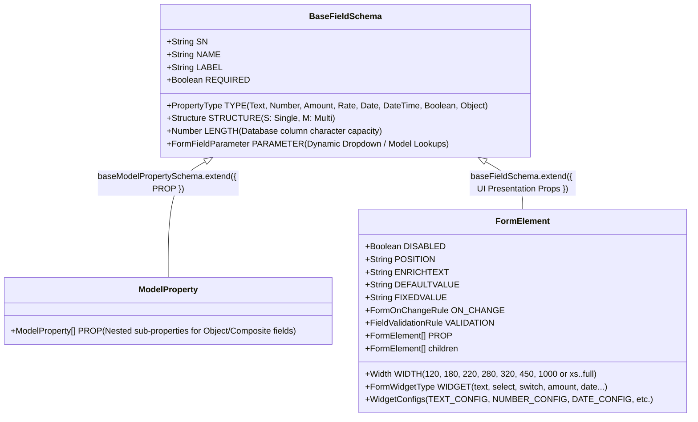
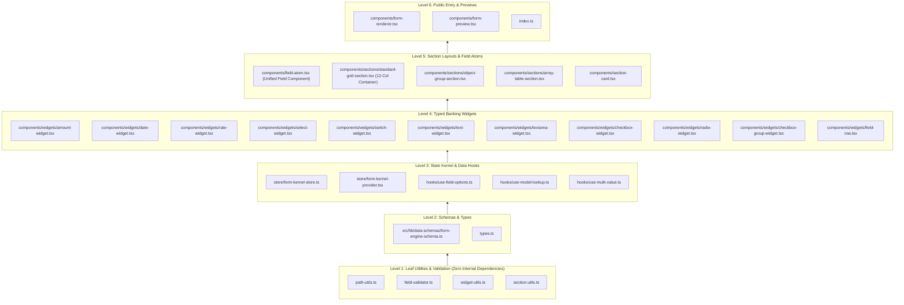

# Janata CBS — Unified Form Engine Developer Guide & Audit Reference

> **Authoritative Specification**: Architecture, Schema Hierarchy, 12-Column Grid Tokens, and Step-by-Step File Audit Dependency Ladder for the unified CBS Form Engine package.

---

## 1. Core Architecture & Philosophy

The Janata CBS Form Engine is a **headless metadata compiler and runtime UI engine** designed for high-density core banking screens.

### Key Tenets:

1. **Zero Legacy**: No backwards-compatibility shims, no magic strings, no ad-hoc pixel widths (`width: 280px`).
2. **Strict Unidirectional Hierarchy**:
   $$\text{MODEL.CONFIG (Database Columns)} \longrightarrow \text{FORM.CONFIG (Layout Overrides)} \longrightarrow \text{Form Engine Runtime (UI)}$$
3. **Pure 12-Column Grid**: All form containers render on a 12-column track (`grid grid-cols-12 gap-x-3 gap-y-2`). Inputs take `w-full` within their cell.
4. **Centralized & DRY**: A single unified field renderer (`FieldAtom`) handles both Kernel-managed isolated states and controlled form inputs.

---

## 2. Schema Inheritance & Metamodel Hierarchy

Both backend database tables and visual forms share a single physical core: `baseFieldSchema`.



---

## 3. The 12-Column Grid & Fallback Resolution Matrix

### Semantic & Fixed Numerical Width Mapping

`MODEL.CONFIG` stores **`LENGTH`** (physical DB size). `FORM.CONFIG` stores **`WIDTH`** (12-column layout width).

When a field is rendered:
$$\text{Explicit Form Config WIDTH} \quad \xrightarrow{\text{fallback}} \quad \text{Infer 12-col span from Model Config LENGTH}$$

| Fixed Width (`WIDTH`) | Semantic Token | Inferred from Physical `LENGTH` |    12-Col Tailwind Class    | Grid Proportion | Primary Banking Use Case                           |
| :-------------------: | :------------: | :-----------------------------: | :-------------------------: | :-------------: | -------------------------------------------------- |
|       **`120`**       |      `xs`      |   `LENGTH <= 6` or `Boolean`    | `col-span-12 md:col-span-2` | 2 of 12 (16.6%) | Currency (`USD`), Branch Code (`JB0001`), Switches |
|       **`180`**       |      `sm`      |    `LENGTH <= 16` or `Date`     | `col-span-12 md:col-span-3` | 3 of 12 (25.0%) | Account No., Routing No., Status tags              |
|       **`220`**       |      `md`      |         `LENGTH <= 25`          | `col-span-12 md:col-span-4` | 4 of 12 (33.3%) | Date Pickers, Nominee Share %, Phone numbers       |
|       **`280`**       |      `md`      | `LENGTH <= 40` or `Amount/Rate` | `col-span-12 md:col-span-4` | 4 of 12 (33.3%) | Standard Amounts, Dropdowns                        |
|       **`320`**       |      `lg`      |         `LENGTH <= 70`          | `col-span-12 md:col-span-6` | 6 of 12 (50.0%) | Customer Name, Branch Title (Half row)             |
|       **`450`**       |      `xl`      |         `LENGTH <= 120`         | `col-span-12 md:col-span-8` | 8 of 12 (66.6%) | Address Line 1, Organization Title                 |
|      **`1000`**       |     `full`     |  `LENGTH > 120` or `textarea`   |        `col-span-12`        | 12 of 12 (100%) | Remarks, Narrative, Textarea, Sub-tables           |

> [!IMPORTANT]
> **No Inline Pixel Widths**: Inputs inside grid cells always use `w-full`. This guarantees crisp, responsive alignments across laptop terminals (1366×768) and high-res monitors (1920×1080+).

---

## 4. Easy Implementation & Usage Endpoints

Developers only interact with clean, high-level components:

### Scenario A: Standard Screen or Dialog (Controlled Mode)

```tsx
import { FormRenderer } from "@/features/form-engine";

export function SimpleUserForm({ values, onChange, errors }) {
  return (
    <FormRenderer
      frmElements={formConfig.frmElements}
      values={values}
      onChange={onChange}
      errors={errors}
    />
  );
}
```

### Scenario B: Full Banking Screen (Isolated Kernel State)

```tsx
import { FormKernelProvider, FormRenderer } from "@/features/form-engine";

export function CustomerScreen({ formConfig, initialData }) {
  return (
    <FormKernelProvider initialValues={initialData}>
      <FormRenderer frmElements={formConfig.frmElements} />
    </FormKernelProvider>
  );
}
```

---

## 5. File-by-File Audit Dependency Ladder

Audit and clean every file **one by one** strictly from the lowest leaf dependency upward:



---

## 6. Audit Checklist by File

### Phase 1: Leaf Utilities & Validation

- [x] **File 1: `utils/path-utils.ts`** — Checked. Pure, safe, immutable nested getters/setters (`getFieldValue`, `setFieldValue`).
- [x] **File 2: `validation/field-validator.ts`** — Checked. Pure regex, required, and length validation.
- [ ] **File 3: `utils/widget-utils.ts`** — Remove `getFieldWidthStyle()` pixel widths (`280px`). Keep `resolveWidgetType()`.
- [ ] **File 4: `utils/section-utils.ts`** — Implement 12-column grid spans & the Authoritative Length Fallback Resolver.

### Phase 2: Schemas & Types

- [ ] **File 5: `src/lib/data-schemas/form-engine-schema.ts`** — Update `propertyWidthSchema` with fixed numbers & semantic tokens.
- [ ] **File 6: `types.ts`** — Consolidate clean public props and types.

### Phase 3: State Kernel & Data Hooks

- [ ] **File 7: `store/form-kernel-store.ts`** — Clean 2-tier keystroke isolation store.
- [ ] **File 8: `store/form-kernel-provider.tsx`** — Context provider with lightweight fallback for controlled mode.
- [ ] **File 9: `hooks/use-field-options.ts`** — Clean dynamic options selector.
- [ ] **File 10: `hooks/use-model-lookup.ts`** — Foreign key lookup hook.
- [ ] **File 11: `hooks/use-multi-value.ts`** — Multi-value (Structure M) array helper.

### Phase 4: Typed Banking Widgets

- [ ] **File 12: `widgets/amount-widget.tsx`** — Enforce right-aligned financial monospace, `w-full`.
- [ ] **File 13: `widgets/date-widget.tsx`** — Calendar popover + keyboard input, `w-full`.
- [ ] **File 14: `widgets/rate-widget.tsx`** — Right-aligned percentage input with suffix, `w-full`.
- [ ] **File 15: `widgets/select-widget.tsx`** — Accessible search & select dropdown, `w-full`.
- [ ] **File 16: `widgets/switch-widget.tsx`** — Compact switch toggle with semantic badges.
- [ ] **File 17: `widgets/text-widget.tsx`** — Text with auto-uppercase/trim, `w-full`.
- [ ] **File 18: `widgets/textarea-widget.tsx`** — Auto-growing banking remarks field, `w-full`.
- [ ] **File 19: `widgets/checkbox-widget.tsx`** — Checkbox toggle.
- [ ] **File 20: `widgets/radio-widget.tsx`** — Compact radio group.
- [ ] **File 21: `widgets/checkbox-group-widget.tsx`** — Multi-checkbox selector.
- [ ] **File 22: `widgets/field-row.tsx`** — Label + Input + Error + EnrichText row wrapper.

### Phase 5: Section Layouts & Field Atoms

- [ ] **File 23: `components/field-atom.tsx`** — Consolidated single field atom.
- [ ] **File 24: `sections/standard-grid-section.tsx`** — Pure `grid grid-cols-12 gap-x-3 gap-y-2`.
- [ ] **File 25: `sections/object-group-section.tsx`** — Nested sub-object 12-col container.
- [ ] **File 26: `sections/array-table-section.tsx`** — High-density array table.
- [ ] **File 27: `components/section-card.tsx`** — Card wrapper with collapsible header.

### Phase 6: Public Entry & Previews

- [ ] **File 28: `components/form-renderer.tsx`** — Orchestrator for tab groups & sections.
- [ ] **File 29: `components/form-preview.tsx`** — Live interactive preview for Form Designer.
- [ ] **File 30: `index.ts`** — Public export facade.

---

## 7. Quality Gates

Every file audit must preserve:

1. `pnpm lint:fix` $\to$ **0 errors, 0 warnings**
2. `pnpm typecheck` $\to$ **0 TypeScript compile errors**
3. `pnpm verify:all` $\to$ **13/13 CBS domain test suites passing 100%**
