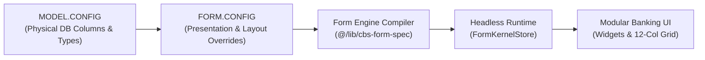
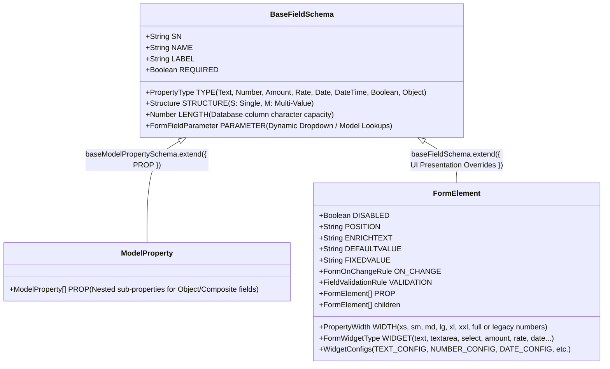
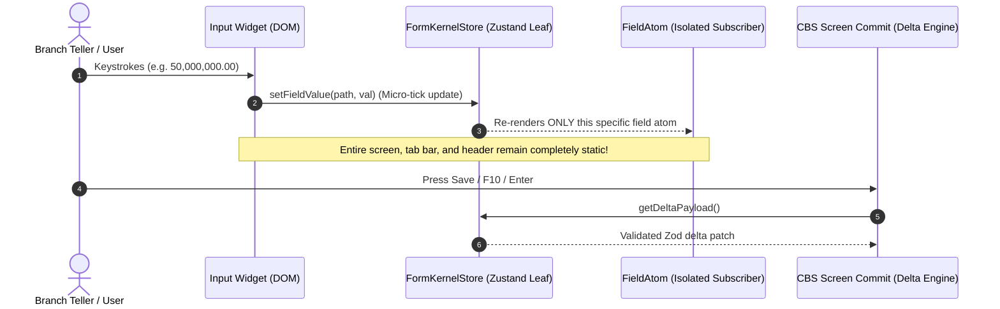
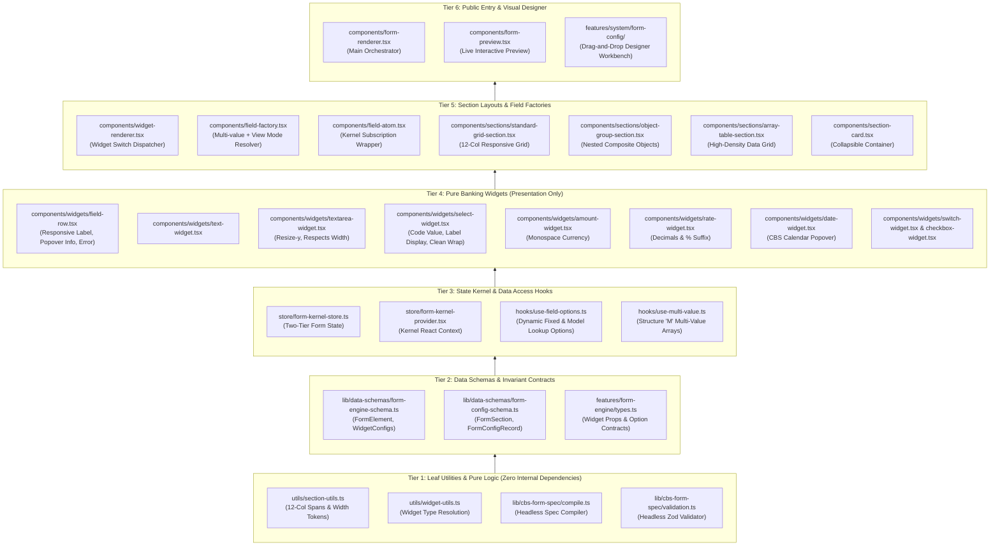

# Janata CBS — Unified Form Engine & Form Designer Master Architecture Guide

> **Authoritative Specification**: Metamodel Inheritance Hierarchy, Unified State Kernel, Responsive 12-Column Grid Tokens, and Step-by-Step Modular Audit Reference for Janata CBS Form Engine.

---

## 1. Executive Summary & Core Pillars

The Janata CBS Form Engine is a **headless, schema-driven metadata compiler and high-density runtime execution engine**. It eliminates scattered, duplicated definitions by strictly enforcing a single source of truth across the entire lifecycle:



### Architectural Invariants:

1. **Zero Redeclarations (DRY)**: Visual forms inherit from database models via `baseFieldSchema`. Visual layouts override _only_ presentation concerns (`WIDTH`, `WIDGET`, `TAB`, `SECTION`).
2. **Strict Modular Boundaries**: Every component $\le 300$ lines, helpers $\le 200$ lines. Clear leaf-to-root dependency direction.
3. **Single Dynamic Field Atom**: Controlled inputs and isolated Kernel-backed keystroke states resolve through the exact same field factory.
4. **Fluid Multi-Resolution Consistency**: Compact desktop density (640px+) switches to full-width stacked touch inputs on mobile (<640px) without breaking 12-column grid integrity.

---

## 2. Metamodel Hierarchy & Schema Unification

Both backend database tables and visual form designs share a single physical core: `baseFieldSchema`.



---

## 3. The 12-Column Responsive Layout Formula

`MODEL.CONFIG` stores **`LENGTH`** (physical DB character capacity). `FORM.CONFIG` stores **`WIDTH`** (12-column track width).

When a field is rendered on screen:
$$\text{Explicit Form Config WIDTH} \quad \xrightarrow{\text{fallback}} \quad \text{Infer 12-Col Span from Model Config LENGTH}$$

### Responsive Width Tokens & Mapping Matrix

| Semantic Token |  Legacy Code  | Inferred from Physical `LENGTH` |       Desktop Grid Span (`>= 640px`)       | Mobile Layout (`< 640px`) | Primary Banking Domain Use Case               |
| :------------: | :-----------: | :-----------------------------: | :----------------------------------------: | :-----------------------: | :-------------------------------------------- |
|    **`xs`**    |     `120`     |   `LENGTH <= 6` or `Boolean`    |  `col-span-12 sm:col-span-2` (`max-w-28`)  |     `w-full` stacked      | Currency (`BDT`), Branch Code, Switches       |
|    **`sm`**    |     `180`     |    `LENGTH <= 16` or `Date`     |  `col-span-12 sm:col-span-3` (`max-w-44`)  |     `w-full` stacked      | Account No, Routing No, Status Code           |
|    **`md`**    | `220` / `280` | `LENGTH <= 40` or `Amount/Rate` |  `col-span-12 sm:col-span-4` (`max-w-72`)  |     `w-full` stacked      | Financial Amounts, Rates, Dropdown Codes      |
|    **`lg`**    |     `320`     |         `LENGTH <= 70`          |  `col-span-12 sm:col-span-6` (`max-w-md`)  |     `w-full` stacked      | Customer Name, Branch Title (Half Row)        |
|    **`xl`**    |     `450`     |         `LENGTH <= 120`         |  `col-span-12 sm:col-span-8` (`max-w-xl`)  |     `w-full` stacked      | Street Address, Organization Title            |
|   **`xxl`**    |       —       |  `LENGTH > 120` (Single-line)   | `col-span-12 sm:col-span-10` (`max-w-2xl`) |     `w-full` stacked      | Long description, Email address               |
|   **`full`**   |    `1000`     | Multi-line `Textarea` / Tables  |          `col-span-12` (`w-full`)          |     `w-full` stacked      | Remarks, Narratives, Audit Logs, Array Tables |

> [!IMPORTANT]
> **Mobile Edge Alignment**: On mobile devices (`< 640px`), every input spans `w-full` on Line 2 beneath its label. On desktop (`>= 640px`), inputs snap back to their compact financial widths adjacent to the fixed 144px (`w-36`) label.

---

## 4. State Lifecycle & Two-Tier Keystroke Isolation

Janata CBS uses a **Two-Tier Form Kernel** to eliminate React re-render thrashing during rapid teller data entry:



---

## 5. Modular Directory Architecture & Audit Dependency Ladder

Every file in the Form Engine belongs to an explicit architectural tier. Audits, refactorings, and reviews must progress **strictly bottom-up**:



---

## 6. Comprehensive File Audit Checklist & Modernization Status

### Tier 1: Leaf Utilities & Pure Logic

- [x] **`utils/section-utils.ts`**
  - Enforces `SEMANTIC_INPUT_WIDTH_CLASSES` with mobile `w-full` and desktop `sm:max-w-*`.
  - Maps physical DB `LENGTH` to canonical semantic tokens.
  - Generates 12-column grid span classes (`col-span-12 sm:col-span-*`).
- [x] **`utils/widget-utils.ts`**
  - Resolves widget type from physical property type, lookup parameter (`M` / `O`), and explicit `WIDGET` override.
- [x] **`lib/cbs-form-spec/compile.ts`**
  - Headless fallback compiler generating standard 12-column sections when no layout exists.
- [x] **`lib/cbs-form-spec/validation.ts`**
  - Headless runtime validator validating mandatory required fields, max length, numeric limits, and dates.

### Tier 2: Schemas & Invariant Contracts

- [x] **`form-engine-schema.ts`**
  - Defines `propertyWidthSchema` supporting fixed numerical codes and semantic strings (`xs` through `full`).
  - Defines `FormWidgetType` and widget configuration sub-schemas.
- [x] **`form-config-schema.ts`**
  - Defines `FormSection`, `FormBlock`, tab groups, zones (`header`, `standard`, `tab`), and container types.
- [x] **`types.ts`**
  - Exports `BaseWidgetProps`, `WidgetOption`, and `UnifiedFieldFactoryProps`.

### Tier 3: State Kernel & Data Hooks

- [x] **`store/form-kernel-store.ts`**
  - Leaf subscription model preventing screen-level re-render thrashing.
- [x] **`store/form-kernel-provider.tsx`**
  - Dual-mode context provider for both isolated Kernel state and external controlled states.
- [x] **`hooks/use-field-options.ts`**
  - Fetches and resolves dynamic dropdown options (Fixed Option Lists and Model Lookups).
- [x] **`hooks/use-multi-value.ts`**
  - Handles multi-value arrays (Structure `M`) with add/remove/reorder operations.

### Tier 4: Pure Banking Widgets

- [x] **`widgets/field-row.tsx`**
  - Desktop: Label on left (`w-36`), colon separator, dotted underline with right hover tooltip (`side="right"`).
  - Mobile: Full-width top row label with touch `<Popover>` help icon (`side="top"`), hidden colon, input on Line 2.
- [x] **`widgets/select-widget.tsx`**
  - Stores strictly item `code` in value/state.
  - Dropdown displays human-readable `label` (with natural text wrapping and `min-w-44 max-w-72`).
  - No redundant inline right-side preview text.
- [x] **`widgets/textarea-widget.tsx`**
  - Vertical-only drag expansion (`resize-y`, `min-h-14`).
  - Strict compliance with configured width parameter.
- [x] **`widgets/amount-widget.tsx`** & **`widgets/rate-widget.tsx`**
  - Financial monospace alignment with currency prefix / percentage suffix.
- [x] **`widgets/date-widget.tsx`**
  - Calendar picker popover with direct ISO keyboard entry.

### Tier 5: Section Layouts & Field Factories

- [x] **`components/widget-renderer.tsx`**
  - Clean `switch (widget)` dispatcher routing to dedicated widget primitives.
- [x] **`components/field-factory.tsx`**
  - Bridges View Mode (`mode="V"`) badge rendering and Edit Mode (`mode="I"`).
- [x] **`components/field-atom.tsx`**
  - Subscribes individual DOM elements to their specific store path.
- [x] **`components/sections/standard-grid-section.tsx`**
  - 12-column grid container mapping fields to responsive spans.
- [x] **`components/sections/array-table-section.tsx`** & **`object-group-section.tsx`**
  - Composite multi-row tables and grouped nested objects.

### Tier 6: Public Entry & Visual Designer

- [x] **`components/form-renderer.tsx`**
  - Top-level screen orchestrator compiling blocks, cards, and tab groups.
- [x] **`features/system/form-config/components/fc-designer-tab.tsx`**
  - Container-aware responsive workbench (`useContainerWidth(960)`).
  - Left offcanvas drawer: Field Palette (Variables / Containers).
  - Center: Drag-and-drop hierarchy canvas with top mobile toolbar.
  - Right offcanvas drawer: Property Inspector (auto-opens on element tap).
- [x] **`features/system/model-config/components/mc-json-tab.tsx`**
  - 3-Way JSON Viewer: **`Raw (DB)`** | **`Changes (+X -Y)`** | **`Output`**.

---

## 7. Developer Usage Reference

### Scenario A: Standard Controlled Form Screen

```tsx
import { FormRenderer } from "@/features/form-engine";

export function BranchSetupScreen({ formConfig, values, onChange, errors }) {
  return (
    <FormRenderer
      frmElements={formConfig.frmElements}
      values={values}
      onChange={onChange}
      errors={errors}
    />
  );
}
```

### Scenario B: High-Throughput Core Banking Screen (Kernel State)

```tsx
import { FormKernelProvider, FormRenderer } from "@/features/form-engine";

export function CustomerAccountScreen({ formConfig, initialData }) {
  return (
    <FormKernelProvider initialValues={initialData}>
      <FormRenderer frmElements={formConfig.frmElements} />
    </FormKernelProvider>
  );
}
```

---

## 8. Quality Verification & Regression Gate

Every modification across the Form Engine hierarchy must pass the 3 mandatory gates:

```bash
pnpm lint:fix         # Biome check: 0 errors, 0 warnings
pnpm typecheck        # Strict TypeScript: 0 errors (tsc --noEmit)
pnpm verify:form-spec # CBS Headless Form Spec & Compiler Engine (10/10 tests clean)
pnpm verify:all       # Master CBS domain test suite (13/13 suites clean)
```
