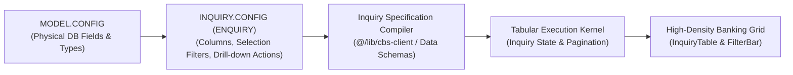
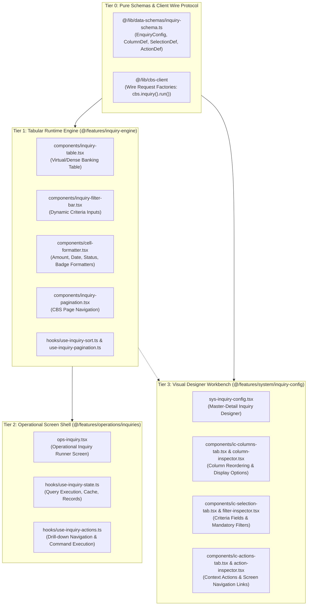

# Janata CBS — Inquiry Engine & Inquiry Config Master Architecture & Audit Guide

> **Authoritative Specification**: Schema Contracts, High-Density Table Grid, Dynamic Filters, Action Dispatcher, and Complete Refactoring Plan for Janata CBS Inquiry Engine (`inquiry-engine`, `inquiry-config`, `ops-inquiry`).

---

## 1. Executive Summary & Core Pillars

Just like the **Form Engine**, the **Inquiry Engine** in Janata CBS is a **headless, schema-driven query compiler, tabular presentation engine, and command gateway**.



### Core Architectural Invariants:

1. **Single Source of Truth**: Inquiry schemas (`enquiryConfigSchema`) inherit column metadata, data types, and parameters from database models (`MODEL.CONFIG`).
2. **Zero Magic Strings**:
   - Filter criteria operators use canonical types (`EQ`, `NE`, `GT`, `GE`, `LT`, `LE`, `LK`, `UL`, `RG`, `NR`).
   - Row action commands route through the **CBS Command Gateway** (`cbsCommand.execute("COMMAND ...")`).
3. **Strict Size Budget**: Every component $\le 300$ lines, every hook/helper $\le 200$ lines.
4. **Fluid Banking Density**: Monospace alignment for amounts and account numbers, compact header sorters, keyboard shortcuts (Page Up/Down, Enter to drill down), and 1366x768 multi-monitor consistency.

---

## 2. Directory Architecture & Layer Dependencies

The Inquiry ecosystem spans three synchronized feature areas:



---

## 3. Comprehensive File Audit & Line Budget Analysis

### A. Inquiry Engine (`src/features/inquiry-engine/`)

| File                                                                                                                           | Current Lines |      Status / Budget       | Refactoring & Audit Task                                                                                                        |
| :----------------------------------------------------------------------------------------------------------------------------- | :-----------: | :------------------------: | :------------------------------------------------------------------------------------------------------------------------------ |
| [`inquiry-table.tsx`](file:///d:/Work/React/cbs/janata-cbs/src/features/inquiry-engine/components/inquiry-table.tsx)           |  **365** ⚠️   | Exceeds Budget ($\le 300$) | **Decompose**: Extract `table-body-rows.tsx` (row rendering, selection state, keyboard navigation) and `table-empty-state.tsx`. |
| [`inquiry-filter-bar.tsx`](file:///d:/Work/React/cbs/janata-cbs/src/features/inquiry-engine/components/inquiry-filter-bar.tsx) |      201      |   Borderline ($\le 200$)   | Extract `filter-criterion-item.tsx` for clean per-field operator inputs.                                                        |
| [`inquiry-preview.tsx`](file:///d:/Work/React/cbs/janata-cbs/src/features/inquiry-engine/components/inquiry-preview.tsx)       |      180      |       Within Budget        | Simplify mock runner preview for the designer workbench.                                                                        |
| [`cell-formatter.tsx`](file:///d:/Work/React/cbs/janata-cbs/src/features/inquiry-engine/components/cell-formatter.tsx)         |      124      |       Within Budget        | Centralize formatters (Amount, Date, Status Badges) delegating to `@/lib/core-utils`.                                           |
| [`inquiry-pagination.tsx`](file:///d:/Work/React/cbs/janata-cbs/src/features/inquiry-engine/components/inquiry-pagination.tsx) |      96       |       Within Budget        | Clean banking density page-size switcher and records counter.                                                                   |
| [`criteria-mapper.ts`](file:///d:/Work/React/cbs/janata-cbs/src/features/inquiry-engine/utils/criteria-mapper.ts)              |      85       |       Within Budget        | Maps UI filter inputs into wire criteria payloads.                                                                              |
| [`column-compiler.ts`](file:///d:/Work/React/cbs/janata-cbs/src/features/inquiry-engine/utils/column-compiler.ts)              |      67       |       Within Budget        | Infers column alignments (Numeric $\to$ right, Date $\to$ center).                                                              |

---

### B. Operational Inquiry Shell (`src/features/operations/inquiries/`)

| File                                                                                                                            | Current Lines | Status / Budget | Refactoring & Audit Task                                                                |
| :------------------------------------------------------------------------------------------------------------------------------ | :-----------: | :-------------: | :-------------------------------------------------------------------------------------- |
| [`ops-inquiry.tsx`](file:///d:/Work/React/cbs/janata-cbs/src/features/operations/inquiries/ops-inquiry.tsx)                     |      196      |  Within Budget  | Wraps `CbsScreenScaffold` variant="inquiry", connecting filter bar, table, and actions. |
| [`use-inquiry-state.ts`](file:///d:/Work/React/cbs/janata-cbs/src/features/operations/inquiries/hooks/use-inquiry-state.ts)     |      186      |  Within Budget  | Manages wire fetch lifecycle, query execution, pagination, and sorting.                 |
| [`use-inquiry-actions.ts`](file:///d:/Work/React/cbs/janata-cbs/src/features/operations/inquiries/hooks/use-inquiry-actions.ts) |      91       |  Within Budget  | Executes drill-down screen commands via `cbsCommand.execute()`.                         |
| [`use-inquiry-schema.ts`](file:///d:/Work/React/cbs/janata-cbs/src/features/operations/inquiries/hooks/use-inquiry-schema.ts)   |      41       |  Within Budget  | Resolves inquiry schema by command code.                                                |

---

### C. Visual Inquiry Designer (`src/features/system/inquiry-config/`)

| File                                                                                                                              | Current Lines |      Status / Budget       | Refactoring & Audit Task                                                                                                                                 |
| :-------------------------------------------------------------------------------------------------------------------------------- | :-----------: | :------------------------: | :------------------------------------------------------------------------------------------------------------------------------------------------------- |
| [`fields.ts`](file:///d:/Work/React/cbs/janata-cbs/src/features/system/inquiry-config/fields.ts)                                  |  **480** ⚠️   | Exceeds Budget ($\le 300$) | **Decompose**: Split large monolithic field definitions into modular sections (`ic-general-fields.ts`, `ic-column-fields.ts`, `ic-selection-fields.ts`). |
| [`ic-selection-tab.tsx`](file:///d:/Work/React/cbs/janata-cbs/src/features/system/inquiry-config/components/ic-selection-tab.tsx) |      285      |       Within Budget        | Reorderable filter list with inspector sync.                                                                                                             |
| [`ic-columns-tab.tsx`](file:///d:/Work/React/cbs/janata-cbs/src/features/system/inquiry-config/components/ic-columns-tab.tsx)     |      233      |       Within Budget        | Reorderable column list with inspector sync.                                                                                                             |
| [`use-inquiry-config.ts`](file:///d:/Work/React/cbs/janata-cbs/src/features/system/inquiry-config/hooks/use-inquiry-config.ts)    |  **224** ⚠️   | Helper Budget ($\le 200$)  | Modularize: Delegate state actions to sub-hooks (`use-ic-column-ops`, `use-ic-filter-ops`).                                                              |
| [`ic-validation.ts`](file:///d:/Work/React/cbs/janata-cbs/src/features/system/inquiry-config/hooks/ic-validation.ts)              |  **221** ⚠️   | Helper Budget ($\le 200$)  | Clean validation rules for inquiry metadata.                                                                                                             |

---

## 4. Step-by-Step Refactoring Order (Following Form Engine Pattern)

### Step 1: Schemas & Wire Contracts Purification

- Audit `src/lib/data-schemas/inquiry-schema.ts` (ensure strict Zod types, zero legacy shims).
- Standardize criteria operators (`EQ`, `LK`, `RG`, `GT`, `LT`) and column types.

### Step 2: Tabular Runtime De-bloating (`inquiry-engine`)

- Break `inquiry-table.tsx` ($\le 300$ lines):
  - Extract `table-body-rows.tsx` for row rendering and click-to-select logic.
  - Extract `table-keyboard-nav.ts` for keyboard row navigation (Arrow Up/Down, Enter).
- Enhance `cell-formatter.tsx` to handle monetary amounts, dates, and account masking consistently using `@/lib/core-utils`.

### Step 3: Operational Screen Shell (`ops-inquiry`)

- Standardize `ops-inquiry.tsx` with `CbsScreenScaffold` (variant="inquiry").
- Ensure export options (CSV, Excel, Print) integrate cleanly through the Command Gateway.
- Drill-down actions trigger `cbsCommand.execute("COMMAND ...")` with zero hardcoded URLs.

### Step 4: Inquiry Designer Workbench (`inquiry-config`)

- Partition `fields.ts` (480 lines) into clean modular sub-schemas.
- Partition `use-inquiry-config.ts` into focused sub-hooks.
- Provide live preview with mock data via `inquiry-preview.tsx`.

### Step 5: Verification Suite

- Add or update `scripts/verify/verify-cbs-inquiry.ts`.
- Run quality gates:

  ```bash
  pnpm lint:fix
  pnpm typecheck
  pnpm verify:all
  ```
