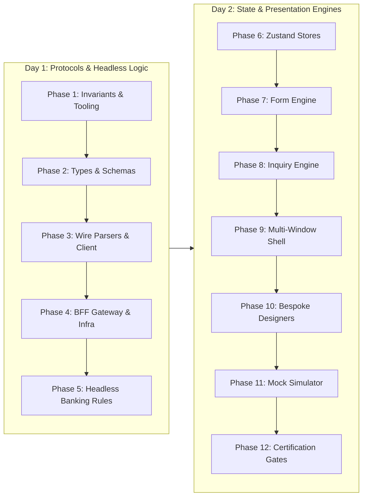

# 🏛️ Janata CBS Workbench — Master Audit & Learning Runbook

> **Audience:** Core banking frontend engineers, tech leads, code auditors, and architecture reviewers.  
> **Timeline:** 2-Day In-Depth Codebase Audit & Mastery Curriculum.  
> **Target Framework:** Next.js 16 (App Router) + React 19 + TypeScript (Strict) + Tailwind CSS v4 + Biome.

---

## 📋 Executive Overview & Audit Rhythm

The Janata CBS Workbench is a presentation layer and Backend-For-Frontend (BFF) connecting web clients to a Java core banking engine. It operates under strict enterprise banking constraints:

1. **Zero Banking Logic in Frontend:** All ledgers, settlement, interest calculations, and postings live in the Java core.
2. **Untrusted Client:** The server proxy never trusts the browser for user identity, branch, or permissions.
3. **Deterministic Layering:** Strictly downward imports (`app` down to `types`/`data-schemas`).
4. **Schema-Driven Presentation:** Screens are not hard-coded; they compile dynamically from Model and Form configurations.

### 2-Day Audit Schedule

| Day       | Focus Areas                                           | Phases      | Core Objective                                                                                                                          |
| :-------- | :---------------------------------------------------- | :---------- | :-------------------------------------------------------------------------------------------------------------------------------------- |
| **Day 1** | **Foundations, Wire Protocols, BFF & Banking Rules**  | Phases 1–5  | Master layer boundaries, Zod contracts, server security, gRPC/Redis infra, and headless banking logic (RIDASHL & Four-Eyes).            |
| **Day 2** | **State, UI Engines, Multi-Window Shell & Simulator** | Phases 6–12 | Master Zustand context stores, dynamic Form & Inquiry engines, detached popups, drag-and-drop designers, and offline mock verification. |



---

## 📅 DAY 1: Foundations, Protocols, BFF & Headless Rules

---

### Phase 1: Project Invariants, Tooling & Architecture Guardrails

**Files to Inspect:**

- `AGENTS.md`
- `.agents/rules/00-core-pillars.md`
- `.agents/rules/01-architecture-layers.md`
- `.agents/rules/02-nextjs-and-react19.md`
- `.agents/rules/03-cbs-domain-security.md`
- `.agents/rules/04-styling-and-tokens.md`
- `package.json`
- `biome.json`
- `tsconfig.json`
- `scripts/verify/verify-layers.ts`

#### 1. What This Subsystem Does

Defines the unbreakable rules of the project. Janata CBS rejects unstructured code growth through automated verification scripts instead of manual code review alone. The layer rank table in `scripts/verify/verify-layers.ts` enforces that high-level code consumes low-level code, never the reverse.

#### 2. Modern React 19 & TypeScript Best Practices

- **Strict Downward Layer Hierarchy:**

  ```text
  app → features → components → hooks → store → lib/cbs-*, core-utils → lib/infra-*, core-config, core-logger, data-parsers → types, data-schemas
  ```

- **Public Barrel Encapsulation:** Every consumer imports through the module's `index.ts` (or `server.ts` for server-only code). Deep imports like `@/lib/cbs-access/record-guard` are prohibited.
- **Size Budgeting:** Components must be $\le 300$ lines (cohesive limit 350); hooks, helpers, and stores $\le 250$ lines (limit 280).
- **Zero Raw Console Logging:** `console.log` is strictly banned in application code to prevent PII leaks. All logging must use `@/lib/core-logger`.

#### 3. Red Flags & Anti-Patterns to Audit

| Anti-Pattern                                                                         | Why It Is Dangerous                                              | Correct Industry Pattern                                                      |
| :----------------------------------------------------------------------------------- | :--------------------------------------------------------------- | :---------------------------------------------------------------------------- |
| Upward import (`src/lib` importing `@/store`)                                        | Creates circular dependencies and breaks modular testability.    | Register an adapter bus (`registerCommandAdapter`) or emit custom events.     |
| Deep internals import (`@/components/cbs-form-engine/components/widgets/text-input`) | Couples callers to private implementation details.               | Import from public barrel (`@/components/cbs-form-engine`).                   |
| Unsafe type assertions (`as any` or `!` non-null)                                    | Defeats TypeScript strict mode; causes runtime crashes.          | Use Zod `.safeParse()` or exhaustive type guards.                             |
| Hardcoded CSS colors (`bg-[#002244]`, `text-blue-600`)                               | Breaks semantic theming and branch terminal high-contrast modes. | Use semantic OKLCH tokens (`bg-primary`, `text-foreground`, `border-border`). |

#### 4. Audit Exercise & Command

```bash
# Verify all layer ranks and barrel exports are 100% compliant
pnpm verify:layers
```

---

### Phase 2: Domain Schemas, Type Contracts & Validation

**Files to Inspect:**

- `src/types/access.ts`
- `src/types/status.ts`
- `src/types/screen.ts`
- `src/types/command.ts`
- `src/types/payload.ts`
- `src/lib/data-schemas/access-schema.ts`
- `src/lib/data-schemas/command-schema.ts`
- `src/lib/data-schemas/form-config-schema.ts`
- `src/lib/data-schemas/inquiry-config-schema.ts`
- `src/lib/data-schemas/model-config-schema.ts`
- `src/lib/data-schemas/wire-schema.ts`

#### 1. What This Subsystem Does

Acts as the single source of truth for all banking domain types and runtime validation contracts. Uses **Zod 4** to validate every payload entering the system from the network, storage, URL query strings, or cross-window messages. TypeScript types are derived directly from schemas via `z.infer<typeof schema>`.

#### 2. Key Banking Concepts

- **RIDASHL Matrix (`src/types/access.ts`):** The 7 fundamental core-banking record functions:
  - `R` — Reverse (cancel an authorized transaction with audit trail)
  - `I` — Input (enter new draft or edit unapproved record)
  - `D` — Delete (remove an unapproved draft)
  - `A` — Authorize (checker approval committing transaction to core)
  - `S` — See (view record in inquiry mode)
  - `H` — Hold (park a transaction temporarily)
  - `L` — List (query multiple records)
- **Record Statuses (`src/types/status.ts`):** `New Draft`, `Pending Approval` (Unauthorized / UNA), `Authorized` (Live / AU), `Held`, `Reversed`, `Deleted`.

#### 3. Modern React 19 & TypeScript Best Practices

- **No Naked Type Casts at Trust Boundaries:** Never cast query params or storage items (e.g. `searchParams.get("mode") as CbsScreenMode`). Always validate with `cbsScreenModeSchema.safeParse(...)`.
- **Loose Objects for Core Payloads:** Core banking payloads may include auxiliary flags. Use `z.looseObject({...})` so unexpected backward-compatible backend fields do not fail validation.

#### 4. Audit Exercise & Command

```bash
# Run the schema verification suite
pnpm verify:schemas
```

---

### Phase 3: Wire Parsers, Envelopes & Network Boundary

**Files to Inspect:**

- `proto/service.proto`
- `src/lib/infra-grpc/generated/`
- `src/lib/data-parsers/` (`inquiry-parser.ts`, `form-config-parser.ts`, `model-config-parser.ts`, `menu-parser.ts`)
- `src/lib/cbs-client/` (`payloads/`, `transport/proxy-client.ts`, `client.ts`)

#### 1. What This Subsystem Does

- `proto/service.proto`: Defines the gRPC Protobuf contract with the Java core. Generated code in `src/lib/infra-grpc/generated/` must never be hand-edited (regenerate via `pnpm proto:gen`).
- `data-parsers`: Normalizes raw core banking responses into clean, typed UI models. Handles legacy field conventions (such as `1_1` sub-indexes) in one place.
- `cbs-client`: Typed frontend request client. All UI components call `cbs.send(payload)` or `cbsAuth.*`. Direct `fetch()` calls in components or hooks are forbidden.

#### 2. Request Envelope Standards

- **Mutations:** Wrapped in `useIdempotentSend().sendMutation()`, which automatically generates and attaches a UUIDv4 idempotency key to prevent double posting.
- **Error Handling:** Failures produce exactly one toast notification managed centrally by `cbs.send()`. UI components do not display duplicate error alerts.

#### 3. Red Flags & Anti-Patterns to Audit

| Anti-Pattern                                | Why It Is Dangerous                                                                | Correct Industry Pattern                                                        |
| :------------------------------------------ | :--------------------------------------------------------------------------------- | :------------------------------------------------------------------------------ |
| Hand-editing `generated/` Protobuf files    | Any regeneration with `pnpm proto:gen` will overwrite manual edits.                | Modify `proto/service.proto` and run `pnpm proto:gen`.                          |
| Direct `fetch()` inside a component or hook | Bypasses CSRF protection, error normalization, idempotency, and session injection. | Use `cbs.send(...)` from `@/lib/cbs-client`.                                    |
| Throwing raw unhandled exceptions in UI     | Leads to unhandled React error boundary crashes.                                   | Use structured result objects `{ success: boolean, data?: T, error?: string }`. |
| Using `z.looseObject` on client input       | Accepts arbitrary or tampered fields (e.g. `selectFieldType`) from the browser.    | Keep boundary schema strict; transform/enrich payloads on the server proxy.     |

> [!IMPORTANT]
> **Active Audit Case Study: Inquiry Redundant Data & Page Sizing**  
> In recent commit `ed2c15a1` (`chore(inquiry-extra):revised the inq payload added redundant data passing`), two architectural drifts occurred:
>
> 1. **Schema Boundary Weakening:** Changing `inquiryOperatorCriterionSchema` from `.strict()` to `.looseObject()` in `src/lib/data-schemas/inquiry-config-schema.ts` allows the browser to send arbitrary keys (failing `verify:schemas` test 10d). If backend microservices require the field name duplicated as a direct key (e.g. `{ selectFieldName: "ACCOUNT.NO", "ACCOUNT.NO": "1002345" }`), this transformation belongs in `src/app/api/_lib/inquiry.ts` before dispatching to the core, rather than relaxing trust at the API boundary.
> 2. **Inquiry Page Cap vs. Client Pagination:** Changing `perPage: INQUIRY_MAX_ROWS` (5000) to `perPage: inquiryPageSize(info)` (30) in `src/app/api/_lib/inquiry.ts` causes `verify:grpc` test 5.1 to fail. Janata CBS uses client-side pagination in `useInquiryPagination`; clamping the envelope fetch to 30 rows at the BFF restricts the total record set retrieved for the browser table.

#### 4. Audit Exercise & Command

```bash
pnpm verify:parsers
pnpm verify:client
```

---

### Phase 4: Server-Side BFF, Security, Sessions & Infrastructure

**Files to Inspect:**

- `src/proxy.ts` (Edge session guard)
- `src/app/api/proxy/route.ts` (Canonical BFF proxy)
- `src/app/api/login/route.ts`
- `src/app/api/logout/route.ts`
- `src/app/api/session/route.ts`
- `src/app/api/change-password/route.ts`
- `src/app/api/cache/route.ts`
- `src/lib/infra-grpc/dispatch.ts`
- `src/lib/infra-grpc/client.ts`
- `src/lib/infra-redis/cache.ts`
- `src/lib/infra-redis/redis-client.ts`

#### 1. What This Subsystem Does

The Backend-for-Frontend (BFF) layer is the security gatekeeper:

- **Session Protection:** Sessions live in Redis on the server; the browser receives only an `httpOnly`, `secure`, `sameSite: strict` session cookie.
- **Proxy Pipeline (`/api/proxy`):**
  1. Validates session cookie (returns `401 Unauthorized` if invalid).
  2. Parses request body with `cbsWirePayloadSchema.safeParse()`.
  3. Verifies user record rights (`verifyUserRecordAccess`) and clearance levels.
  4. Injects authenticated `userId` and `branchCode` from the server session (ignores any client-submitted identity).
  5. Checks Redis read-through cache for deterministic queries (`INQ`, `MODEL`, `CONFIG`).
  6. Dispatches to Java core (gRPC) or mock simulator (`DATA_SOURCE=static`).
  7. Decodes response once and invalidates related cache entries on mutations.

#### 2. Next.js 16 App Router Invariants

- **`cookies()`, `headers()`, `params`, and `searchParams` are Promises.** They **must** be awaited before reading properties:

  ```typescript
  // Next.js 16 compliant
  const cookieStore = await cookies();
  const sessionToken = cookieStore.get("cbs_session")?.value;
  ```

- **`"server-only"` Enforcement:** Files touching `@grpc/grpc-js` or `ioredis` import `"server-only"` at the top line to prevent bundling backend code into the client.

#### 3. Audit Exercise & Command

```bash
pnpm verify:grpc
pnpm verify:redis
```

---

### Phase 5: Headless Banking Rule Engines

**Files to Inspect:**

- `src/lib/cbs-access/` (`access-evaluator.ts`, `record-guard.ts`, `zero-auth-guard.ts`)
- `src/lib/cbs-record/` (`record-diff.ts`, `record-state.ts`, `status-transition.ts`)
- `src/lib/cbs-command/` (`engine/`, `registry/`, `executor/`)
- `src/lib/cbs-screen/` (`action-bar.ts`, `workbench-bus.ts`, `screen-resolver.ts`)
- `src/lib/core-utils/` (`cbs-storage.ts`, `formatting.ts`, `id-generator.ts`)
- `src/lib/core-logger/` (`logger.ts`, `redactor.ts`)

#### 1. What This Subsystem Does

- **`cbs-access` (Four-Eyes & Permissions):**
  - Evaluates whether an operator has RIDASHL rights for the record.
  - Enforces the **Four-Eyes (Maker-Checker)** principle: If `currentUserId === recordInputter`, the Authorization button (`A`) is strictly disabled with the message: _"Four-Eyes Compliance: The Maker/Inputter cannot authorize their own transaction."_
- **`cbs-record` (Delta Mutations):**
  - Compares original record with user modifications (`diffRecord`).
  - Emits only changed fields to minimize payload size and avoid race-condition overwrites.
- **`cbs-command` (Command Grammar):**
  - Parses bank command grammar: `CONTROL FUNCTION RECORD_ID` (e.g. `ACCOUNT I 1001`).
  - Resolves aliases (e.g. `CUST` $\rightarrow$ `CUSTOMER.INFO`).
  - Connects to the UI store via `registerCommandAdapter`.
- **`core-logger` (PII Redaction):**
  - Automatically masks customer PAN/card numbers, passwords, national IDs, and JWT tokens before logging.

#### 2. Audit Exercise & Command

```bash
pnpm verify:access
pnpm verify:record
pnpm verify:command
pnpm verify:logger
pnpm verify:utils
```

---

## 📅 DAY 2: State, UI Engines, Shell & Production Certification

---

### Phase 6: Global & Local State Management

**Files to Inspect:**

- `src/store/session/` (`session-store.ts`, `session-provider.tsx`)
- `src/store/workbench/` (`workbench-store.ts`, `workbench-provider.tsx`)
- `src/store/alert/` (`alert-store.ts`, `alert-provider.tsx`)
- `src/store/index.ts`
- `src/hooks/use-single-tab.ts`
- `src/hooks/use-idle-timeout.ts`

#### 1. What This Subsystem Does

Implements UI state using **Zustand 5** vanilla stores scoped through React 19 Context Providers. This guarantees:

- SSR safety (no leaking state across concurrent server requests).
- Complete isolation between separate workbench popups or testing environments.
- Granular subscription to store slices via selectors to prevent unnecessary re-renders.

#### 2. Modern React 19 / Zustand 5 Best Practices

- **Selector Subscriptions:** Always select primitive values or use shallow equality:

  ```typescript
  // Correct: Only re-renders when activeTabId changes
  const activeTabId = useWorkbenchStore((state) => state.activeTabId);

  // Anti-Pattern: Re-renders on any store update!
  const { activeTabId } = useWorkbenchStore();
  ```

- **Local Keystroke Buffering:** Field-level edits in large forms (100+ fields) are kept local to the field widget and synced upstream on blur/debounce, rather than pushing every keystroke into global state.

#### 3. Audit Exercise

Inspect `src/store/workbench/workbench-store.ts` and verify all mutation actions use immutable updates without mutating draft objects in-place.

---

### Phase 7: Dynamic Form Presentation Engine

**Files to Inspect:**

- `src/lib/cbs-form-spec/` (`compile.ts`, `layout-grid.ts`, `validation.ts`)
- `src/components/cbs-form-engine/`
  - `components/form-renderer.tsx`
  - `components/field-grid.tsx`
  - `components/field-row.tsx`
  - `components/containers/card-container.tsx`
  - `components/containers/tab-group-container.tsx`
  - `components/widgets/` (`amount-input.tsx`, `date-picker-input.tsx`, `rate-input.tsx`, `select-input.tsx`, `text-input.tsx`)
- `src/features/operations/forms/ops-form.tsx`

#### 1. What This Subsystem Does

Compiles raw JSON specifications (`Model Config` for data attributes + `Form Config` for visual arrangement) into a rendered banking form.

- Supports arbitrary root ordering: independent fields, card containers, and tab groups in any sequence.
- Applies standard banking 12-column responsive layout (`col-span-1` through `col-span-12`).
- Renders typed domain inputs: currency amounts with monetary formatting and monospace fonts, percentage rates, calendar pickers, and model lookup popups.

#### 2. Audit Checklist & Anti-Patterns

- [ ] No hardcoded form layouts for operational screens (only `OpsForm` rendering compiled specs).
- [ ] Monetary amounts always format with `font-mono` and explicit currency symbols.
- [ ] Mandatory fields display clear visual asterisks and pass client validation before submit.

#### 3. Audit Exercise & Command

```bash
pnpm verify:form-spec
```

---

### Phase 8: Dynamic Inquiry Engine & Filters

**Files to Inspect:**

- `src/lib/cbs-inquiry-spec/` (`column-compiler.ts`, `criteria-mapper.ts`)
- `src/components/cbs-inquiry-engine/`
  - `components/inquiry-table.tsx`
  - `components/inquiry-filter-bar.tsx`
  - `components/filters/filter-criterion-row.tsx`
  - `components/pagination/inquiry-pagination.tsx`
  - `hooks/use-inquiry-runner.ts`
  - `hooks/use-inquiry-sort.ts`
- `src/features/operations/inquiries/ops-inquiry.tsx`

#### 1. What This Subsystem Does

Renders searchable, paginated, and sortable banking ledgers from inquiry configurations.

- Dynamic filter criteria bar supporting complex operands (`EQ`, `LK`, `GT`, `LT`, `BW`, `NE`).
- Row-level banking actions (e.g. clicking an account row executes `ACCOUNT S <ACCOUNT_ID>` to open the account view in a new tab).
- Client-side data export to CSV, HTML, and XML formats directly from the table toolbar.

#### 2. Audit Exercise & Command

```bash
pnpm verify:inquiry
```

---

### Phase 9: Multi-Tab Workbench & Detached Popups

**Files to Inspect:**

- `src/features/workbench/dashboard/` (Panel mode tabs)
- `src/app/(workbench)/screen/[id]/` (Detached window mode)
- `src/features/workbench/standalone-screen.tsx`
- `src/components/layout/workbench-shell.tsx`
- `src/lib/cbs-screen/workbench-bus.ts`

#### 1. What This Subsystem Does

Allows bank tellers to operate with maximum workstation flexibility:

- **Panel Mode:** Multiple tabs open inside the main dashboard shell.
- **Window Mode:** A user can pop out any tab into a standalone browser window (`/screen/[id]`).
- **State Synchronization:**
  - Active draft state transfers via `sessionStorage` (keyed by unpredictable `tabId`), never in URL query strings.
  - Windows synchronize focus and tab close actions over `BroadcastChannel` (`CBS_SCREEN_MESSAGE`).
  - Origin verification (`e.origin === window.location.origin`) protects cross-window communication.
  - Single-tab coordinator enforces that only the main shell window runs the idle session timeout.

#### 2. Audit Exercise & Command

```bash
pnpm verify:screen
```

---

### Phase 10: System Designers & Bespoke Screens

**Files to Inspect:**

- `src/features/system/form-config/` (Visual Form Designer with `@dnd-kit`)
- `src/features/system/inquiry-config/` (Visual Inquiry Builder)
- `src/features/system/model-config/` (Metamodel Dictionary Editor)
- `src/features/system/menu-designer/` (Navigation Tree Editor)
- `src/features/workbench/registry.tsx` (`BESPOKE_SCREENS`)
- `src/features/auth/` (Login & Change Password flows)

#### 1. What This Subsystem Does

The system designers are the only visual screens authored with custom, hand-crafted layouts. They allow bank administrators to visually drag-and-drop fields, configure validation rules, build inquiry queries, and arrange menu navigation trees without writing code.

- Registered explicitly in `BESPOKE_SCREENS` inside `src/features/workbench/registry.tsx`.
- Uses `@dnd-kit` for accessible, performant drag-and-drop canvas manipulation.

#### 2. Audit Checklist

- [ ] Every bespoke screen must be registered in `BESPOKE_SCREENS` and `MASTER_COMMAND_DEFINITIONS`.
- [ ] Drag-and-drop interactions handle keyboard accessibility and clean item reordering.

---

### Phase 11: In-Memory Core Banking Simulator

**Files to Inspect:**

- `mock/core/index.ts`
- `mock/core/database-router.ts`
- `mock/core/handlers/` (`query-handler.ts`, `mutation-handler.ts`, `inquiry-handler.ts`, `model-handler.ts`, `menu-handler.ts`)
- `mock/db/` (`SC_USER.ts`, `SC_CONTROL.ts`, `AC_ACCOUNT.ts`, `CUST_CUSTOMER.ts`, etc.)

#### 1. What This Subsystem Does

Enables 100% offline development and deterministic unit testing without requiring a live Java backend or Redis server.

- Intercepts requests when `DATA_SOURCE=static`.
- Implements realistic banking responses, errors, and validation rules.
- Contains fixture tables matching real core banking table structures.

#### 2. How to Add a New Offline Banking Screen

1. Add table definition in `mock/db/` (e.g. `FX_TRADE.ts`) and export from `mock/db/index.ts`.
2. Register the table in `CBS_PHYSICAL_TABLES` in `mock/core/database-router.ts`.
3. Add model definition in `mock/db/SC_MODEL_CONFIG.ts`.
4. Add layout definition in `mock/db/SC_FORM_CONFIG.ts`.
5. Add control entry in `mock/db/SC_CONTROL.ts` and menu node in `mock/db/SC_MENU_TREE.ts`.

#### 3. Audit Exercise & Command

```bash
pnpm verify:mock
```

---

### Phase 12: Production Quality Gates & Certification

**Files to Inspect:**

- `scripts/verify/verify-all.ts`
- `scripts/verify/verify-*.ts` (all 16 offline suites)
- `knip.json` (or package configuration)

#### 1. The Quality Gate Standard

Every pull request or release candidate must pass all 4 production gates:

1. **Linter & Formatter Gate:** `pnpm lint` (Biome, 0 errors, 0 warnings).
2. **TypeScript Strict Gate:** `pnpm typecheck` (`tsc --noEmit`, 0 type errors).
3. **Master Verification Runner:** `pnpm verify:all` (all 16 suites PASS).
4. **Dead Code Elimination:** `pnpm knip` (0 orphaned exports, files, or unused packages).

#### 2. Master Verification Command

```bash
# Run the complete test and certification battery
pnpm lint && pnpm typecheck && pnpm verify:all
```

---

## 🏁 Summary Checklist for the 2-Day Audit

Use this checklist to track your progress as you complete each phase:

- [ ] **Day 1 / Phase 1:** Invariants, Ranks & Tooling verified (`pnpm verify:layers`)
- [ ] **Day 1 / Phase 2:** Domain Schemas & Zod validation audited (`pnpm verify:schemas`)
- [ ] **Day 1 / Phase 3:** Client Wire Protocol & Parsers audited (`pnpm verify:parsers`, `pnpm verify:client`)
- [ ] **Day 1 / Phase 4:** Server Proxy, Auth & `"server-only"` boundary audited (`pnpm verify:grpc`, `pnpm verify:redis`)
- [ ] **Day 1 / Phase 5:** Headless Banking Rules & Four-Eyes audited (`pnpm verify:access`, `pnpm verify:record`, `pnpm verify:command`, `pnpm verify:logger`, `pnpm verify:utils`)
- [ ] **Day 2 / Phase 6:** Zustand 5 Context Stores & Performance audited
- [ ] **Day 2 / Phase 7:** Dynamic Form Presentation Engine audited (`pnpm verify:form-spec`)
- [ ] **Day 2 / Phase 8:** Inquiry Engine & Filters audited (`pnpm verify:inquiry`)
- [ ] **Day 2 / Phase 9:** Multi-Tab Shell & Detached Popups audited (`pnpm verify:screen`)
- [ ] **Day 2 / Phase 10:** Bespoke Screens & Visual Designers audited
- [ ] **Day 2 / Phase 11:** Offline Simulator & Tables audited (`pnpm verify:mock`)
- [ ] **Day 2 / Phase 12:** Full Quality Gate Certification passed (`pnpm verify:all`)
