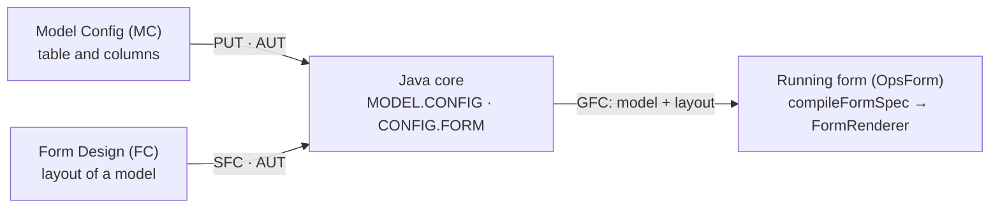
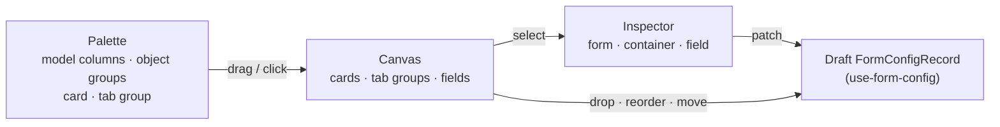
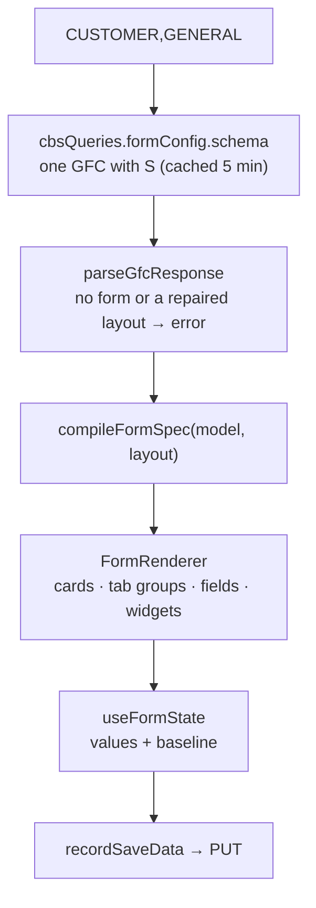
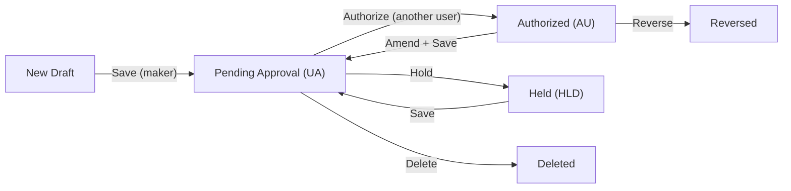

# Model Config & Form Config: How They Work

This page teaches how the Workbench builds its data screens: how a table is described (**Model Config**), how its screen is laid out (**Form Config**), and how the two meet when an operator opens a form. Read it top to bottom once; afterwards use sections 9 to 11 as a reference.

> [!NOTE]
> Source files are named as code paths (they don't open inside the portal). Most `src/lib` units and engines also have a `README.md` next to the code with the finer detail.

---

## 1. Why the screens are built from configuration

The Workbench doesn't hand-code banking screens. The core stores two kinds of configuration record, and the Workbench draws a screen from them at runtime:

| Record                               | Control table  | Says                                             | Edited in           |
| ------------------------------------ | -------------- | ------------------------------------------------ | ------------------- |
| **Model** (`ModelConfigRecord`)      | `MODEL.CONFIG` | **What** the data is: the table and its columns  | Model Config (`MC`) |
| **Form layout** (`FormConfigRecord`) | `CONFIG.FORM`  | **How** it looks: sections, cards, tabs, widgets | Form Design (`FC`)  |

Adding a screen is therefore a data change, not a code change: define the model, design the layout, authorize both, and the screen exists under its command.



---

## 2. The two records

### The model

```text
ModelConfigRecord               (record ID = model key, e.g. BRANCH)
├── TABLENAME, PREFIX, DESCRIPTION
├── ACCESS  G (global) | B (per branch)
├── SERVICEPATH  default | finxurm …        which backend owns the table
├── AUTHLEVEL  0-9                           0 = saved and authorized in one step
├── USERDEFINEID, SEARCHABLE, READONLY, ASSOCIATES
├── IDDEF { IDPREFIX, IDPATTERN, SEQUENCELENGTH, SEQUENCERESET, SEQRESETPERIOD }
├── PROPERTIES[]                             the columns
│     └── { SN, NAME, TYPE, STRUCTURE (S|M), LENGTH, REQUIRED, MODELNAME, PROP[] }
│           TYPE: String · Number · Boolean · Date · DateTime · Time · Array
│           PROP: the sub-columns of an Array column (an "object group" on a form)
└── auditData { recStatus, recInputter, recAuthorizer, recCurrNumber … }   stamped by the core
```

### The form layout

```text
FormConfigRecord                (record ID = MODEL,VERSION, e.g. CUSTOMER,GENERAL)
├── title, description, authNumber
├── frmRoutine { rtnValidate[], rtnBeforeAuth[], rtnAfterAuth[] }
├── frmElements
│     ├── layout  horizontal | stacked,  density  compact | normal | spacious
│     └── sections[]
│           ├── id, title, containerType card | tab, groupId, groupTitle
│           ├── columns 1-4, collapsible, containerConfig
│           └── fields[]  FormElement
│                 ├── copied from the model: SN, NAME, TYPE, LENGTH, STRUCTURE, REQUIRED, MODELNAME
│                 ├── look: LABEL, WIDGET, WIDTH, ENRICHTEXT, DEFAULTVALUE, FIXEDVALUE, *_CONFIG
│                 ├── options: PARAMETER { type O | M | A, data, modelName, condition … }
│                 ├── rules: VISIBLE_WHEN, DISABLED_WHEN, CASCADE, ON_CHANGE, TRANSFORM, VALIDATION
│                 └── PROP[]  inner fields of an object group
└── auditData
```

`CUSTOMER` and `CUSTOMER,` read the base form `CUSTOMER`; `CUSTOMER,V2` reads only that version. The part before the comma is the **model key**: caches, copy/paste and running forms use it, never `TABLENAME` (which can differ, e.g. model `USER.MGT` has table `USER_MGT`).

### Who decides what

When a form runs, the model is the authority on facts and the layout on presentation:

| The model decides (wins at runtime)                                 | The layout decides                                    |
| ------------------------------------------------------------------- | ----------------------------------------------------- |
| Which fields exist: a layout field the model lacks is left out      | Label, widget, width, help text, default, fixed value |
| `TYPE` and `LENGTH`                                                 | Sections, cards, tabs, order, columns                 |
| `REQUIRED` (the model's or the layout's, whichever is true)         | Options and lookups, rules, layout and density        |
| `STRUCTURE`: a layout may narrow `M` to `S`, never widen `S` to `M` |                                                       |

---

## 3. Where the code lives

Imports only point downward (`pnpm verify:layers` enforces it). The pieces of these two modules, by layer:

| Layer                                     | Model Config                                                                                      | Form Config                                                                |
| ----------------------------------------- | ------------------------------------------------------------------------------------------------- | -------------------------------------------------------------------------- |
| Screen (`src/features/system`)            | `model-config/` (`SysModelConfig`)                                                                | `form-config/` (`SysFormConfig`)                                           |
| Running form                              | —                                                                                                 | `src/features/operations/forms/` (`OpsForm`)                               |
| Engine (`src/components`)                 | `cbs-form-engine` draws the MC tabs and inspector                                                 | `cbs-form-engine` draws running forms and the FC tabs and inspectors       |
| Compiler (`src/lib`)                      | —                                                                                                 | `cbs-form-spec` (`compileFormSpec`, rules, validation, lookups, paths)     |
| Wire (`src/lib/cbs-client`)               | `cbs.modelConfig`, `cbsQueries.modelConfig`                                                       | `cbs.formConfig` (GFC / SFC), `cbsQueries.formConfig.schema`               |
| Cleaning (`src/lib/data-parsers`)         | `model-config-parser.ts`                                                                          | `form-config-parser.ts`, `form-config-serializer.ts`                       |
| Shapes and rules (`src/lib/data-schemas`) | `model-config-schema.ts`, `model-config-save-schema.ts`                                           | `form-config-schema.ts`, `form-engine-schema.ts`, `form-widget-schema.ts`  |
| Rights (`src/lib/cbs-access`)             | `evaluateCbsAccess`, `recordFunctionOfMode`, `isRecordMaker` (shared by every screen)             |                                                                            |
| Server (`src/app/api`)                    | `proxy/route.ts`, `_lib/record-guards.ts`, Redis cache in `src/lib/infra-redis/cache.ts` (shared) |                                                                            |
| Offline core (`mock/`)                    | `mock/db/SC_MODEL_CONFIG.ts`                                                                      | `mock/db/SC_FORM_CONFIG.ts`, GFC in `mock/core/handlers/model-handlers.ts` |

Every designer screen has the same inner shape, worth recognising once:

```text
sys-<x>.tsx          tabs + CbsScreenScaffold (action bar, Authorize/Reverse, copy/paste)
hooks/use-<x>.ts     the brain: load, validate, wire the other hooks together
hooks/use-<x>-persistence.ts   useCbsPersistence: values, baseline, dirty, tab restore
hooks/use-<x>-actions.ts       Save · Authorize · Hold · Delete · Reverse
hooks/<x>-validation.ts        save-schema issues → tab and field errors
fields/*.ts          the screen's own forms, drawn by FormRenderer
components/*         the tabs and panes
```

---

## 4. Model Config, step by step

### 4.1 Open and load

1. The operator types `MC BRANCH`. `MC` is an alias of `MODEL.CONFIG` (`src/lib/cbs-command/registry/catalog.ts`); `resolveScreen()` finds it in `BESPOKE_SCREENS` (`src/features/workbench/registry.tsx`). The record ID reaches the screen from the workbench tab, not from the command.
2. `useModelConfig().fetchRecord(id, mode)` reads with a plain **GET** on `MODEL.CONFIG` (`cbsQueries.modelConfig.record`). The record function is the mode's (`recordFunctionOfMode`): See reads the live copy, Authorize the pending copy it acts on.
3. A model the core reports missing (`ModelConfigNotFoundError`) opens a new draft in Input mode, or "Model Not Found" in any other mode. Any other failure shows "Model Could Not Be Loaded" and keeps the screen as it was, so an outage never becomes a blank draft that could be saved over a real model.
4. The loaded record (`rawRecord`) is kept as **the saved copy**: the saved-column rules compare against it.

### 4.2 Edit

- **General tab** (`fields/mc-general-fields.ts`): table, prefix, access, service, authorization level 0-9, ID rules. Table name and prefix lock once saved.
- **Properties tab**: a column list and an inspector (`use-mc-property-ops.ts`). New columns get the next free `SN`.
- **Saved columns are append-only**, because stored rows depend on them: name, type, structure and linked model are locked, a saved column can't be removed, `LENGTH` may only grow, and an optional column can't become required.
- With **User Defined ID** on, the `IDDEF` fields are disabled but keep their values and are saved. That is intended: the core ignores them for a user-defined ID.

### 4.3 Validate and save

`validateModelConfig(formData, rawRecord)` (`hooks/mc-validation.ts`) runs two checks and points every issue at its tab and column:

1. `modelConfigSaveSchema`: uppercase table name, `G`/`B`, a service name, auth level 0-9, a numeric sequence length, at least one column, and per column unique names, a positive length, a well-formed `MODELNAME` (String or Number only), at least one sub-column on `Array`, no nested `Array`.
2. `savedModelIssues(next, saved)`: the append-only rules above.

Save then cleans the record (`sanitizeModelConfigRecord`) and sends **PUT** through `sendMutation()` (which adds the idempotency key). On success the screen tells other windows (`broadcastRecordMutation`), clears the browser caches of this model and of every form schema, and returns to idle.

### 4.4 Lifecycle actions

| Action    | Request                       | Needs right | After success         |
| --------- | ----------------------------- | ----------- | --------------------- |
| Save      | `PUT` with `I`                | `I`         | idle                  |
| Authorize | `AUT` with `A`                | `A`         | idle                  |
| Hold      | `HLD` with `H`, **the draft** | `H`         | reloads the held copy |
| Delete    | `PUT` with `D`                | `D`         | idle                  |
| Reverse   | `REV` with `R`                | `R`         | reloads               |

---

## 5. Form Config, step by step

### 5.1 Open and load

1. `FC CUSTOMER,GENERAL` opens `SysFormConfig` the same way.
2. `useFormConfig().fetchRecord(id, mode)` sends **GFC** with the mode's record function. The core answers with **one** record: the model's columns plus a `FORMCONTROL` key holding the stored layout.
3. `parseGfcResponse()` (`src/lib/data-parsers/form-config-parser.ts`) splits them:
   - the model half is checked with `modelConfigRecordSchema` (falling back to a partial check, so the palette still loads);
   - the layout half is read **leniently**: each part that fails `formConfigRecordSchema` is dropped and listed in `repairs`, then the layout is cleaned;
   - `isNew` is true only when `FORMCONTROL` is empty, so a stored layout (even one holding only a description) is never replaced by a blank draft.
4. A repaired layout opens with a "Stored Layout Repaired" warning; saving stores the clean version. A form with no layout opens a new draft in Input mode, or "Form Not Found" otherwise.

### 5.2 The designer

The Designer tab is three panes sharing one draft through `DesignerProvider` (`components/designer/context/`):



- **Every new field** comes from `createDesignerField` (`hooks/fc-field-tree.ts`), however it is added.
- **Drag and drop**: palette drags are native HTML5 drags whose data is written and read only by `drag-payload.ts` and checked with `designerDragPayloadSchema`, so a foreign or tampered drop is ignored. Sorting inside the canvas uses dnd-kit. Drops go through `canvas-drop-dispatcher.ts` with an explicit target (canvas, section, new tab). A drop on a gap between blocks makes the field its own card there (`canvasGapId`).
- **Tabs**: sections with the same `groupId` are one tab group (`buildRenderBlocks`). A group left with one tab becomes a card (`dissolveLoneTabGroup`).
- **State updates are pure**: ids and new fields are made from a snapshot (`readSections`) before the update, and selection is set after it.
- **Field inspector rules** (`inspector/field-inspector.tsx`): a single-value column can't become multi-value, a `NOT NULL` column can't become optional, a model lookup stays a `select`. The widget picker explains each disabled widget with `widgetIneligibleReason`. Width AUTO leaves `WIDTH` unset so it follows the column length.

### 5.3 Validate, save, hold

- `validateFormConfig(formData, model)` (`hooks/fc-validation.ts`) runs `formConfigSaveSchema` (a title, sections with unique ids, tab titles, field labels, unique names, condition targets that exist, options for choice widgets, `min ≤ max`, valid regex, a readable lookup condition) and then the model check (every field, inner fields included, exists in the model; no multi-value field on a single-value column).
- Save cleans the layout (`sanitizeFormConfigRecord` writes sparse JSON: unset defaults left out, `WIDTH` kept whenever set) and sends **SFC**. On success it clears the browser's form-schema cache and returns to idle.
- Hold sends the cleaned draft **without** validation (`HLD` with `H`) and keeps the screen on the record, the sent draft becoming its baseline.

---

## 6. Running a form

An operator types a form's command, say `CUSTOMER,GENERAL`. It isn't a bespoke screen or an inquiry, so `resolveScreen()` returns `OpsForm` (`src/features/operations/forms/ops-form.tsx`).



1. **Load the spec.** `cbsQueries.formConfig.schema(command)` sends one GFC and fails with a clear message when there is no form ("Create it in Form Design (FC)") or when the layout needed repairing (open it in FC and save it first: a dropped field could take wrong input).
2. **Compile.** `compileFormSpec` (`src/lib/cbs-form-spec/compile.ts`) keeps only the layout fields the model has (`mergeKnownFields`, one logged warning for the rest) and merges each with its column (`mergeFieldWithModelProp`) under the authority table in section 2. Without a layout it builds one card of every column (used by the MC preview).
3. **Draw.** `FormRenderer` (`src/components/cbs-form-engine`) groups the sections into cards and tab groups, and on each change applies the field's `TRANSFORM` (trim waits for blur), then its `CASCADE`, then its `ON_CHANGE`. `field-factory` locks every field outside Input mode, applies a default once and a fixed value always. Lookups load once per model and become options in `resolveLookupOptions`; a lookup `condition` the engine can't read shows **no** options.
4. **Keep a baseline.** `useFormState` keeps the values and the **baseline**: the record as loaded, or empty for a new entry. Loading a record (`hydrate`) makes it the baseline; New, a successful save and Return (`clearForm`) go back to an empty one; Reset (`revertForm`) drops the edits.
5. **Save.** `recordSaveData` (`src/lib/cbs-record`) decides what is sent: an amendment sends only what differs from the baseline, a new entry sends every field. Field keys are paths (an object group's inner field is `nominees.0.nomineeName`), and `setValue` always writes them nested with `setFieldValue`.
6. **Refresh.** When another window changes the open record, the form reloads it (`useRecordMutationSubscriber`).

---

## 7. What the server adds

Every request goes through `POST /api/proxy` (`src/app/api/proxy/route.ts`). For these two modules, in order:

| Step | Check                                                                                                                                                             | Model Config                      | Form Config                      |
| ---- | ----------------------------------------------------------------------------------------------------------------------------------------------------------------- | --------------------------------- | -------------------------------- |
| 1    | Session, password-change gate, branch                                                                                                                             | ✓                                 | ✓                                |
| 2    | Request shape (`cbsWirePayloadSchema`); the request type must be a known `CbsRequestType`                                                                         | ✓                                 | ✓                                |
| 3    | Rights (`verifyUserRecordAccess`); zero-auth (auth level 0) also needs `A`                                                                                        | ✓                                 | ✓                                |
| 4    | Save rules on the data (`SAVE_DATA_SCHEMAS`)                                                                                                                      | `PUT` → `modelConfigSaveSchema`   | `SFC` → `formConfigSaveSchema`   |
| 4b   | Hold: the lenient read schema (no save rules, unknown keys stripped)                                                                                              | `HLD` → `modelConfigRecordSchema` | `HLD` → `formConfigRecordSchema` |
| 5    | Authorize, Delete, Reverse forward **no** data                                                                                                                    | ✓                                 | ✓                                |
| 6    | A save never forwards the browser's audit fields; only `recCurrNumber` (`withoutClientAudit`)                                                                     | ✓                                 | ✓                                |
| 7    | **Four-Eyes** before every authorize: reads the pending record and refuses its maker (403), or any record it can't read or that names no maker (`verifyFourEyes`) | ✓                                 | ✓                                |
| 8    | **Saved-model rules** against the live model (`verifySavedModel`, 409)                                                                                            | ✓                                 | —                                |
| 9    | Cache: reads with `S` are cached in Redis; a change clears the record's keys (and a model change clears every form of that model)                                 | ✓                                 | ✓                                |

User and branch always come from the session, never from the browser. The UI runs the same rights and Four-Eyes checks (`evaluateCbsAccess`) so a button is disabled with its reason before the server ever has to refuse.

---

## 8. The record lifecycle

Both records follow the core's maker-checker lifecycle:



- The inputter never authorizes their own record (Four-Eyes, enforced in the UI and the proxy).
- A comma screen (`MC,` / `FC,`, auth level 0) saves and authorizes in one step, and needs the `A` right.
- Offline, the mock writes every change straight to `LIVE` with status `UA` and the session user as maker; it has no separate pending copy.

---

## 9. One home for each rule

Each rule has exactly one definition; search for the name and you find one definition and only callers.

| Rule                                                 | Home                                                                                  |
| ---------------------------------------------------- | ------------------------------------------------------------------------------------- |
| Save rules, screen and proxy                         | `modelConfigSaveSchema`, `formConfigSaveSchema`                                       |
| Saved-model (append-only) rules, screen and proxy    | `savedModelIssues`                                                                    |
| Record function of a screen mode                     | `recordFunctionOfMode` (`cbs-access`)                                                 |
| Four-Eyes, tooltip and proxy                         | `isRecordMaker`, `FOUR_EYES_REASON` (`cbs-access`)                                    |
| Audit fields a save may carry                        | `withoutClientAudit` (`app/api/_lib/record-guards.ts`)                                |
| Field ↔ model column, by name                        | `modelPropertyMatcher` (`cbs-form-spec/compile.ts`)                                   |
| Which layout fields run                              | `mergeKnownFields` (`compile.ts`, private)                                            |
| Field ↔ model column, by `SN` (designer)             | `findModelPropDeep` (`fc-field-tree.ts`)                                              |
| A new designer field                                 | `createDesignerField` (`fc-field-tree.ts`)                                            |
| Lookup or options of a field                         | `resolveFieldParameter`, `hasFieldOptions`, `isArrayLookup` (`form-engine-schema.ts`) |
| A lookup `condition`                                 | `parseLookupCondition` (`form-engine-schema.ts`)                                      |
| Lookup rows → options                                | `resolveLookupOptions` (`cbs-form-spec`)                                              |
| Widget for a field; why one can't be picked          | `resolveWidgetType`; `widgetIneligibleReason`                                         |
| Tab grouping; a lone tab becomes a card              | `buildRenderBlocks`; `dissolveLoneTabGroup`                                           |
| Designer drag data                                   | `designerDragPayloadSchema` + `readDragPayload`                                       |
| What a record save sends                             | `recordSaveData` (`cbs-record`)                                                       |
| Errors as a form's error map; the validation warning | `fieldErrorMap`, `tabFieldErrors` (`cbs-screen`); `toastValidationIssues`             |

---

## 10. Where to change what

| You want to…                              | Change                                                                                                                                                              |
| ----------------------------------------- | ------------------------------------------------------------------------------------------------------------------------------------------------------------------- |
| Add a model header field                  | `modelConfigRecordSchema`, `mc-general-fields.ts`, `sanitizeModelConfigRecord`, `INITIAL_MODEL`                                                                     |
| Add a column property                     | `baseFieldSchema` + `createModelProperty`, `mc-property-fields.ts`, `sanitizeModelProperty`                                                                         |
| Add a model save rule                     | `model-config-save-schema.ts` (screen and proxy)                                                                                                                    |
| Add a rule for saved columns              | `savedModelIssues` (screen and proxy), plus the editor lock in `use-mc-property-ops.ts`                                                                             |
| Add a field setting to forms              | the field schema in `form-engine-schema.ts`, an inspector spec in `form-config/fields/`, `sanitizeFormElement`, and the engine code that uses it                    |
| Add a form save rule                      | `formConfigSaveSchema` (screen and proxy)                                                                                                                           |
| Add a widget                              | `form-widget-schema.ts` (type, compatibility, reason), a widget in `cbs-form-engine/components/widgets/`, `widget-renderer.tsx`, its label in `fc-widget-fields.ts` |
| Change how a field merges with its column | `compile.ts`                                                                                                                                                        |
| Add a rule operator or on-change action   | `field-rules.ts`, the schema enum, `fc-rule-fields.ts`                                                                                                              |
| Change what a running form sends          | `recordSaveData`                                                                                                                                                    |
| Fix how a form is drawn                   | the compiler or the engine, never one screen                                                                                                                        |
| Add an offline model or form              | `mock/db/SC_MODEL_CONFIG.ts` / `mock/db/SC_FORM_CONFIG.ts`, then `pnpm verify:mock`                                                                                 |

---

## 11. Traps

1. **Record ID vs `TABLENAME`.** A model's key and its table name can differ. Caches are cleared under both; forms use the key.
2. **Read leniently, save strictly.** Stored models and layouts that predate a rule must still open so they can be fixed; only saves apply the rules. Don't make a read schema strict.
3. **The model decides what runs.** A missing field on a running form is usually a field its model doesn't have (it is logged).
4. **The baseline.** Any new way of changing which record `OpsForm` shows must reset the baseline (`hydrate` or `clearForm`), or a new record is saved as a diff against the old one.
5. **Field keys are paths.** Write values with `setFieldValue`, never `{ ...prev, [key]: value }`.
6. **One engine, five screens.** `cbs-form-engine` draws running forms and the inspectors of MC, FC, Inquiry Design and Menu Design; an engine change must keep all of them working.
7. **Compatibility boundaries.** The `MC`/`FC` aliases, the `MODEL.CONFIG`/`CONFIG.FORM` control names, the request types (`GET`, `PUT`, `AUT`, `GFC`, `SFC`, `HLD`, `REV`) and the field names on the wire need a migration and the owner's approval to change.

---

## 12. Verify

```bash
pnpm lint
pnpm typecheck
pnpm knip
pnpm deprecated
pnpm verify:all
```

All clean except `verify:schemas` case `10d`, kept failing by choice: it expects an inquiry filter with an extra key to be rejected, while the inquiry filter schema accepts extra keys because the URM sends one.

| Suite                         | Covers here                                                                           |
| ----------------------------- | ------------------------------------------------------------------------------------- |
| `verify:schemas`              | save rules, saved-model rules, request-type allowlist, drag payload, lookup condition |
| `verify:form-spec`            | compiler (fields the model lacks), widths, widgets, rules, validation, paths, lookups |
| `verify:parsers`              | GFC parsing, model extraction, cleaning                                               |
| `verify:client`               | GET/PUT/AUT, GFC/SFC and Hold payloads, the form-schema query                         |
| `verify:record`               | what a record save sends                                                              |
| `verify:access`               | rights, Hold right, Four-Eyes in the UI and the proxy, audit-field stripping          |
| `verify:mock`, `verify:redis` | the offline core; spec cache and invalidation                                         |

> [!IMPORTANT]
> The suites test the pure rules, not the React hooks that call them. Run this smoke test in the app after changing either module:
>
> 1. **MC**: open `MC BRANCH`; shorten a saved column and Validate (refused); grow it (accepted); add a column and save.
> 2. **FC**: drop a model field, an object group, a card and a tab group; reorder, move a tab between groups, drop a field on a gap, close one of two tabs. Set a short field to width `md`, save and reload. Change something, Hold, reopen: the change is still there.
> 3. **Running form**: amend record A and save; New, enter B and save; view B (every field is there). Edit an object group's inner field and save. Change a field and press Reset.
> 4. **Four-Eyes**: save as one user, then try to authorize as the same user: the button is disabled, and a forced request gets a 403.
> 5. Open Inquiry Design and Menu Design: their inspectors still render and save.

---

## 13. Still open

- [ ] **`pnpm verify:api` against a live core** (`DATA_SOURCE=grpc`, dev server running) before shipping.
- [ ] **`GET CONFIG.FORM` with function `A` on the live core.** The proxy's Four-Eyes check reads a pending form that way (the mock supports it). If the core serves forms only through GFC, every form authorize is refused, and the check must read the layout's own audit block from `FORMCONTROL` instead (GFC's top-level audit block is the model's).
- [ ] **Core team: audit fields on save.** The proxy forwards only `recCurrNumber` from a save's audit block; confirm the core needs nothing else.
- [ ] **`authNumber`** on CONFIG.FORM is edited but read by nothing in the frontend (authorization comes from the model's `AUTHLEVEL`); waiting on the core team.
- [ ] **`10d`**: decide whether to fix the schema, the test, or keep it red.
- [ ] **A shared designer kit.** Model, Form, Inquiry and Menu Design each still have their own actions hook and issue-to-tab mapper; one unit in `src/lib/cbs-screen` would remove that duplication.

For the wider codebase, continue with the [Project Roadmap](PROJECT_ROADMAP.md).
