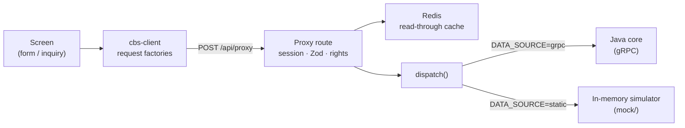

# 🏛️ Janata CBS Workbench — Developer Portal

The Janata CBS Workbench is the browser front end for the Java core banking system. It is a **Next.js 16 (App Router) + React 19** app with a thin server-side proxy (a BFF) in front of the core. Tellers, officers and administrators open every banking screen from a command, and the screens are drawn from configuration sent by the core instead of being hand-coded.

New to the project? Start with the [Project Roadmap](PROJECT_ROADMAP.md).

---

## What the Workbench does, and doesn't do

| It does                                                                                              | It doesn't                                                                     |
| ---------------------------------------------------------------------------------------------------- | ------------------------------------------------------------------------------ |
| Render forms and inquiries from the core's configuration (Model Config, Form Config, Inquiry Config) | Hold any banking logic: ledgers, interest and settlement stay in the Java core |
| Enforce RIDASHL rights and Four-Eyes in the UI **and again on the server**                           | Connect to a database, or let the browser reach gRPC or Redis                  |
| Keep a multi-tab workbench, with screens that can pop out into their own windows                     | Trust user or branch values sent by the browser                                |
| Run fully offline against an in-memory simulator of the core                                         |                                                                                |

---

## How a request travels



The proxy takes the user and branch from the server session, checks the request body and the user's rights, and decodes the core's response once before it reaches the browser. Level 5 of the [Project Roadmap](PROJECT_ROADMAP.md) walks through each step in the code.

---

## Code layout at a glance

Imports only point downward, and `pnpm verify:layers` enforces it:

```text
app → features → components → hooks → store → lib/cbs-*, core-utils → lib/infra-*, core-config, core-logger, data-parsers → types, data-schemas
```

| Folder                   | Holds                                                                                                  |
| ------------------------ | ------------------------------------------------------------------------------------------------------ |
| `src/app`                | Pages, layouts and API routes (`/api/proxy`, `login`, `logout`, `session`, `change-password`, `cache`) |
| `src/features`           | Screens: auth, workbench, operations (forms and inquiries), system designers, this portal              |
| `src/components`         | Shared UI: the form and inquiry engines, the screen scaffold, the layout shell                         |
| `src/store`, `src/hooks` | Zustand stores (session, workbench, alert, theme) and shared hooks                                     |
| `src/lib`                | Headless libraries: banking rules (`cbs-*`) and infrastructure (`infra-grpc`, `infra-redis`)           |
| `mock/`                  | The offline core: request handlers and tables named after the real CBS tables                          |
| `proto/`                 | The gRPC contract with the core                                                                        |

The [Project Tree](PROJECT_TREE.md) has the full annotated tree. Most `src/lib` units and engines have their own `README.md` next to the code.

---

## Run it locally

```bash
pnpm install
cp .env.example .env.local      # DATA_SOURCE=static + CACHE_ENABLED=false runs fully offline
pnpm dev                        # http://localhost:3000
```

Before you finish any change, run `pnpm lint:fix`, `pnpm typecheck` and `pnpm verify:all`. The full command list and the rules every change must follow are in `AGENTS.md` and `.agents/rules/` at the repository root.

---

## 🗺️ Portal pages

### 01. Engineering Reference

- [Project Roadmap](PROJECT_ROADMAP.md) — A guided path through the codebase, from first run to building a screen offline.
- [Model & Form Config](MODEL_AND_FORM_CONFIG.md) — How a table is described (Model Config), how its screen is laid out (Form Config), and how they meet in a running form: flow, files, server checks, lifecycle, where to change what.
- [Project Tree](PROJECT_TREE.md) — Annotated repository and `src/` layer structure.
- [Architecture & Security Audit Checklist](ARCHITECTURE_AUDIT_CHECKLIST.md) — Checklist for security, single-source logic, layer discipline, dead code and simplicity.
- [Production Operations](PRODUCTION_OPERATIONS.md) — Production settings, clearing the cache through `DELETE /api/cache`, Redis outages, unlocking a user, release checks.

> [!NOTE]
> To add a page, create `docs/devs/<path>.md`, then list it here and in `DEV_NAV_GROUPS` in `src/features/docs/config.ts`. Links between portal pages are written relative to `docs/devs/` (for example `PROJECT_TREE.md`). Name source files as code paths, because links to source files don't open inside the portal.
