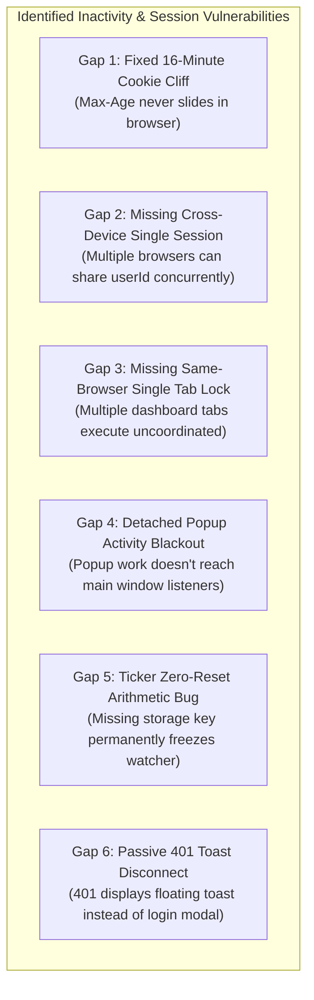
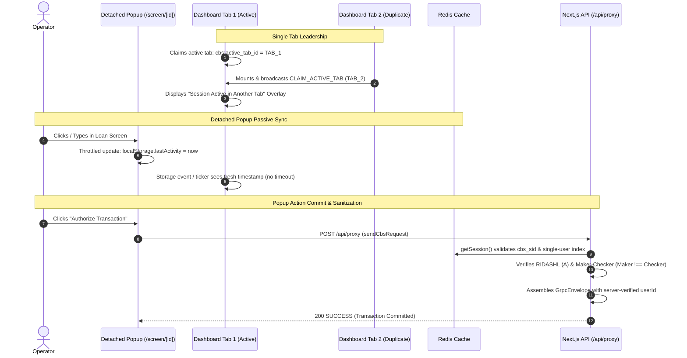

# 🏛️ CBS Session Lifecycle, Timeout & Single-Login Architecture Specification

> **Document Type:** Developer Architecture & Implementation Specification  
> **Status:** Draft / Planned Implementation  
> **Target Audience:** CBS Core Engineers, Frontend Architects, Code Reviewers  
> **Scope:** `src/lib/infra-redis`, `src/hooks`, `src/components/layout`, `src/lib/cbs-client`, `src/app/(workbench)`

---

## 1. Executive Summary & Security Objectives

In a Tier-1 Core Banking System (CBS), session management must satisfy two non-negotiable security requirements:

1. **Deterministic Inactivity Timeout (15-Minute Sliding Window):** An operator who steps away from their workstation must be warned at 14 minutes and logged out at 15 minutes. Active work (keystrokes, mouse clicks, proxy mutations) must slide the session forward transparently without dropping connections or triggering premature 401 errors.
2. **Strict Single Active Session Enforcement (Concurrent Login Prevention):** An operator must never hold multiple active sessions simultaneously.
   - **Cross-Browser / Cross-Device:** Logging in from a second browser, machine, or incognito window must instantly invalidate the previous session on the backend.
   - **Same Browser / Multi-Tab:** Only **one active dashboard tab** is permitted at any given moment. Secondary tabs must be locked with a clear take-over prompt.
3. **Seamless Detached Popup Workstations:** Operators frequently detach banking forms (e.g., Account Opening, Loan Approval) into standalone popup windows (`/screen/[id]`). Working in a popup must keep the banking session alive without showing duplicate countdown dialogs in child windows.

---

## 2. Root Cause Audit: Identified Architectural Gaps



### Detailed Gap Summary

| # | Component | Root Cause | Symptom |
| :--- | :--- | :--- | :--- |
| **1** | [`src/lib/infra-redis/session.ts`](file:///d:/CBS/In_house/finx/janata-cbs/src/lib/infra-redis/session.ts) | `cbs_sid` cookie is created with `maxAge: 960s` (16 mins). Next.js Server Components cannot set cookies, and `getSession()` never slides the cookie header. | Exactly 16 minutes after login, the browser deletes `cbs_sid` while the user is actively typing. The next proxy request fails with `401 Unauthorized`. |
| **2** | [`src/lib/infra-redis/session.ts`](file:///d:/CBS/In_house/finx/janata-cbs/src/lib/infra-redis/session.ts) | Redis stores sessions by random UUID (`cbs:sess:{uuid}`). There is no index mapping `userId -> sessionId`. | User `AD028459` can be logged in concurrently on Chrome, Edge, and multiple physical machines without conflict. |
| **3** | [`src/components/layout/workbench-shell.tsx`](file:///d:/CBS/In_house/finx/janata-cbs/src/components/layout/workbench-shell.tsx) | No active tab leadership election across browser tabs. | An operator can open 5 tabs in the same browser, creating desynchronized draft forms and uncoordinated record mutations. |
| **4** | [`src/app/(workbench)/screen/[id]/page.tsx`](file:///d:/CBS/In_house/finx/janata-cbs/src/app/(workbench)/screen/[id]/page.tsx) | Popups intentionally omit `AppTimeoutWatcher`, but have no passive activity listeners. DOM events in Window B do not bubble to Window A. | Operator works exclusively in a detached popup. The main dashboard receives zero events, times out after 15m, and deletes the Redis session. Submitting from popup fails with 401. |
| **5** | [`src/hooks/use-idle-timeout.ts`](file:///d:/CBS/In_house/finx/janata-cbs/src/hooks/use-idle-timeout.ts) | `Number(localStorage.getItem(STORAGE_KEY) \|\| Date.now())` evaluates to `Date.now()` when the key is null. | `elapsed = Date.now() - Date.now() = 0`. The ticker permanently calculates `elapsed = 0` every second. The timeout warning never displays. |
| **6** | [`src/lib/cbs-client/transport/proxy-client.ts`](file:///d:/CBS/In_house/finx/janata-cbs/src/lib/cbs-client/transport/proxy-client.ts) | On `401 Unauthorized`, `proxy-client.ts` fires a Sonner toast and throws an error. | The operator is left on a dead form with disabled action buttons. No uncloseable "Session Expired" modal appears and no redirect occurs. |

---

## 3. End-to-End System Topology



---

## 4. Implementation Blueprint: 6 Discrete Features

---

### Feature 1: Fix the Fixed Cookie Expiration Cliff (Sliding Inactivity Session)

#### What It Does
Transforms `cbs_sid` from a brittle, fixed 16-minute cookie into a **session-scoped cookie** (or long-lived shift cookie). The client browser will never discard `cbs_sid` mid-work. The true inactivity timeout is governed strictly by **Redis TTL** and `session.lastActiveAt`.

#### Affected Files
- [`src/lib/infra-redis/session.ts`](file:///d:/CBS/In_house/finx/janata-cbs/src/lib/infra-redis/session.ts)
- [`src/lib/core-config/server.ts`](file:///d:/CBS/In_house/finx/janata-cbs/src/lib/core-config/server.ts)

#### Implementation Details
1. In `src/lib/infra-redis/session.ts`, update `cookieOpts`:
   ```ts
   // Session cookie: omit maxAge so the cookie persists for the browser session.
   // Redis TTL remains the strict source of truth for inactivity invalidation.
   const cookieOpts = (httpOnly = true, maxAge?: number) => ({
     httpOnly,
     secure: !serverConfig.isDev && serverConfig.useHttps,
     sameSite: "lax" as const,
     path: "/",
     ...(maxAge !== undefined ? { maxAge } : {}),
   });
   ```
2. When creating the session in `createSession`:
   ```ts
   // cbs_sid is session-scoped (expires when browser terminates or on explicit logout)
   store.set(COOKIE_NAME, id, cookieOpts(true));
   ```
3. Whenever `getSession()` is called (during proxy mutations, heartbeats, or route navigation), `session.lastActiveAt` updates and the Redis key TTL resets to `serverConfig.auth.sessionMaxAgeSeconds`.

#### Verification Steps
1. Log in with any teller user.
2. Remain active for **17+ minutes** (perform intermittent clicks or form updates).
3. **Verify:** No 401 error or "Session Expired" toast appears at minute 16. The session continues smoothly.

---

### Feature 2: Server-Side Single Active Login (Cross-Browser / Cross-Device Enforcement)

#### What It Does
Prevents the same user ID from being logged in simultaneously on different browsers, machines, or incognito tabs. Logging in on a new device immediately terminates the prior device's session.

#### Affected Files
- [`src/lib/core-config/server.ts`](file:///d:/CBS/In_house/finx/janata-cbs/src/lib/core-config/server.ts) (Add Redis cache key generator)
- [`src/lib/infra-redis/session.ts`](file:///d:/CBS/In_house/finx/janata-cbs/src/lib/infra-redis/session.ts) (User-to-session index & revocation)

#### Implementation Details
1. Add cache key helper in `src/lib/core-config/server.ts`:
   ```ts
   cacheKeys: {
     // ...
     userSession: (userId: string) => `user:sess:${userId}`,
   }
   ```
2. In `createSession` inside `src/lib/infra-redis/session.ts`:
   ```ts
   // 1. Evict any prior session for this userId across all devices
   const userSessionKey = cacheKey(serverConfig.redis.cacheKeys.userSession(data.userId));
   const existingSessionId = await cacheGet<string>(userSessionKey);
   if (existingSessionId && existingSessionId !== id) {
     sessionLogger.info(`Superseding prior session ${existingSessionId} for user ${data.userId}`);
     await cacheDelete(getSessionRedisKey(existingSessionId));
     memoryStore.delete(existingSessionId);
   }

   // 2. Index current active session
   await cacheSet(userSessionKey, id, TTL_SECONDS);
   ```
3. In `getSession` inside `src/lib/infra-redis/session.ts`:
   ```ts
   // Validate that this session is still the active session for this user
   const userSessionKey = cacheKey(serverConfig.redis.cacheKeys.userSession(session.userId));
   const activeSessionId = await cacheGet<string>(userSessionKey);
   if (activeSessionId && activeSessionId !== id) {
     sessionLogger.warn(`Session ${id} revoked: user ${session.userId} logged in elsewhere`);
     await cacheDelete(getSessionRedisKey(id));
     memoryStore.delete(id);
     return null;
   }
   ```
4. On `destroySession`:
   ```ts
   if (session?.userId) {
     await cacheDelete(cacheKey(serverConfig.redis.cacheKeys.userSession(session.userId)));
   }
   ```

#### Verification Steps
1. Log in as `AD028459` in Google Chrome (Session 1).
2. Open Microsoft Edge and log in as `AD028459` (Session 2).
3. Return to Chrome and click any screen or action button.
4. **Verify:** Chrome is immediately rejected with `401 Unauthorized` and transitioned to the login screen.

---

### Feature 3: Client-Side Single Active Tab Enforcement (Within the Same Browser)

#### What It Does
Enforces that an operator can only have **one active dashboard workbench tab** open within the same browser. Opening a second dashboard tab locks the first tab with an uncloseable security overlay and a **"Take Over Session Here"** action button.

#### Affected Files
- [`src/hooks/use-single-tab.ts`](file:///d:/CBS/In_house/finx/janata-cbs/src/hooks/use-single-tab.ts) *(New Hook)*
- [`src/components/layout/workbench-shell.tsx`](file:///d:/CBS/In_house/finx/janata-cbs/src/components/layout/workbench-shell.tsx)
- [`src/lib/core-config/client.ts`](file:///d:/CBS/In_house/finx/janata-cbs/src/lib/core-config/client.ts) (Add storage key)

#### Implementation Details
1. Add constant in `src/lib/core-config/client.ts`:
   ```ts
   storage: {
     local: {
       activeTabInstance: `${APP_PREFIX}:session:active_tab_instance`,
     }
   }
   ```
2. Create `useSingleTab()` hook:
   - On mount, generates a unique `tabInstanceId` (e.g. `uuid` or `Date.now()`).
   - Writes `localStorage.setItem(clientConfig.storage.local.activeTabInstance, tabInstanceId)`.
   - Broadcasts `{ type: "CLAIM_ACTIVE_TAB", tabInstanceId }` via `BroadcastChannel(workbenchBus)`.
   - Listens to `BroadcastChannel` and `window.addEventListener("storage")`.
   - If a message or storage change arrives with `tabInstanceId !== myTabInstanceId`, sets `isOverridden(true)`.
3. In `WorkbenchShell`:
   - If `isOverridden` is true, renders an uncloseable `<Dialog>` or full-height overlay:
     > **"Active Banking Session in Another Tab"**  
     > *"This session was claimed by another browser tab. For data integrity, only one active tab is permitted."*  
     > **Button:** `Take Over Session Here` (re-claims leadership).

#### Verification Steps
1. Open the dashboard in Tab 1.
2. Open a new browser tab and navigate to `/dashboard` (Tab 2).
3. **Verify:** Tab 1 instantly blurs and shows the "Active in Another Tab" modal.
4. Click "Take Over Session Here" in Tab 1.
5. **Verify:** Tab 1 unfreezes, and Tab 2 immediately becomes locked.

---

### Feature 4: Detached Popup Passive Activity Reporter (No Dialogs in Popups)

#### What It Does
Honors the intentional design choice that **detached popups must never render timeout modals or countdown dialogs**, while resolving the activity blackout. Keystrokes and clicks in the popup passively update the shared `lastActivity` timestamp so the background dashboard does not falsely assume the operator is idle.

#### Affected Files
- [`src/app/(workbench)/screen/[id]/page.tsx`](file:///d:/CBS/In_house/finx/janata-cbs/src/app/(workbench)/screen/[id]/page.tsx)

#### Implementation Details
1. In `StandaloneScreenContent` inside `src/app/(workbench)/screen/[id]/page.tsx`, mount a passive activity listener:
   ```ts
   React.useEffect(() => {
     let lastRecorded = Date.now();
     const STORAGE_KEY = clientConfig.storage.local.lastActivity;

     const handlePassiveActivity = () => {
       const now = Date.now();
       if (now - lastRecorded > 2000) {
         lastRecorded = now;
         localStorage.setItem(STORAGE_KEY, String(now));
       }
     };

     const events = ["mousedown", "keydown", "touchstart", "wheel"];
     for (const evt of events) {
       window.addEventListener(evt, handlePassiveActivity, { passive: true });
     }
     return () => {
       for (const evt of events) {
         window.removeEventListener(evt, handlePassiveActivity);
       }
     };
   }, []);
   ```
2. **Zero UI impact:** No `<AppTimeoutWatcher>`, no dialogs, and no countdown banners inside `/screen/[id]`.

#### Verification Steps
1. Open an Account Opening form in a detached popup window (`/screen/[id]`).
2. Minimize or ignore the main dashboard window.
3. Spend 16+ minutes typing and working inside the popup window.
4. **Verify:** The dashboard window does NOT trigger an idle logout. Submitting from the popup succeeds without 401.

---

### Feature 5: Fix Ticker Freeze & Multi-Tab Logout Sync in `useIdleTimeout`

#### What It Does
Fixes the mathematical bug where a missing or deleted `STORAGE_KEY` results in `elapsed = 0` forever (freezing the timeout watcher). Also ensures that when any tab logs out, all other open tabs immediately log out.

#### Affected Files
- [`src/hooks/use-idle-timeout.ts`](file:///d:/CBS/In_house/finx/janata-cbs/src/hooks/use-idle-timeout.ts)

#### Implementation Details
1. **Fix missing key handling in the 1-second ticker:**
   ```ts
   const rawStored = localStorage.getItem(STORAGE_KEY);
   if (!rawStored) {
     // If user is supposed to be logged in but key is missing, initialize once:
     localStorage.setItem(STORAGE_KEY, String(Date.now()));
     return;
   }
   const storedTime = Number(rawStored);
   if (isNaN(storedTime)) return;
   const elapsed = Date.now() - storedTime;
   ```
2. **Fix multi-tab logout synchronization:**
   ```ts
   const handleStorageChange = (e: StorageEvent) => {
     if (isLoggedOut) return;
     if (e.key === STORAGE_KEY) {
       // Item deleted means another tab logged out
       if (!e.newValue) {
         performLogout();
         return;
       }
       const remoteTime = Number(e.newValue);
       const elapsed = Date.now() - remoteTime;
       if (elapsed >= totalTimeoutMs) {
         performLogout();
       } else if (elapsed < warningThresholdMs) {
         setIsWarningOpen(false);
       }
     }
   };
   ```
3. **Listen for `SESSION_LOGOUT` broadcast:**
   ```ts
   React.useEffect(() => {
     const channel = new BroadcastChannel(clientConfig.storage.broadcast.workbenchBus);
     channel.onmessage = (event) => {
       if (event.data?.type === "SESSION_LOGOUT" || event.data?.type === "SESSION_EXPIRED") {
         performLogout();
       }
     };
     return () => channel.close();
   }, [performLogout]);
   ```

#### Verification Steps
1. In Tab 1, click "Logout" or let the 15-minute timer expire.
2. **Verify:** Tab 2 immediately transitions to the logged-out modal without delay.
3. Leave the dashboard untouched for 14 minutes.
4. **Verify:** The 60-second countdown warning dialog opens accurately at the 14-minute mark.

---

### Feature 6: Actionable Global 401 Interceptor with "Log In Again" Modal

#### What It Does
Replaces the unhelpful, passive floating Sonner toast with an uncloseable **"Session Expired"** modal when any API proxy call encounters `401 Unauthorized`.

#### Affected Files
- [`src/lib/cbs-client/transport/proxy-client.ts`](file:///d:/CBS/In_house/finx/janata-cbs/src/lib/cbs-client/transport/proxy-client.ts)
- [`src/components/layout/app-timeout-watcher.tsx`](file:///d:/CBS/In_house/finx/janata-cbs/src/components/layout/app-timeout-watcher.tsx)

#### Implementation Details
1. In `src/lib/cbs-client/transport/proxy-client.ts`:
   ```ts
   if (res.status === 401) {
     if (typeof window !== "undefined") {
       try {
         const channel = new BroadcastChannel(clientConfig.storage.broadcast.workbenchBus);
         channel.postMessage({ type: "SESSION_EXPIRED" });
         channel.close();
       } catch {
         // Fallback
       }
     }
     throw new Error("UNAUTHORIZED");
   }
   ```
2. In `AppTimeoutWatcher`:
   - Listens for `"SESSION_EXPIRED"` on `workbenchBus`.
   - When received, sets `isLoggedOut(true)`.
   - The uncloseable "Session Expired" dialog renders with the prominent **"Log In Again"** button, redirecting cleanly to `/login` and resetting stores.

#### Verification Steps
1. Simulate a backend 401 by manually deleting the active session key in Redis:
   ```bash
   pnpm cache:clear
   ```
2. Click any action button on an open screen.
3. **Verify:** The floating error toast is replaced by the uncloseable "Session Expired" modal prompting the operator to log in again.

---

## 5. Verification & Quality Gates Checklist

Before marking this implementation as production-ready, ensure all quality gates pass:

```bash
# 1. Biome formatting and linter checks
pnpm lint:fix

# 2. Strict TypeScript compilation check
pnpm typecheck

# 3. Domain verification test suites
pnpm verify:all
pnpm verify:access
pnpm verify:client
pnpm verify:redis
```

- [ ] **Zero Magic Strings:** All storage and broadcast keys reference `clientConfig.storage.*`.
- [ ] **Server Boundary:** No server-only secrets or Redis imports leak into client hooks.
- [ ] **DRY Check:** Session verification logic delegates exclusively to `src/lib/infra-redis`.
- [ ] **File Budgets:** Components $\le 300$ lines, hooks/helpers $\le 200$ lines.
- [ ] **Dual Workspace Contract:** Internals tabs (`panel`) and detached popups (`window`) function without state or session collisions.

