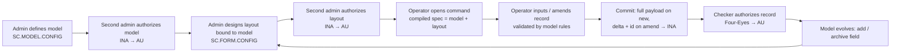
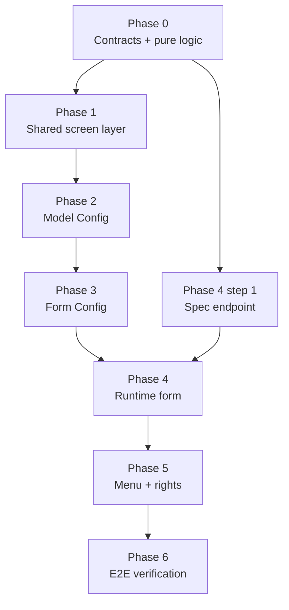

# Model → Form → Runtime: Revision Plan

**Scope:** one feature, end to end — Model Config (`SC.MODEL.CONFIG`), Form Config (`SC.FORM.CONFIG`), and the runtime operations form (`FormScreen`) that renders what those two define.
**Last audited:** 2026-10-19 against branch `centralize`.

---

## 1. Definition of done: the full circle

The feature is complete when this loop runs without fixtures, hardcoded layouts, or manual cache flushes:



Every step must be reachable through the UI, use the real wire contract (or `mock-services` in static mode), and be covered by either a `verify:*` script or the manual walkthrough in §8.

---

## 2. Audit: where the circle breaks today

Each item is verified in code. **Blockers** stop the loop from closing at all; the rest degrade it.

### 2.1 Blockers

| # | Break | Evidence |
|---|---|---|
| B1 | **Form Config never saves.** `handleSubmit` waits 600 ms and shows a success toast; no wire call. | [use-form-config.ts:566-580](../src/features/system/form-config/hooks/use-form-config.ts#L566-L580) |
| B2 | **Runtime never reads a saved form config.** Layout comes from the static fixture `SC_FORM_CONFIG_LIVE`, otherwise a flat one-section fallback. | [form-grid.tsx:25-29](../src/features/operations/forms/components/form-grid.tsx#L25-L29) |
| B3 | **Three different model→layout compilers.** `parseGMC` (server), `FormGrid` default section, and `buildDefaultFormPresentation` (inside a component) each turn a model into a form differently. Preview ≠ runtime by construction. | [form-parser.ts:103](../src/lib/data-parsers/form-parser.ts#L103), [form-grid.tsx:35-55](../src/features/operations/forms/components/form-grid.tsx#L35-L55), [mc-preview-tab.tsx:24](../src/features/system/model-config/components/mc-preview-tab.tsx#L24) |
| B4 | **Runtime commit has no identity.** `commitRecord(schema.code, data)` sends no `recordId` / `recordFunction`, so new vs. amend is indistinguishable on the wire. | [use-form-actions.ts:189](../src/features/operations/forms/hooks/use-form-actions.ts#L189) |
| B5 | **Delta compares against the wrong baseline.** `computeDelta(initialValues, values)` uses the component prop (usually `{}`), not the loaded record. | [use-form-actions.ts:184-187](../src/features/operations/forms/hooks/use-form-actions.ts#L184-L187) |
| B6 | **Model changes don't reach operators.** Runtime spec is cached in Redis (`spec:<CMD>`, TTL) and nothing invalidates it on model save/authorize. `invalidateCache` exists but is only reachable via the token-guarded `/api/cache` route. | [form-service.ts:63-76](../src/lib/infra-services/form-service.ts#L63-L76), [cache.ts:59](../src/lib/infra-redis/cache.ts#L59) |
| B7 | **No record lifecycle on config records.** `ModelConfigRecord` / `FormConfigRecord` carry no record status, inputter, or authoriser, so Four-Eyes cannot be evaluated for them. | [model-config-schema.ts](../src/lib/data-schemas/model-config-schema.ts), [form-config-schema.ts](../src/lib/data-schemas/form-config-schema.ts) |

### 2.2 Contract gaps between stages

| # | Gap | Evidence |
|---|---|---|
| C1 | Form fields bind to model properties by `name` only; no model version recorded. Rename/retype of a committed property silently breaks layouts. | [field-palette.tsx:100-130](../src/features/system/form-config/components/designer/field-palette.tsx#L100-L130) |
| C2 | Model rules (required, type, length) are copied into the layout at drop time and never re-synced. | same |
| C3 | Widget↔type compatibility is only checked in the designer UI, not on save. | [field-compatibility.ts](../src/lib/data-schemas/field-compatibility.ts) |
| C4 | Runtime validation uses GMC `schema.fields`, layout uses form config — two sources that can disagree. | [use-form-state.ts:38-52](../src/features/operations/forms/hooks/use-form-state.ts#L38-L52) |
| C5 | No binding from command code → form config (which layout, which version). The `APP,VERSION` grammar exists but isn't mapped to a form config version. | [form-service.ts:38-47](../src/lib/infra-services/form-service.ts#L38-L47) |

### 2.3 Screen-level defects

**Shared layer**
- `updateFormData` force-sets `isDirty: true`; any computed dirty state is overwritten. [workbench-store.ts:142-147](../src/store/workbench/workbench-store.ts#L142-L147)
- `useCbsPersistence` marks dirty on every `formData` change, including record load. No baseline, no debounce. [use-cbs-persistence.ts:122-133](../src/components/cbs-screen/hooks/use-cbs-persistence.ts#L122-L133)
- F3/Esc hotkeys call `onReturnToSearch` directly, bypassing any header-level guard. [cbs-screen-scaffold.tsx:63](../src/components/cbs-screen/cbs-screen-scaffold.tsx#L63)
- Tab close treats any non-empty `formData` as dirty. [tab-item.tsx:69-72](../src/components/layout/tabs/tab-item.tsx#L69-L72)
- Searching another record ID or pressing Create New while dirty is unguarded (not covered anywhere).
- Workbench bus has no "record mutated" message — only draft/dock helpers. [workbench-bus.ts](../src/lib/cbs-screen/workbench-bus.ts)

**Model Config**
- Hold / Delete / Reverse not wired to the scaffold; only Authorize. [sys-model-config.tsx:125-150](../src/features/system/model-config/sys-model-config.tsx#L125-L150)
- Magic fallbacks: `onReset` → `"MENU_TREE"`, Create New → `APP.CUSTOM.<ts>` instead of GNI.
- `isFieldCommitted` exists but committed properties can still be renamed/retyped (feeds C1).
- Size: `use-model-config.ts` 394 lines (limit 200), `mc-general-tab.tsx` 451 (limit 300).

**Form Config**
- Bespoke persistence hook duplicates `useCbsPersistence`. [use-form-config-persistence.ts](../src/features/system/form-config/hooks/use-form-config-persistence.ts)
- Imports `@fixtures` directly in the feature (catalog + load fallback) instead of going through `mock-services` in static mode.
- `resetToIdle` only sets mode; record ID and draft remain.
- Preview uses hardcoded sample values (`accountType: "SAVINGS"`…) and no validation. [fc-preview-tab.tsx:14-19](../src/features/system/form-config/components/fc-preview-tab.tsx#L14-L19)
- No Authorize / Hold / Delete wiring. `onReset` fallback `"FC.ACCOUNT.RETAIL"`.
- Size: `use-form-config.ts` 661 lines (limit 200).

**Runtime form**
- Three dirty flags (`useFormState`, kernel store, tab) and a fourth persistence hook (`use-form-persistence.ts`).
- Every keystroke: writes the tab store (breaks 400 ms debounce rule), re-renders the whole tree via `values` prop (defeats `FieldAtom`), and re-runs the sync effect that calls `setValues(normalized)`. [ops-form.tsx:90-130](../src/features/operations/forms/ops-form.tsx#L90-L130)
- Fixtures checked before backend even in live mode. [use-form-actions.ts:52-64](../src/features/operations/forms/hooks/use-form-actions.ts#L52-L64)
- Authorize/reverse decided by literal `"AU"` instead of `CbsRecordStatus` + `evaluateCbsAccess`.
- Commit success neither re-baselines nor moves to `S`/INA; `Process` action is a stub toast.
- Size: `use-form-actions.ts` 351 lines.

### 2.4 What the previous plan got right — keep it

- Pilot on Model Config, then cascade.
- Centralize dirty detection in a shared layer using `computeDelta`.
- The 12-point screen quality checklist (now §7).
- Already in place, no work needed: validation errors clear when leaving mode `I`; validation checklist renders only in mode `I`.

---

## 3. Open decisions (resolve before Phase 1)

These change the design; several need confirmation from the Java backend team.

| ID | Decision | Recommendation |
|---|---|---|
| D1 | Where runtime layout comes from | **BFF composes.** `getFormSpec(cmd)` in `infra-services` fetches model (GMC) + authorized form config (`FORM.CONFIG` GET) and returns one compiled spec. Keeps Java unchanged. |
| D2 | Command → form config binding | Form config gets explicit `targetModel` + `version`. `APP` resolves the active (AU) layout; `APP,VERSION` resolves that version; no layout → compiled default. |
| D3 | Field identity | Keep binding by property `name`, but make **committed properties' `name` and `type` immutable** (archive instead). `isFieldCommitted` already tracks this — enforce it in validation. |
| D4 | Config record lifecycle | Confirm backend returns `RECORD_STATUS`, `CURR_NO`, `INPUTTER`, `AUTHORISER` for `MODEL.CONFIG` / `FORM.CONFIG`. If yes, add to schemas; if no, Four-Eyes on config is out of scope and must be stated. |
| D5 | Model-change policy | Archiving a property used by an AU layout is allowed but flags that layout **stale**; runtime drops archived fields; Form Config shows a stale banner until re-authorized. |
| D6 | Static mode | Fixtures are reachable **only** through `src/lib/mock-services` via `cbs.send`. Features never import `@fixtures`. |

---

## 4. Target contracts

All pure, server-safe, and testable with `tsx`.

```
src/lib/data-schemas/form-spec-schema.ts   CompiledFormSpec (Zod) — the one runtime shape
src/lib/cbs-form-spec/                      new lib module (≤200 lines per file)
  compile.ts       compileFormSpec(model, layout | null): CompiledFormSpec
                   — replaces parseGMC→fields default, FormGrid fallback, buildDefaultFormPresentation
  validate.ts      validateLayoutAgainstModel(model, layout): Issue[]
                   — missing/archived property, incompatible widget, stale model version
  field-rules.ts   validateValues(spec, values): Record<string, string>
                   — required / type / length / pattern from the model, one source for preview + runtime
  index.ts
src/lib/cbs-record/
  baseline.ts      createBaseline / evaluateDirty / rebaseline helpers over computeDelta
```

`useCbsPersistence` return contract (every screen in this feature uses it, nothing else):

```ts
{
  recordId, setRecordId, mode, setMode,
  formData, setFormData,
  hydrate(record): void      // sets data AND baseline; not dirty
  rebaseline(): void         // baseline := current data
  isDirty: boolean           // computeDelta(baseline, formData).isDirty
  dirtyKeys: string[]
  reset(): void              // IDLE, empty id, initialData, baseline cleared
}
```

Baseline is persisted in the tab alongside `formData`, so a reloaded tab is not falsely dirty.

---

## 5. Phases

Each phase lists its exit criteria. Do not start the next phase until they pass. After every phase run `pnpm lint`, `pnpm typecheck`, and the listed `verify:*` scripts.

### Phase 0 — Contracts and pure logic (no UI)

1. Resolve D1–D6; record answers in this file.
2. Add `form-spec-schema.ts` and `src/lib/cbs-form-spec/` (§4).
3. Add `cbs-record/baseline.ts`.
4. If D4 = yes: add audit fields to both config schemas.
5. Add `scripts/verify-cbs-form-spec.ts` (`verify:form-spec`) and register it in `verify-all.ts`. Extend `verify:record` for baseline helpers.

**Exit:** `verify:form-spec` covers: compile with/without layout; archived field dropped; incompatible widget rejected; stale model version flagged; required/length rules enforced. `verify:record` covers: hydrate is not dirty; edit-then-undo is not dirty; rebaseline clears dirty.

### Phase 1 — Shared screen layer

1. `workbench-store.updateFormData` stops setting `isDirty`; only `setTabDirty` does.
2. Implement the `useCbsPersistence` contract (§4) with 400 ms debounced tab sync.
3. Add `useGuardedAction` in `components/cbs-screen`; scaffold wraps **Return, Create New, and Record Search** with it, for both buttons and hotkeys.
4. Tab close (`tab-item.tsx`, `tab-menu-items.tsx`) uses `tab.isDirty` only.
5. Add `broadcastRecordMutation(control, recordId)` + subscriber hook to `workbench-bus.ts`.
6. Scaffold accepts the record's audit context and derives action availability from `evaluateCbsAccess` (no inline status checks in features).

**Exit:** a screen using the hook can load a record without becoming dirty; Esc while dirty shows the confirm dialog; reloading a tab restores draft and correct dirty state.

### Phase 2 — Model Config (pilot)

1. `fetchRecord` → `hydrate`; `handleSubmit` success → `rebaseline`; `resetToIdle` → `reset`.
2. Committed property `name`/`type` immutable (D3) — enforced in the Zod schema via a refinement against the baseline, and disabled in the inspector UI.
3. Wire Hold / Delete / Reverse via `cbs.modelConfig.*`; availability from `evaluateCbsAccess`.
4. Replace `"MENU_TREE"` / `APP.CUSTOM.<ts>` with real reload and GNI allocation.
5. Server-side: after a successful `PUT`/`AUT` on `MODEL.CONFIG` or `FORM.CONFIG`, `/api/proxy` calls `invalidateCache(<target model>)`.
6. `McPreviewTab` renders `compileFormSpec(model, null)`; delete `buildDefaultFormPresentation`.
7. Broadcast mutation on save/authorize.
8. Split `use-model-config.ts` (catalog / record lifecycle / property tree ops) and `mc-general-tab.tsx` under the size limits.

**Exit:** checklist §7 passes for Model Config; saving a model then opening its command shows the new field without `pnpm cache:clear`.

### Phase 3 — Form Config

1. Real save via `cbs.formConfig.save` (B1); Authorize / Hold / Delete wired.
2. Replace `use-form-config-persistence.ts` with `useCbsPersistence` + `formConfigRecordSchema`; delete the old hook.
3. Remove `@fixtures` imports; catalog and load go through `cbs.send` only (D6).
4. Validate on save with `validateLayoutAgainstModel`; target model must be AU.
5. Show stale banner when the bound model version changed (D5).
6. Preview renders `compileFormSpec(model, layout)` through the **same** component the runtime uses, with values seeded from model defaults and live `validateValues`.
7. Fix `resetToIdle`; remove `"FC.ACCOUNT.RETAIL"` fallback.
8. Split `use-form-config.ts` into section ops, field ops, and record lifecycle hooks.

**Exit:** checklist §7 passes for Form Config; a layout saved and authorized here is what the operator sees in Phase 4.

### Phase 4 — Runtime operations form

1. `/api/form/[cmd]` returns `CompiledFormSpec` via `getFormSpec` (D1, D2). `FormGrid` renders the spec; remove `SC_FORM_CONFIG_LIVE`.
2. Single state source: the form kernel store. Delete `use-form-state.ts`; fields subscribe atomically; whole-form `values` no longer passed down.
3. Delete `use-form-persistence.ts`; use `useCbsPersistence` with `hydrate` on record load.
4. Remove fixture lookups from `ops-form.tsx` and `loadRecordData`; delete the effect that re-normalizes on every `currentTab.formData` change.
5. Commit: new → full payload with allocated id + `INPUT`; amend → `computeDelta(baseline, current).modifiedFields` + `recordId`. On success: `rebaseline`, reload in `S`, broadcast mutation.
6. Authorize / Reverse / Delete via `evaluateCbsAccess` and `CbsRecordStatus` enum.
7. Validation via `validateValues(spec, values)` only.
8. Decide `Process`: implement or remove the button.
9. Split `use-form-actions.ts` under 200 lines.

**Exit:** checklist §7 passes; editing field #N in a 300-field form re-renders only that field (React Profiler); tab store receives ≤ 1 write per 400 ms while typing.

### Phase 5 — Reaching the operator

1. Confirm a new model's command resolves through `resolveScreen` fallthrough to `FormScreen` (no bespoke registration needed).
2. Add the command to a menu via Menu Designer and grant RIDASHL rights via User Groups; confirm `/api/proxy` enforces them.
3. Optional: `INQ <MODEL>` lists records created in Phase 4.

**Exit:** a user with only operator rights can open, input, and commit; a second user can authorize; the inputter cannot.

### Phase 6 — End-to-end verification

1. `pnpm verify:all`, `pnpm lint`, `pnpm typecheck`.
2. Run the walkthrough in §8 in **static** mode, then **live** mode.
3. Move this document to `docs/devs/03-domain-features/` and update the developer portal pages for model/form config.

---

## 6. Phase dependencies



---

## 7. Screen quality checklist

Applies to Model Config, Form Config, and the runtime form. Tick per screen.

| # | Invariant | MC | FC | Form |
|:-:|---|:-:|:-:|:-:|
| 1 | Lookup selection fills the input and waits for Enter | [ ] | [ ] | [ ] |
| 2 | Record load calls `hydrate`; screen is not dirty after load | [ ] | [ ] | [ ] |
| 3 | Dirty = `computeDelta(baseline, current)`; undo returns to clean | [ ] | [ ] | [ ] |
| 4 | Return, Create New, Record Search guarded when dirty (buttons **and** hotkeys) | [ ] | [ ] | [ ] |
| 5 | Tab close guarded by `tab.isDirty` only | [ ] | [ ] | [ ] |
| 6 | Validation drawer only in mode `I`, cleared on exit | [x] | [x] | [ ] |
| 7 | "Fix first" focuses the field and switches to its tab | [ ] | [ ] | [ ] |
| 8 | New commit sends full payload + id; amend sends delta + id | [ ] | [ ] | [ ] |
| 9 | Successful save re-baselines | [ ] | [ ] | [ ] |
| 10 | Audit footer shows status, curr no, inputter, authoriser | [ ] | [ ] | [ ] |
| 11 | Authorize disabled for the inputter (`evaluateCbsAccess`) | [ ] | [ ] | [ ] |
| 12 | Mutations broadcast on the workbench bus; other tabs refetch | [ ] | [ ] | [ ] |
| 13 | No `@fixtures` import, no magic record IDs or status literals | [ ] | [ ] | [ ] |
| 14 | Files within size limits (component ≤300, logic ≤200) | [ ] | [ ] | [ ] |

---

## 8. End-to-end walkthrough (the circle, as a test)

Run with two users: **Maker** and **Checker**.

1. Maker: `SC.MODEL.CONFIG` → Create New (GNI id) → add fields `NAME` (Text, required), `AMOUNT` (Number) → Commit. Status INA.
2. Maker tries Authorize → blocked. Checker authorizes → AU.
3. Maker: `SC.FORM.CONFIG` → new layout targeting the model → place both fields; try `switch` widget on `AMOUNT` → rejected on save → fix → Commit. Checker authorizes.
4. Maker opens the model's command → layout matches the Form Config preview exactly.
5. Maker inputs a record, leaves `NAME` empty → validation blocks commit → fill → Commit (full payload). Status INA.
6. Maker amends `AMOUNT` only → wire payload contains only `AMOUNT` + record id.
7. Edit a field, press Esc → confirm dialog; cancel keeps edits; undo the edit → Esc returns without dialog.
8. Checker authorizes the record; Maker cannot.
9. Maker archives `AMOUNT` in the model → Checker authorizes → Form Config shows stale banner → runtime form no longer shows `AMOUNT` (no cache flush).
10. Popped-out window of the same record refetches after step 8.

The feature is complete when all ten steps pass in static and live mode.
