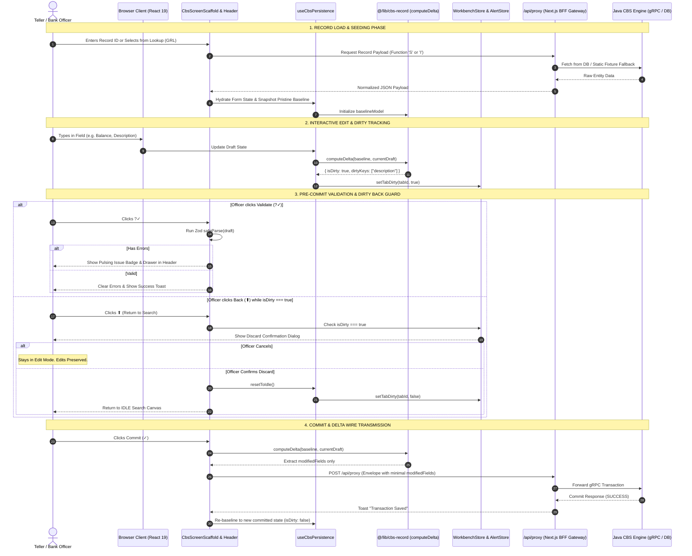

# 🏛️ Master Architecture & Engineering Revision Plan
## Target Domain: Model Config, Form Config, and Runtime Form Engine (Root-to-Wire)

> **Document Classification:** Enterprise Architecture Review & Execution Plan  
> **System:** Janata Core Banking Workbench (`finx-ui`)  
> **Target Modules:**  
> 1. `src/features/system/model-config/` (Data Metamodel & Dictionary Editor)  
> 2. `src/features/system/form-config/` (Visual Form Presentation & Layout Designer)  
> 3. `src/features/operations/forms/` & `src/features/form-engine/` (Dynamic Runtime Form Execution & Mutation Engine)  
> **Last Updated:** October 2026  

---

## 1. Executive Overview & The Dynamic Banking Triad

In modern Core Banking Systems (CBS), forms are **never hardcoded**. Business requirements (central bank regulations, new lending products, tax withholding rules) change frequently. Janata CBS solves this through a decoupled, 3-stage dynamic schema pipeline:

```
┌────────────────────────────────────────────────────────────────────────┐
│ 1. DATA METAMODEL (Model Config)                                       │
│ Defines the structural reality of the banking entity                   │
│ • Database Table, Primary Key & Prefix Sequence Rules                  │
│ • Canonical Fields, Data Types, Lengths, Mandatories, Defaults         │
│ Code: src/features/system/model-config/                                │
└───────────────────────────────────┬────────────────────────────────────┘
                                    │ consumes data dictionary
┌───────────────────────────────────▼────────────────────────────────────┐
│ 2. PRESENTATION LAYOUT (Form Config)                                   │
│ Defines how humans interact with that entity                           │
│ • Tabs (General, Financials, Nominees, Audit)                          │
│ • 12-Column Responsive Grid, Collapsible Section Cards                 │
│ • Field Archetypes (Currency, Account Masks, Radio Groups, Lookups)    │
│ Code: src/features/system/form-config/                                 │
└───────────────────────────────────┬────────────────────────────────────┘
                                    │ compiles to GMC JSON spec
┌───────────────────────────────────▼────────────────────────────────────┐
│ 3. RUNTIME MUTATION & EXECUTION (Ops Form & Form Engine)               │
│ Zero-lag operator workstation (150 - 1,000 fields)                     │
│ • Headless Form Kernel with atomic subscriptions                       │
│ • CBS Action Bar (Commit, Validate, Hold, Delete, Authorize)           │
│ • computeDelta() mutation tracking & Four-Eyes clearance               │
│ Code: src/features/operations/forms/ & src/features/form-engine/       │
└────────────────────────────────────────────────────────────────────────┘
```

If any one of these three layers has architectural flaws, state leakage, or inconsistent contracts, the entire banking application degrades. This document audits the entire path **from Project Root Point to End Point** and outlines the professional engineering plan to revise and standardize all three modules.

---

## 2. Root-to-Wire End-to-End System Flow



---

## 3. Deep-Dive Audit of the Three Target Features

### Feature 1: Model Config (`src/features/system/model-config/`)

#### Purpose
Defines the database metamodel data dictionary. It manages:
- Primary key generation definitions (`idDef`: `idPrefix`, `idPattern`, `sequenceReset`).
- Field property tree: property sequences (`sn`), field names, types, lengths, mandatory flags, and archive states.

#### File Inventory & Role
| File Path | Role | Present Condition & Audit Findings |
| :--- | :--- | :--- |
| [sys-model-config.tsx](file:///d:/Work/React/cbs/janata-cbs/src/features/system/model-config/sys-model-config.tsx) | Screen Scaffold Container | Renders admin tabs (`general`, `properties`, `audit`, `json`). Coordinates header actions with `useModelConfig`. |
| [hooks/use-model-config.ts](file:///d:/Work/React/cbs/janata-cbs/src/features/system/model-config/hooks/use-model-config.ts) | Core Domain Hook | Manages CRUD, property hierarchy tree insertion (`parentSN_childSN`), catalog refresh, validation errors. |
| [hooks/use-mc-persistence.ts](file:///d:/Work/React/cbs/janata-cbs/src/features/system/model-config/hooks/use-mc-persistence.ts) | Persistence Wrapper | Thin wrapper calling `useCbsPersistence`. |
| [components/mc-general-tab.tsx](file:///d:/Work/React/cbs/janata-cbs/src/features/system/model-config/components/mc-general-tab.tsx) | General Metadata Form | 12-column card layout for table names, categories, service paths, and flags. |
| [components/mc-properties-tab.tsx](file:///d:/Work/React/cbs/janata-cbs/src/features/system/model-config/components/mc-properties-tab.tsx) | Property Master-Detail | Left: hierarchical property tree; Right: property inspector. |

#### Specific Gaps Identified in Model Config
1. **Dirty State Tracking**: Does not use `@/lib/cbs-record` (`computeDelta`). Unsaved edits are not mathematically tracked against baseline data.
2. **Back Action Guard**: When in edit mode with modified properties, clicking `⬆` (Return to Search) immediately executes `resetToIdle()`, erasing all unsaved field configurations with no confirmation dialog.

---

### Feature 2: Form Config (`src/features/system/form-config/`)

#### Purpose
Visual drag-and-drop form designer that converts raw metamodel fields into structured banking screens:
- Presentation archetypes (Standard, Compact High-Density, Master-Detail, Wizard).
- Section cards, collapsible headers, 12-column grid positioning, field widths (`col-span-1` through `12`).

#### File Inventory & Role
| File Path | Role | Present Condition & Audit Findings |
| :--- | :--- | :--- |
| [sys-form-config.tsx](file:///d:/Work/React/cbs/janata-cbs/src/features/system/form-config/sys-form-config.tsx) | Screen Scaffold Container | Admin tab wrapper (`designer`, `preview`, `audit`, `json`). |
| [hooks/use-form-config.ts](file:///d:/Work/React/cbs/janata-cbs/src/features/system/form-config/hooks/use-form-config.ts) | Core Domain Hook | Complex state machine managing sections, drag-and-drop reordering, section cards, and field placement. |
| [hooks/use-form-config-persistence.ts](file:///d:/Work/React/cbs/janata-cbs/src/features/system/form-config/hooks/use-form-config-persistence.ts) | Persistence Adapter | Direct synchronization with `useWorkbenchStore`. |
| [components/fc-designer-tab.tsx](file:///d:/Work/React/cbs/janata-cbs/src/features/system/form-config/components/fc-designer-tab.tsx) | Visual Form Canvas | Interactive drag-and-drop section builder. |
| [components/fc-preview-tab.tsx](file:///d:/Work/React/cbs/janata-cbs/src/features/system/form-config/components/fc-preview-tab.tsx) | Live Preview | Renders the designed configuration using the runtime Form Engine. |

#### Specific Gaps Identified in Form Config
1. **Isolated Persistence Implementation**: Maintains its own bespoke `use-form-config-persistence.ts` instead of using the centralized `useCbsPersistence`.
2. **Missing Guard on Unsaved Layouts**: If an administrator rearranges 15 sections and clicks Back, `resetToIdle()` discards the visual layout immediately.

---

### Feature 3: Dynamic Runtime Form Feature (`src/features/operations/forms/` & `src/features/form-engine/`)

#### Purpose
The runtime engine that renders banking forms (Accounts, Customers, Loans, Funds Transfer) dynamically:
- Supports 150 to 1,000 fields per form without UI sluggishness.
- Atomic state kernel: updating Field #480 only re-renders Field #480, not the entire tree.
- Calculates delta payloads on commit (`computeDelta`), so only changed fields hit the banking ledger.

#### File Inventory & Role
| File Path | Role | Present Condition & Audit Findings |
| :--- | :--- | :--- |
| [ops-form.tsx](file:///d:/Work/React/cbs/janata-cbs/src/features/operations/forms/ops-form.tsx) | Universal Screen Scaffold | Standard banking maintenance form wrapper. |
| [hooks/use-form-actions.ts](file:///d:/Work/React/cbs/janata-cbs/src/features/operations/forms/hooks/use-form-actions.ts) | Action Toolbar Dispatcher | Connects toolbar buttons (`Commit`, `Validate`, `Hold`, `Delete`, `Authorize`) to CBS client. |
| [hooks/use-form-state.ts](file:///d:/Work/React/cbs/janata-cbs/src/features/operations/forms/hooks/use-form-state.ts) | Form Input State | Field values, required validations, and dirty flags. |
| [form-engine/store/form-kernel-store.ts](file:///d:/Work/React/cbs/janata-cbs/src/features/form-engine/store/form-kernel-store.ts) | Headless Form Kernel | High-performance atomized Zustand store factory. |
| [form-engine/components/field-atom.tsx](file:///d:/Work/React/cbs/janata-cbs/src/features/form-engine/components/field-atom.tsx) | Atomic Input Component | Self-subscribing widget wrapper preventing parent re-renders. |

#### Specific Gaps Identified in Runtime Forms
1. **Inconsistent Dirty Source**: `use-form-state.ts` tracks `isDirty` via a naive boolean flag (`setValue => setIsDirty(true)`), while `use-form-actions.ts` uses `computeDelta` only upon submission. If a user alters a field and resets it back to original, `use-form-state` still reports dirty.
2. **Unguarded Back Navigation**: `handleReturnToSearch` in `use-form-actions.ts` wipes working draft state unconditionally.

---

## 4. The Expert Engineer's 5-Phase Revision Plan

To achieve enterprise-grade consistency, zero code duplication, and bulletproof stability, follow this structured execution plan:

```
┌─────────────────────────────────────────────────────────────┐
│ PHASE 1: CORE INFRASTRUCTURE HARDENING                      │
│ Centralize dirty detection & modal guards into shared layer │
└──────────────────────────────┬──────────────────────────────┘
                               │
┌──────────────────────────────▼──────────────────────────────┐
│ PHASE 2: PIONEER REFACTOR — MODEL CONFIG                    │
│ Implement & verify end-to-end against 5 quality gates       │
└──────────────────────────────┬──────────────────────────────┘
                               │
┌──────────────────────────────▼──────────────────────────────┐
│ PHASE 3: SECONDARY REFACTOR — FORM CONFIG                   │
│ Migrate bespoke persistence to useCbsPersistence            │
└──────────────────────────────┬──────────────────────────────┘
                               │
┌──────────────────────────────▼──────────────────────────────┐
│ PHASE 4: RUNTIME FORM ENGINE ALIGNMENT                      │
│ Unify Ops Form dirty state with @/lib/cbs-record            │
└──────────────────────────────┬──────────────────────────────┘
                               │
┌──────────────────────────────▼──────────────────────────────┐
│ PHASE 5: AUTOMATED REGRESSION & VERIFICATION                │
│ Lock with pnpm typecheck, verify:all & Biome checks         │
└─────────────────────────────────────────────────────────────┘
```

---

### Phase 1: Core Infrastructure Hardening (The Shared Layer)

#### Objective
Ensure all shared screen components automatically handle dirty tracking, confirmation modals, and error isolation without requiring bespoke code in each feature.

#### Actions
1. **Enhance `useCbsPersistence` ([src/components/cbs-screen/hooks/use-cbs-persistence.ts](file:///d:/Work/React/cbs/janata-cbs/src/components/cbs-screen/hooks/use-cbs-persistence.ts))**:
   - Store a `baselineDataRef` capturing the pristine state when a record is loaded or created.
   - Use `computeDelta(baselineDataRef.current, formData)` reactively.
   - Expose `isDirty: boolean`, `dirtyKeys: string[]`, and `rebaseline(): void`.
   - Synchronize `updateTabState(tabId, { isDirty })` with the workbench store.

2. **Harden `CbsFormHeader` ([src/components/cbs-screen/header/cbs-form-header.tsx](file:///d:/Work/React/cbs/janata-cbs/src/components/cbs-screen/header/cbs-form-header.tsx))**:
   - Wrap `onReturnToSearch`:
     ```tsx
     const handleGuardedReturn = React.useCallback(() => {
       if (!onReturnToSearch) return;
       const effectiveIsDirty = isDirty ?? currentTab?.isDirty ?? false;
       if (effectiveIsDirty) {
         confirm({
           title: "Discard Unsaved Changes?",
           message: "You have unsaved changes in this record. Returning to search will discard your modifications.",
           variant: "destructive",
           confirmText: "Discard & Return",
           onConfirm: () => {
             if (activeTabId) setTabDirty(activeTabId, false);
             onReturnToSearch();
           },
         });
       } else {
         onReturnToSearch();
       }
     }, [isDirty, currentTab?.isDirty, onReturnToSearch, confirm, activeTabId, setTabDirty]);
     ```
   - Ensure `<CbsValidationChecklist>` only renders when `mode === "I"`.

---

### Phase 2: Pioneer Refactor — Model Config (`src/features/system/model-config/`)

#### Objective
Transform Model Config into the **Gold Standard Reference Implementation**.

#### Actions
1. In `use-model-config.ts`:
   - Consume `isDirty` and `rebaseline` directly from `useModelConfigPersistence`.
   - On successful `handleSubmit`, call `rebaseline()` so the record returns to pristine state.
   - When calling `resetToIdle()`, ensure `validationErrors` are cleared.
2. In `sys-model-config.tsx`:
   - Pass `isDirty={isDirty}` to `<CbsScreenScaffold>`.
   - Verify all 5 quality criteria:
     - [x] Record lookup dropdown sets input and waits for Enter.
     - [x] Changing a property sets `isDirty: true`; undoing it resets to `isDirty: false`.
     - [x] Clicking `⬆` Back button triggers confirmation dialog when dirty.
     - [x] Validation errors vanish immediately upon switching modes away from `"I"`.
     - [x] Closing the workbench tab triggers dirty confirmation.

---

### Phase 3: Secondary Refactor — Form Config (`src/features/system/form-config/`)

#### Objective
Standardize Form Config on the centralized persistence pattern and remove bespoke tab syncing.

#### Actions
1. Replace bespoke `use-form-config-persistence.ts` with `useCbsPersistence`.
2. Connect `computeDelta` to track changes in visual section layouts and field configurations.
3. Pass `isDirty` to `CbsScreenScaffold` in `sys-form-config.tsx`.
4. Verify that dragging/reordering form sections marks the screen as dirty and protects back navigation.

---

### Phase 4: Runtime Form Engine Alignment (`src/features/operations/forms/`)

#### Objective
Eliminate discrepancies between `use-form-state.ts` and `use-form-actions.ts`.

#### Actions
1. In `use-form-state.ts`:
   - Replace naive `isDirty` boolean with `computeDelta(initialData, values).isDirty`.
2. In `use-form-actions.ts`:
   - Guard `handleReturnToSearch` with `isDirty` confirmation check.
3. In `ops-form.tsx`:
   - Pass `isDirty` to `CbsScreenScaffold`.

---

### Phase 5: Automated Verification & CI Regression Gates

#### Objective
Lock in all architectural rules with automated regression suites.

#### Verification Commands
```bash
# 1. Typecheck the entire project with strict mode
pnpm typecheck

# 2. Run master verification suite (Access, Record Delta, Commands, Wire Client)
pnpm verify:all

# 3. Specifically verify Delta Mutation Engine
pnpm verify:record

# 4. Check Biome lint and code quality standards
pnpm lint
```

---

## 5. Master Screen Quality Checklist

Every screen in Janata CBS must satisfy these 12 criteria before being considered production-ready:

| # | Standard Invariant | Implementation Mechanism | Verified |
| :---: | :--- | :--- | :---: |
| 1 | **Clean Lookup** | Dropdown selection populates input, closes menu, and waits for user Enter/submit prompt. | [ ] |
| 2 | **Pristine Snapshot** | Baseline data snapshot captured on fetch or new record allocation. | [ ] |
| 3 | **True Dirty Calculation** | Uses `@/lib/cbs-record` (`computeDelta`) for deep equality (no false alarms on undo). | [ ] |
| 4 | **Guarded Back Action** | Clicking `⬆` (Return to Search) pops `useAlertStore.confirm()` if `isDirty === true`. | [ ] |
| 5 | **Tab Close Guard** | Closing tab warns user if `tab.isDirty === true`. | [ ] |
| 6 | **Validation Scope** | Validation drawer/badge renders strictly in `mode === "I"` and auto-clears on mode exit. | [ ] |
| 7 | **Fix First Navigation** | Clicking "Fix First →" focuses the offending field and switches to its tab. | [ ] |
| 8 | **Delta Commits** | Submit payloads transmit only modified fields (`computeDelta().modifiedFields`). | [ ] |
| 9 | **Re-baseline on Save** | Successful save updates baseline to current data, setting `isDirty: false`. | [ ] |
| 10 | **Audit Footer** | Footer renders `RECORD_STATUS`, `CURR_NO`, `INPUTTER`, and `AUTHORISER`. | [ ] |
| 11 | **Four-Eyes Enforcement** | Authorize (`✓✓`) is disabled if `currentOfficer === inputter`. | [ ] |
| 12 | **Detached Popup Sync** | Edits sync across windows via `BroadcastChannel` (`workbench-bus.ts`). | [ ] |

---

## 6. Recommended Next Steps

1. **Review and approve this Master Architecture & Revision Plan.**
2. **Execute Phase 1 & Phase 2**: Implement the centralized dirty engine and guarded Back button on `Model Config` as the Pioneer Feature.
3. **Audit and verify `Model Config`** against the Master Quality Checklist.
4. **Cascade across `Form Config` and `Ops Form`.**
