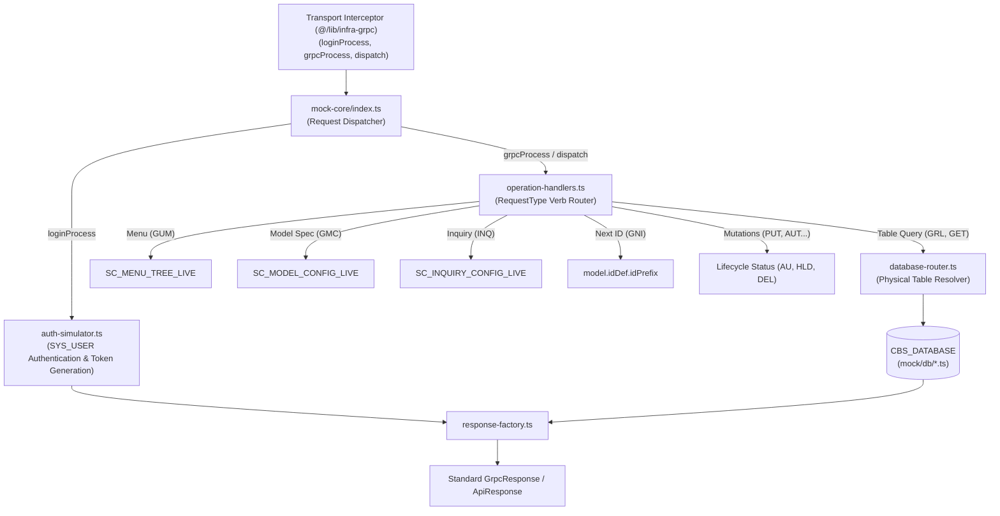

# 🧪 CBS Mock Core: In-Memory Core Banking Simulator (`@mock/core`)

A high-fidelity, in-memory **Core Banking Protocol Simulator** for the **Janata Core Banking Workbench**.

It powers the system when running in static mode (`DATA_SOURCE="static"` in `.env.local`), providing a 100% offline simulation of the CBS Core backend with **zero network sockets**, **zero external database dependencies**, and **exact wire protocol parity**.

---

## 📦 What It Contains

```text
mock/core/
├── database-router.ts       # Resolves logical controlName to canonical CBS_DATABASE tables
├── operation-handlers.ts    # Pattern-based protocol handlers for CBS verbs (GUM, GMC, GRL, GET, etc.)
├── auth-simulator.ts        # User authentication & JWT token generation from SYS_USER
├── response-factory.ts      # Standardized response envelopes (200, 404, 401, GrpcResponse)
├── index.ts                 # Public barrel: mockLogin, mockProcess, mockDispatch, getMockProxyResponse
└── README.md                # Documentation & architectural reference
```

---

## ⚙️ Core Architecture & Execution Flow



---

## 🎯 Supported Core Protocol Verbs

Every operation follows canonical CBS request verbs without requiring ad-hoc alias maps or fuzzy guessing:

| Request Verb | Operation | Source / Handler | Returns |
|---|---|---|---|
| **`GUM`** | Get User Menu | `handleGetMenu()` | Hierarchical navigation tree from `SC_MENU_TREE` |
| **`GMC`** | Get Model Configuration | `handleGetModelConfig()` | Dynamic form & column definition from `SC_MODEL_CONFIG` |
| **`INQ`** | Execute Inquiry Query | `handleInquiry()` | Query rows matching target model from `SC_INQUIRY_CONFIG` |
| **`GRL`** | Generic Record List | `handleRecordList()` | Complete record collection (`table.LIST`) for `controlName` |
| **`GET`** | Get Single Record | `handleGetRecord()` | Exact record by ID, or dynamic `MODEL,VERSION` layout template |
| **`GNI`** | Get Next ID Sequence | `handleNextId()` | Next sequential ID formatted with `idDef.idPrefix` |
| **`PUT`** | Create / Update Record | `handleMutation()` | In-memory record with `RECORD_STATUS: "INA"` |
| **`AUT`** | Authorize Record | `handleMutation()` | In-memory record with `RECORD_STATUS: "AU"` |
| **`DEL`** | Delete Record | `handleMutation()` | In-memory record with `RECORD_STATUS: "DEL"` |
| **`HLD`** | Hold Record | `handleMutation()` | In-memory record with `RECORD_STATUS: "HLD"` |
| **`REV`** | Reverse Record | `handleMutation()` | In-memory record with `RECORD_STATUS: "REV"` |

---

## 🗄️ Two-Tier Model to Physical Database Routing

In Core Banking, the frontend passes a logical `controlName` (e.g. `ACCOUNT`, `CUSTOMER`). The database router resolves this to the physical database table (`AC_ACCOUNT`, `CUST_CUSTOMER`) automatically:

```typescript
import { resolveTable } from "@mock/core/database-router";

// Automatically resolves 'ACCOUNT' -> 'AC_ACCOUNT' via SC_MODEL_CONFIG
const table = resolveTable("ACCOUNT");

if (table) {
  console.log("Physical table:", table.name); // 'AC_ACCOUNT'
  console.log("Records available:", table.getList().length);
}
```

---

## 🚀 How to Use

### 1. In Transport Layer (`@/lib/infra-grpc`)

Domain services call standard gRPC methods without knowing they are being intercepted:

```typescript
// Inside src/lib/infra-grpc/client.ts
import { isStaticMode } from "./client";
import { mockLogin, mockProcess } from "@mock/core";

export async function grpcProcess(req: GrpcRequest): Promise<GrpcResponse> {
  if (isStaticMode()) {
    return mockProcess(req);
  }
  // Otherwise, live HTTP/2 gRPC channel
  return liveClient.Process(req);
}
```

### 2. In Direct Server-Side Simulation

```typescript
import { getMockProxyResponse } from "@mock/core";

// Fetch list of Accounts
const accountList = getMockProxyResponse("GRL", "ACCOUNT");

// Fetch single Customer by ID
const customer = getMockProxyResponse("GET", "CUSTOMER", "CU1001");

// Generate Next ID for Account opening
const nextId = getMockProxyResponse("GNI", "ACCOUNT");
```

---

## 📈 How to Scale in the Future

The architecture is strictly data-driven:

* **To add a new business table (e.g. `LOAN`)**:
  1. Add `LN_LOAN.ts` in [`mock/db/`](file:///d:/Work/React/cbs/janata-cbs/mock/db/).
  2. Add `LOAN: LN_LOAN_TABLE` to `CBS_DATABASE` in [`mock/db/index.ts`](file:///d:/Work/React/cbs/janata-cbs/mock/db/index.ts).
  3. **Zero code changes needed in `core`**! The database router immediately discovers and serves it.

* **To add a new CBS protocol verb (e.g. `VAL` for field validation)**:
  1. Add `handleValidation()` in [`operation-handlers.ts`](file:///d:/Work/React/cbs/janata-cbs/mock/core/operation-handlers.ts).
  2. Map `reqType === "VAL"` in [`index.ts`](file:///d:/Work/React/cbs/janata-cbs/mock/core/index.ts).

---

## 🧪 Verification & Testing

Run the dedicated 33-test suite covering authentication, gRPC simulation, and proxy CRUD matrices:

```bash
pnpm tsx scripts/verify-mock-core.ts
```

Run all system verification suites:

```bash
pnpm run verify:all
```
